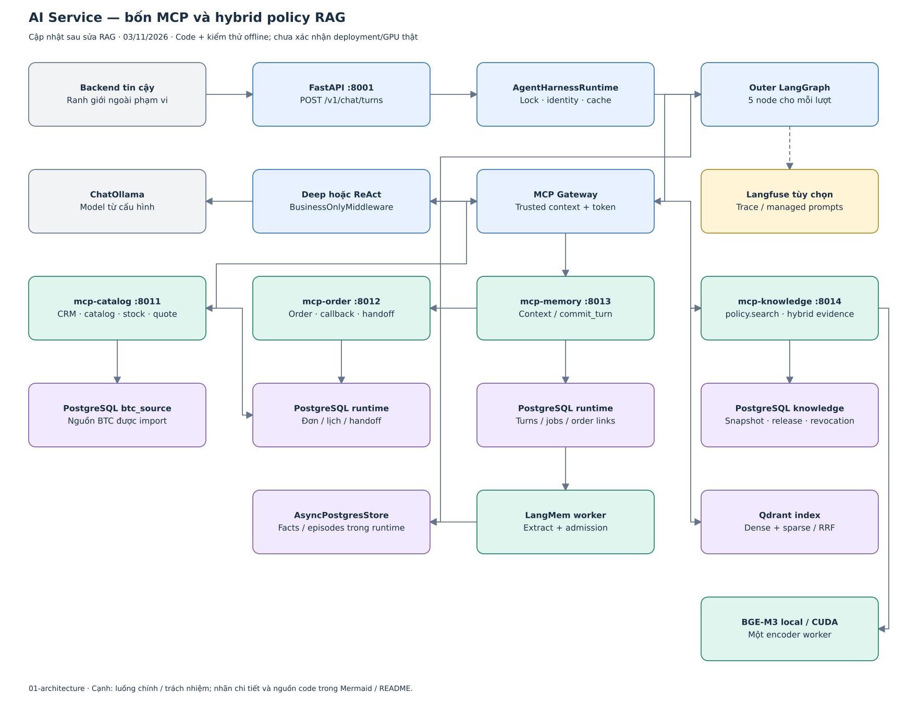
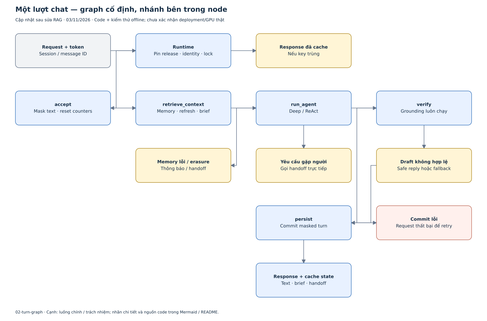
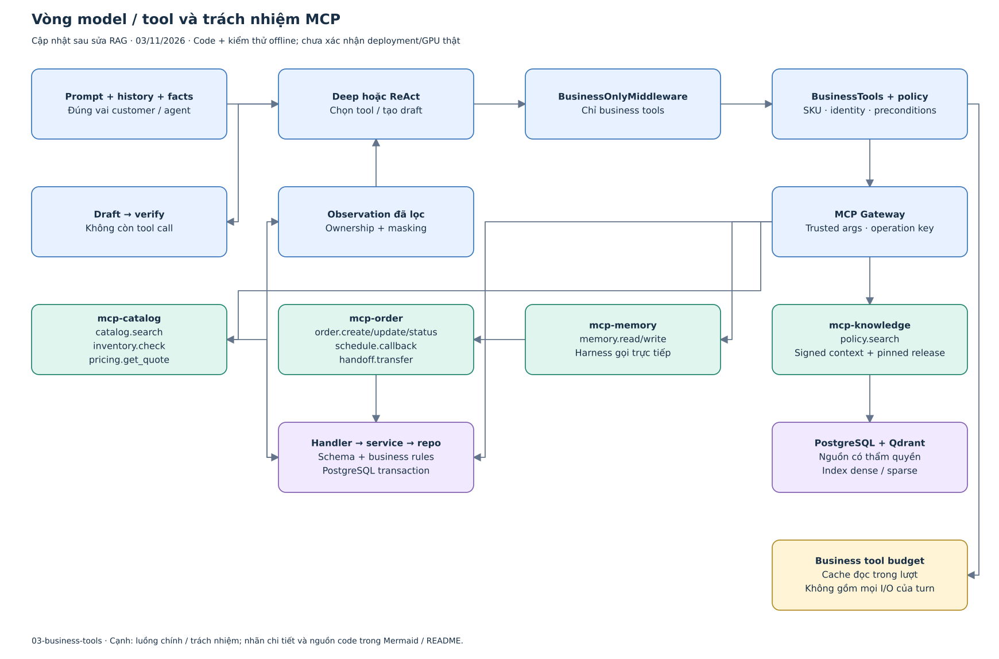
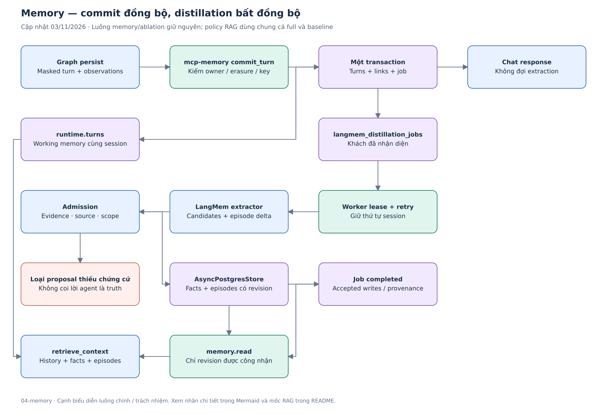
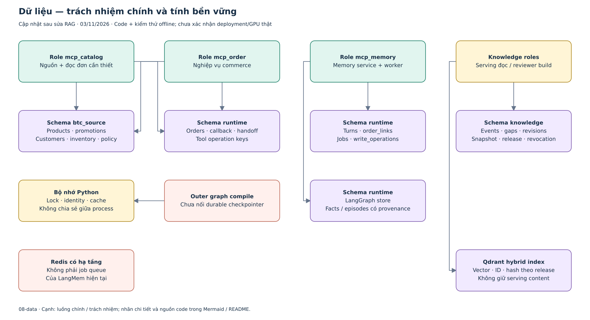
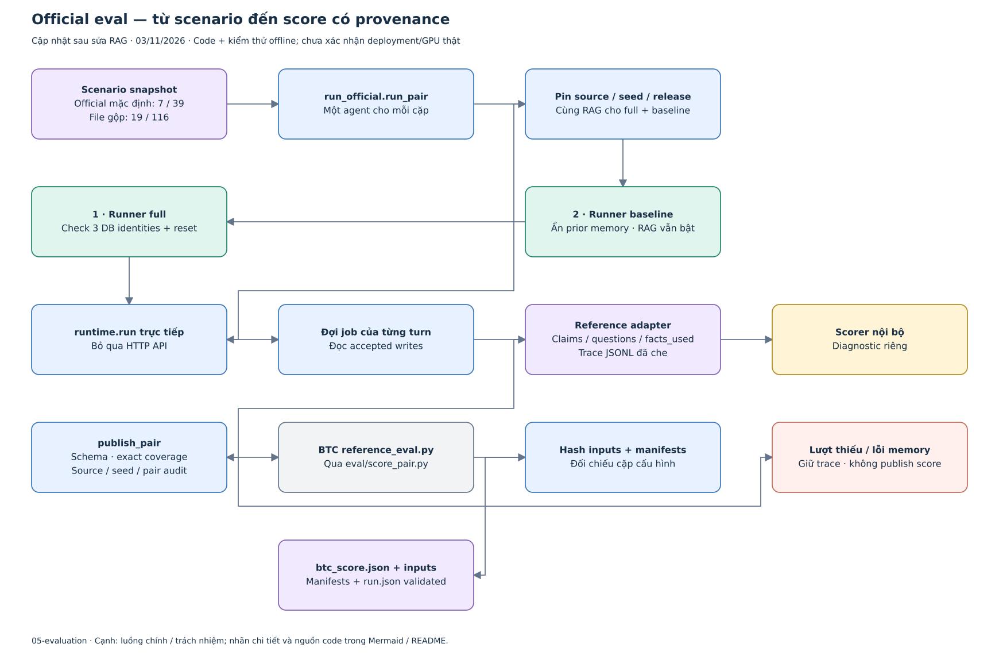
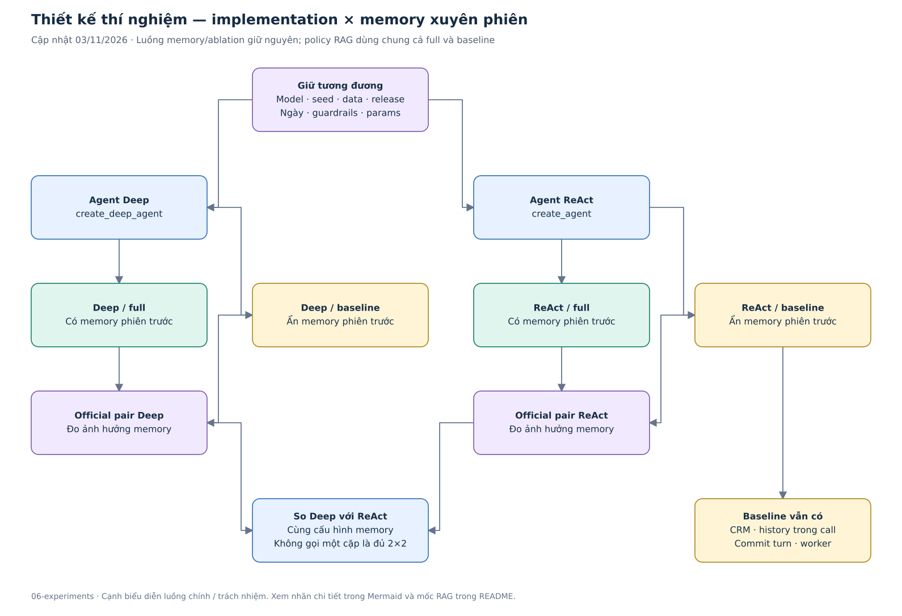
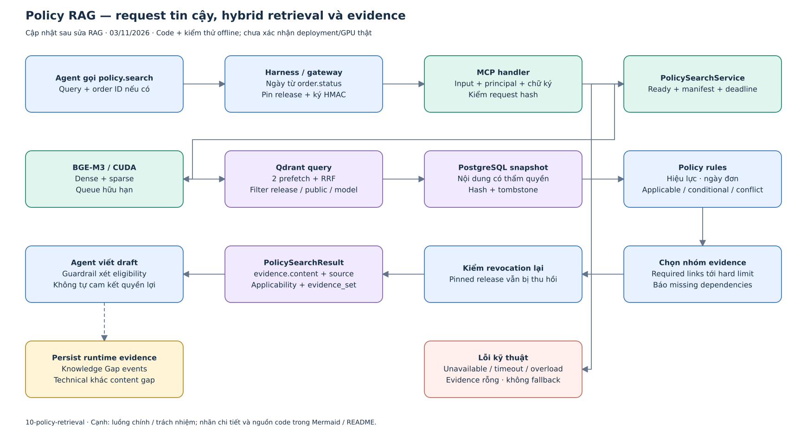
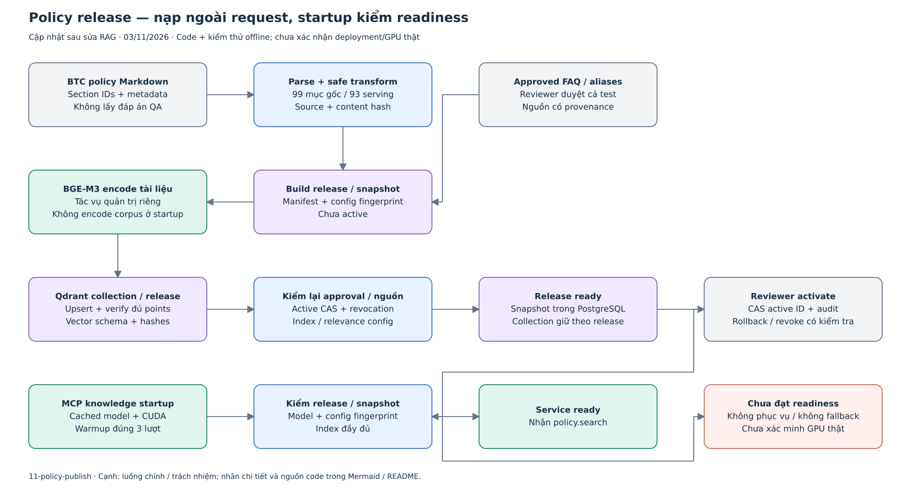
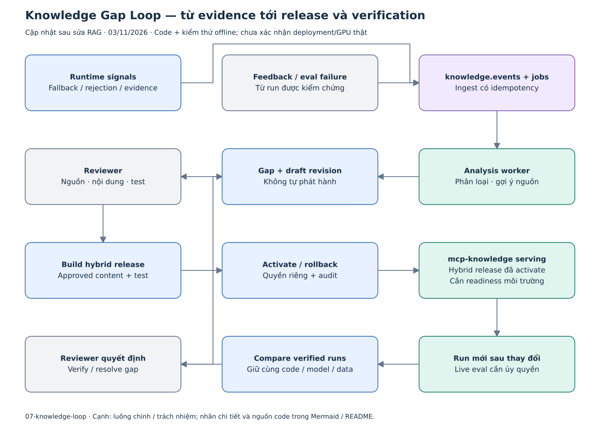

# Review kiến trúc AI Service và Eval Harness

Ngày khảo sát: **03/11/2026**. Phạm vi: `ai-services/` và các module `eval/` mà harness sử dụng. Backend chỉ xuất hiện ở ranh giới gọi API; không khảo sát frontend, ASR hoặc TTS.

Bản cập nhật sau thay đổi RAG, khảo sát lại **03/11/2026, từ 10:54 +07:00**. HEAD tham chiếu: `1c977c036f2f568deac07142b5fcedc542038029`; code RAG và tài liệu có thay đổi chưa commit. Báo cáo này thay thế phần nhận định RAG trung gian lúc 10:19 của bản trước. Các mô tả “policy.search còn ở catalog”, “factory chỉ nối ba MCP” và “Qdrant mới là thiết kế” không còn đúng với code được khảo sát lại.

Phân biệt ba mức bằng chứng: **đã có code và wiring**, **đã qua kiểm thử offline**, **đã vận hành/đo trên hệ thống thật**. Phiên review này xác nhận hai mức đầu trong phạm vi nêu ở mục 10; chưa xác nhận GPU/model thật, DB/index thật hoặc container đang chạy.
## 1. Kết luận kiến trúc

AI Service là dịch vụ xử lý **một lượt hội thoại dạng text** bằng FastAPI và LangGraph. Một outer graph cố định điều phối nhận yêu cầu, đọc ngữ cảnh, chạy agent, kiểm tra câu trả lời và lưu lượt. Agent bên trong có hai implementation chọn bằng cấu hình: Deep Agent hoặc ReAct. Cả hai dùng chung model interface, business tools, memory adapter và guardrails.

RAG chính sách hiện là **MCP thứ tư `mcp-knowledge`**: BGE-M3 local tạo dense+sparse vector, Qdrant hợp nhất bằng RRF, PostgreSQL cấp nội dung từ snapshot của release được ghim. Agent và guardrails nhận `evidence[].content` kèm điều kiện áp dụng.

Nghiệp vụ không được giao hoàn toàn cho LLM: middleware giới hạn tool; policy kiểm điều kiện và bổ sung ngữ cảnh tin cậy; các MCP server kiểm đầu vào, quyền sở hữu và quy tắc nghiệp vụ trước khi đọc/ghi PostgreSQL. Trí nhớ dài hạn được trích xuất bất đồng bộ bằng LangMem, sau đó kiểm bằng chứng trước khi lưu.

Eval Harness dùng chính runtime Python của agent, tạo trace rồi đưa qua bộ chấm tham chiếu BTC. Điểm diagnostic nội bộ và điểm BTC là hai loại artifact khác nhau. Một lần `run_official` so sánh **full với baseline của một loại agent**; muốn so Deep với ReAct cần hai cặp chạy riêng.

### Bộ sơ đồ

Mỗi hình SVG có thể chèn trực tiếp vào tài liệu hoặc slide; file Mermaid `.mmd` đi kèm để chỉnh sửa bố cục và tên thành phần. Sơ đồ sequence có file Mermaid riêng.

| Hình | Nội dung | Nguồn chỉnh sửa |
|---|---|---|
| [01](diagrams/01-architecture.svg) | Kiến trúc tổng thể và ranh giới service | [Mermaid](diagrams/01-architecture.mmd) |
| [02](diagrams/02-turn-graph.svg) | Outer graph và các nhánh xử lý | [Mermaid](diagrams/02-turn-graph.mmd) |
| [03](diagrams/03-business-tools.svg) | Tool loop và MCP routing | [Mermaid](diagrams/03-business-tools.mmd) |
| [04](diagrams/04-memory.svg) | Working memory và long-term memory | [Mermaid](diagrams/04-memory.mmd) |
| [05](diagrams/05-evaluation.svg) | Pipeline chạy và chấm official eval | [Mermaid](diagrams/05-evaluation.mmd) |
| [06](diagrams/06-experiments.svg) | Ma trận Deep/ReAct × full/baseline | [Mermaid](diagrams/06-experiments.mmd) |
| [07](diagrams/07-knowledge-loop.svg) | Knowledge Gap Loop và phát hành hybrid | [Mermaid](diagrams/07-knowledge-loop.mmd) |
| [08](diagrams/08-data.svg) | Phân tách dữ liệu và quyền truy cập | [Mermaid](diagrams/08-data.mmd) |
| [09](diagrams/09-turn-sequence.mmd) | Sequence một lượt chat, có policy RAG | Mermaid sequence diagram |
| [10](diagrams/10-policy-retrieval.svg) | Luồng tra cứu hybrid và evidence | [Mermaid](diagrams/10-policy-retrieval.mmd) |
| [11](diagrams/11-policy-publish.svg) | Nạp nguồn, build release và readiness | [Mermaid](diagrams/11-policy-publish.mmd) |

## 2. Kiến trúc tổng thể



| Thành phần | Trách nhiệm | Nguồn code |
|---|---|---|
| FastAPI | Kiểm token nội bộ; nhận và trả hợp đồng text turn | [main.py](../../app/main.py), [api/chat.py](../../app/api/chat.py) |
| Public chat entrypoint | Tạo session khi chưa có, dùng runtime được chia sẻ | [chat.py](../../app/agent/chat.py) |
| Runtime | Khóa theo session, ràng buộc identity, cache response, gọi graph | [runtime.py](../../app/agent/harness/runtime.py) |
| Outer graph | Điều phối 5 node theo thứ tự cố định | [graph.py](../../app/agent/graph.py) |
| Agent implementation | Vòng model → tool → observation → câu trả lời | [implementations/](../../app/agent/implementations/) |
| Tool policy và gateway | Kiểm điều kiện, budget, định tuyến MCP, trusted context | [policy.py](../../app/agent/harness/policy.py), [gateway.py](../../app/agent/mcp/gateway.py) |
| MCP catalog | CRM, sản phẩm, tồn kho, báo giá; không đăng ký policy tool | [mcp_catalog/](../../app/mcp_servers/mcp_catalog/) |
| MCP order | Tạo/cập nhật/tra đơn, hẹn gọi, chuyển nhân viên | [mcp_order/](../../app/mcp_servers/mcp_order/) |
| MCP memory | Đọc ngữ cảnh; commit lượt và enqueue job | [mcp_memory/](../../app/mcp_servers/mcp_memory/) |
| MCP knowledge | Hybrid retrieval, xác minh release/nguồn và điều kiện áp dụng | [mcp_knowledge/](../../app/mcp_servers/mcp_knowledge/) |
| LangMem worker | Trích xuất, admission, ghi facts và episodes có provenance | [distiller_worker.py](../../app/mcp_servers/mcp_memory/distiller_worker.py) |
| Observability | Log và Langfuse tùy chọn; prompt management tùy chọn | [tracing.py](../../app/agent/harness/tracing.py), [prompts.py](../../app/agent/prompts.py) |

Model được xây dựng qua `ChatOllama`; model thực tế lấy từ cấu hình, không nên coi tên model ghi trong docstring benchmark là model của mọi lần chạy. `LANGMEM_MODEL` có thể chọn model riêng cho extraction.

Bốn MCP phục vụ qua HTTP `/mcp`, có bearer token. Cổng mặc định: catalog 8011, order 8012, memory 8013, knowledge 8014; API mặc định 8001. `factory.build_runtime()` yêu cầu đủ bốn URL và token, rồi truyền endpoint knowledge cho gateway. Đây là wiring trong code, không phải xác nhận các cổng đang mở.

Compose có `mcp-knowledge` trong profile **`knowledge`**, dùng `Dockerfile.knowledge`, cấu hình GPU, model cache read-only, config JSON và DB role riêng. API có entrypoint `python -m app`. Launcher local khởi chạy **bốn MCP và LangMem worker**, yêu cầu config/secret trước khi tạo process. Knowledge Gap analysis worker là entrypoint riêng, không tự được launcher này khởi chạy.

Qdrant hiện có vai trò thực trong implementation RAG: giữ vector và định danh/hash để xếp hạng. Nội dung trả cho agent do PostgreSQL cung cấp. Redis có trong Compose nhưng không phải cache response hay hàng đợi LangMem trong luồng khảo sát; hai phần đó lần lượt nằm trong process Python và PostgreSQL.

## 3. Luồng xử lý một lượt



Outer graph thực tế trong `build_graph()` có đúng đường đi:


Các nhánh trong hình 02 nằm **bên trong node hoặc runtime**, không phải conditional edge bổ sung của outer graph.

1. API xác thực `X-AI-Internal-Token`, validate `ChatRequest`. Input là text, kể cả khi `input_mode=asr_transcript`; service này không tự nhận dạng âm thanh.
2. Public entrypoint đảm bảo có `session_id`. Với gateway có knowledge transport, runtime gọi `eval.knowledge_release` và ghim release cho lượt **trước khi vào `_run()`** nếu chưa có release context. Sau đó runtime khóa session, đối chiếu fingerprint của `channel` và `channel_identity`; nếu đã cache cùng session/message thì trả response đã có.
3. Runtime nhận diện qua CRM khi cần, phân biệt known/unknown/ambiguous và kiểm identity được backend xác minh. Identity lookup diễn ra **trước** outer graph.
4. `accept`: che PII trong text, khởi tạo counter/tool state của lượt.
5. `retrieve_context`: đọc lịch sử trong phiên, profile/scoped facts, episodes và order links. Có thể làm mới tồn kho/báo giá cho tối đa ba SKU để dựng brief hoặc trả lời về dữ liệu dễ cũ. Brief có cảnh báo và gợi ý mở đầu; không đồng nhất brief với prompt memory đầy đủ.
6. `run_agent`: xử lý sớm yêu cầu gặp người/xử lý dữ liệu cá nhân; nếu memory lỗi thì tạo thông báo gián đoạn. Luồng thông thường dựng prompt theo đúng vai hội thoại và chạy Deep hoặc ReAct. Có nhánh tiếp tục agent để hoàn tất tạo đơn đủ điều kiện, hoặc cập nhật báo giá khi bản nháp nói về ưu đãi thiếu bằng chứng.
7. `verify`: kiểm grounding, tính nhất quán lựa chọn đơn và evidence chính sách theo applicability. Evidence conditional chỉ hỗ trợ giải thích có điều kiện; không đủ để cam kết quyền lợi của đơn. Evidence conflict không được coi là căn cứ xác nhận. Khi bật cấu hình thì kiểm thêm `check_answer`. Bản nháp bị từ chối có thể được thay bằng câu trả lời dựng từ kết quả tool đã có; nếu không khôi phục được thì fallback.
8. `persist`: gọi `memory.write(action=commit_turn)` với text đã che, observations được giới hạn, outcome và đơn đã tạo thành công. Nếu commit không thành công, request thất bại để caller retry. Trường hợp erasure barrier có thể bỏ qua persist theo nhánh `memory_blocked`.
9. Runtime cache response và state, trả `agent_text`, `needs_handoff`, `handoff_ticket_id`, `call_brief` cùng session/message ID. Các state/tool trace chi tiết phục vụ eval không nằm toàn bộ trong HTTP response.

Sequence chi tiết: [09-turn-sequence.mmd](diagrams/09-turn-sequence.mmd).

**Ranh giới cấu hình quan trọng:** `AGENT_GUARDRAILS_ENABLED=false` không tắt mọi lớp kiểm soát. `check_grounding()` và kiểm sai lựa chọn đơn vẫn chạy; tool preconditions, identity, masking và memory admission vẫn áp dụng. README hiện có câu mô tả rộng hơn hành vi code ở điểm này.

## 4. Agent và business tools



Deep dùng `deepagents.create_deep_agent`, ReAct dùng `langchain.agents.create_agent`. Cùng một `BusinessOnlyMiddleware` chỉ cho model dùng business tools được phép và chặn tool dựng sẵn ngoài danh sách. Do đó không nên mô tả Deep đang tự do đọc file/chạy shell, hay có đội multi-agent riêng trong luồng nghiệp vụ này.

| MCP đích hiện tại | Tool | Người điều khiển |
|---|---|---|
| catalog | `crm.get_customer` | Runtime identity |
| catalog | `catalog.search`, `inventory.check`, `pricing.get_quote` | Agent; context loader cũng có thể refresh stock/quote |
| knowledge | `policy.search` | Agent; gateway ký trusted context và ghim release |
| order | `order.create`, `order.update`, `order.status`, `schedule.callback`, `handoff.transfer` | Agent hoặc nhánh handoff trực tiếp |
| memory | `memory.read`, `memory.write` | Harness, không công bố cho model trong business tool list |
| bốn server | `eval.database_identity` | Có tool ở knowledge nhưng runner hiện mới gọi catalog/order/memory |
| knowledge | `eval.knowledge_release` | Runtime pin release; không công bố cho model |

Một lần gọi business tool đi qua: tham số model → resolve lựa chọn sản phẩm/biến thể → `prepare_tool_call` → cache tool đọc trong lượt nếu phù hợp → kiểm budget → gateway → MCP handler/schema → service → repository → PostgreSQL. Kết quả quay lại được lọc quyền sở hữu và che dữ liệu trước khi model thấy.

`order.create` cần identity known, lựa chọn sản phẩm rõ, bằng chứng tồn kho và báo giá tương ứng. MCP order tiếp tục kiểm nghiệp vụ; prompt không phải lớp bảo vệ duy nhất. Lệnh ghi có `operation_key`; MCP lưu kết quả để retry có thể trả kết quả cũ. Không nên gọi cơ chế này là bảo đảm exactly-once cho toàn bộ lượt hội thoại: model, cache, graph và các side effect không nằm trong một giao dịch chung.

`policy.search` được loại khỏi cache business read trong lượt: gọi lại sẽ kiểm revocation thay vì tái dùng evidence cũ. Cache toàn bộ response của runtime vẫn là một cơ chế riêng.

Budget `AGENT_MAX_TOOL_CALLS` giới hạn vòng business tools. CRM lookup, memory I/O và các lượt refresh trong context là các thao tác khác; không nên dùng budget này làm tổng số network request của một lượt.

## 5. Trí nhớ và tính nhất quán



| Loại dữ liệu | Nơi lưu | Khi có thể đọc |
|---|---|---|
| Working memory | `runtime.turns` | Đồng bộ sau commit, cùng session |
| Profile/scoped facts | LangGraph `AsyncPostgresStore`, schema `runtime` | Sau khi worker chấp nhận và job hoàn thành |
| Episodic memory | Store cùng customer namespace, gắn session | Sau worker; dựng summary từ dữ kiện được chấp nhận |
| Order links | `runtime.order_links` | Theo commit và quyền khách |
| Queue/provenance | `runtime.langmem_distillation_jobs` | Theo trạng thái job |
| Idempotency ghi | `runtime.write_operations`, `runtime.tool_operations` | Qua transaction nghiệp vụ/memory |
| Response/state cache | Bộ nhớ Python trong runtime | Chỉ trong process hiện tại |

`commit_turn` lưu lượt và enqueue job cho khách đã nhận diện trong transaction của memory service. Khách chưa nhận diện vẫn có lịch sử phiên; khi nhận diện được có đường gán lượt cũ và enqueue lại. Không tuyên bố mọi lượt anonymous lập tức có long-term memory.

Worker lease job, đọc lượt đã commit và một cửa sổ lịch sử gần, gọi extractor LangMem để đề xuất facts và episode delta. Admission kiểm customer/session/source turn, quote bằng chứng, scope và observations nghiệp vụ thành công. Một số facts nghiệp vụ được dựng từ tool có kiểm chứng thay vì tin lời agent. Accepted proposals được lưu để retry; worker ghi các revision vào store và hoàn thành job. Memory read chọn revision có job hoàn thành, tránh đọc bản ghi trung gian chưa được công nhận.

Facts có scope global/product/room, thông tin nguồn và thời gian; episode giữ các việc đang mở/đã giải quyết. Báo giá hay khuyến mãi từng nhớ không tự trở thành giá hiện tại: context có bước refresh và guardrails đòi bằng chứng tương ứng.

Working memory không cần chờ distillation. Ngược lại, tính sẵn sàng của long-term memory là bất đồng bộ; nếu khách mở phiên mới rất sớm, job trước có thể chưa hoàn tất. Eval chủ động đợi worker nên điều kiện đánh giá khác với traffic tương tác tức thời.

Yêu cầu xóa dữ liệu trong chat được chuyển cho người có thẩm quyền để xác minh, không tự khẳng định đã xóa. Luồng thực thi erasure riêng dùng barrier, purge dữ liệu và namespace; không đồng nhất handoff thành công với erasure hoàn tất.

## 6. Dữ liệu và triển khai



`btc_source` chứa dữ liệu BTC được import. `runtime` chứa dữ liệu vận hành và LangGraph store. Ngoài ra, migration `0002_knowledge_gap_loop.sql` tạo schema **`knowledge`** cho workflow tri thức tùy chọn; vì vậy mô tả toàn hệ thống luôn có đúng hai schema ứng dụng đã không còn đầy đủ khi bật phần này.

Migration [0003_mcp_knowledge_rag.sql](../../migrations/0003_mcp_knowledge_rag.sql) bổ sung `knowledge.policy_sources`, `knowledge.policy_revocations` và quyền cho role `mcp_knowledge`. Snapshot chứa nội dung/metadata serving, release chứa manifest và fingerprint, revocation là hàng rào thu hồi kể cả khi request ghim release cũ.

Các MCP có pool và DB role riêng. Catalog đọc dữ liệu nguồn và một phần đơn vận hành để nhận diện/báo giá; order đọc dữ liệu cần cho quy tắc và ghi đơn/lịch/handoff; memory/worker quản lý lượt, jobs, order links và store. Knowledge đọc snapshot/release/tombstone với role riêng; build/publish do workflow quản trị thực hiện. Chi tiết quyền nằm trong [provision_mcp_roles.sh](../../scripts/provision_mcp_roles.sh); sơ đồ biểu diễn trách nhiệm chính, không thay thế ma trận GRANT.

LangGraph outer graph được `compile()` không truyền PostgreSQL checkpointer. `thread_id` giúp gắn execution context nhưng không tự tạo checkpoint bền vững. Tính bền vững hiện tại đến từ MCP/database; response cache, session identity và khóa vẫn nằm trong process.

Compose COPY code vào image. Sửa checkout không tự cập nhật process MCP/worker đang chạy; tài liệu này không suy ra deployment đã dùng code mới.

## 7. Eval Harness



### 7.1 Đầu vào và cách tạo hội thoại

Runner đọc scenario với `calls` và các customer turn định sẵn. Mỗi call tạo session UUID mới; các lượt trong call giữ cùng session; các call của khách dùng identity theo scenario để kiểm carryover. Nếu có `customer_turns_asr`, runner ưu tiên chuỗi này. Ngày gọi lấy từ `call_date` hoặc cộng `days_later` theo thứ tự call; ngày gốc trong stream là 15/10/2026.

Đây là replay **lời khách theo kịch bản cố định với phản hồi agent sinh trực tiếp**, không phải customer simulator tự thích nghi theo câu trả lời. Mô tả persona trong dataset không đồng nghĩa có một customer LLM đang chạy.

Số liệu đếm từ file tại thời điểm khảo sát:

| Nguồn | Scenarios | Calls | Customer turns | Level |
|---|---:|---:|---:|---|
| `eval_harness/scenarios/*.json` | **7** | **13** | **39** | 7 M1 |
| `benchmark_dataset.json` | **19** | **38** | **116** | 11 M1 + 8 M2 |

`run_official` mặc định dùng **thư mục 7 scenario**. `benchmark_runner` mặc định dùng **file gộp 19 scenario**. Coverage hợp lệ chỉ có nghĩa đủ dữ liệu được chọn, không chứng minh đã chạy toàn bộ 19 scenario. README và bảng mô tả scenario có sai lệch, cần dùng JSON thực tế làm căn cứ.

### 7.2 Pipeline official

1. `run_official.run_pair` chọn một agent, tạo run ID/thư mục mới, ghi nhận source digest, BTC source fingerprint và knowledge release.
2. Chạy subprocess runner cho `full`. Runner đối chiếu DB identity của **catalog/order/memory** rồi reset dữ liệu vận hành theo cơ chế bảo vệ eval database. Đây là thao tác có ghi DB.
3. Runner gọi **`runtime.run()` trực tiếp**, không đi qua HTTP API. Sau từng lượt, runner đợi distillation đúng source turn, đọc accepted writes và gắn provenance vào trace.
4. Chạy cấu hình `baseline` bằng runtime mới; reset lại dữ liệu vận hành. Trên trace, tên cấu hình là `baseline_no_memory`.
5. Kiểm source không đổi trong run, BTC source fingerprint không đổi giữa hai nhánh, DB identity tương ứng giống nhau.
6. `publish_pair` audit từng trace: schema BTC, exact coverage/thứ tự, run ID/config, lỗi lượt và lỗi memory. Sau đó gọi **BTC `eval/reference_eval.py`** qua `eval/score_pair.py`.
7. Hash trace/scenario/scorer trước và sau scoring, dựng manifest, đối chiếu cặp. Chỉ khi qua các bước này mới copy score ra vị trí công bố và ghi `run.json` trạng thái validated.

Cặp full/baseline giữ cùng `knowledge_release`; baseline ẩn memory xuyên phiên chứ **không tắt policy RAG**. Manifest có release ID/hash nhưng việc kiểm DB identity của runner chưa bao gồm MCP knowledge; xem nhận xét review ở mục 9.

Lỗi hoặc lượt thiếu không được hợp thức hóa thành điểm chính thức. Trace lỗi có thể được giữ để điều tra. `preflight.py` là tiện ích kiểm input riêng; không vẽ thành bước mặc định được `run_pair` gọi vì code hiện tại không gọi nó trực tiếp.

### 7.3 Trace và artifact

`reference_adapter.trace_line` chuyển state thành trace: text đã che, tên/args/result tool, `memory_writes`, `facts_used`, `questions`, `claims`, latency và metadata. Mask theo đường dẫn để giữ tên tool/call ID/field mà scorer so sánh. Câu hỏi và claim được tách bằng logic/regex, không gọi thêm LLM judge.

`facts_used` dùng snapshot memory đầu call, kiểm nguồn từ session trước và quan sát việc agent nói/dùng giá trị đúng scope. Khách vừa nhắc lại giá trị không tự chứng minh agent nhớ. BTC CCR còn xét **tên tham số tool**; vì vậy điểm CCR official không tương đương chứng minh mọi carryover đúng giá trị và đúng nguồn.

Các artifact cần phân biệt:

| Artifact | Ý nghĩa |
|---|---|
| `full.diagnostics_full.jsonl`, `baseline.diagnostics_baseline.jsonl` | Trace theo turn từ official runner |
| `*.report.json` | DB identity/config của trace |
| `full.diagnostics.json`, `baseline.diagnostics.json` | Diagnostic do scorer nội bộ tính |
| `btc_score.json` | Điểm từ BTC reference scorer |
| `btc_score.inputs.json` | Hash liên kết score với input |
| `full.manifest.json`, `baseline_no_memory.manifest.json` | Provenance và thông tin so sánh cặp |
| `run.json` | Chỉ mục của run official đã validated |

### 7.4 Thiết kế thí nghiệm



| | Full | Baseline |
|---|---|---|
| Deep | Deep + memory xuyên phiên | Deep + ẩn memory phiên trước |
| ReAct | ReAct + memory xuyên phiên | ReAct + ẩn memory phiên trước |

Baseline giữ nhận diện CRM và working memory trong call; đặt `include_prior=False`, namespace `baseline`, ẩn facts từ phiên trước, episodes cũ và remembered order links. Nó vẫn commit lượt và chạy worker. Vì vậy tên chính xác là **không có memory xuyên phiên**, không phải tắt hoàn toàn memory hoặc tắt worker. CRM vẫn có thể cung cấp đơn có sẵn của khách.

So full/baseline trong cùng agent để xem tác động của memory. So Deep/ReAct ở cùng cấu hình để xem tác động của implementation. Giữ model/seed/params, dataset, ngày, release, guardrails và seed dữ liệu tương đương. Seed hỗ trợ tái lập nhưng không bảo đảm model/provider luôn trả output giống tuyệt đối.

### 7.5 Diễn giải chỉ số

| Chỉ số | Cách đọc | Giới hạn |
|---|---|---|
| TSR | Tỷ lệ scenario đạt các điều kiện `success_if` có thể chấm; có breakdown ca khó | Không phải chỉ đếm số order tạo được |
| RQR | Câu hỏi thừa / câu hỏi agent ở các call có `must_not_ask`; gồm confirm lặp | Phụ thuộc question extraction và mẫu số |
| CCR | Slot carryover được scorer ghi nhận / slot bắt buộc | BTC còn tính key tool args; cần đối chiếu giá trị/provenance riêng |
| HR | Claim sai / claim có thể đối chiếu ground truth; có phần giá/khuyến mãi | Không đo mọi nội dung agent nói; claim chưa được chấm không đồng nghĩa đúng |
| Guardrail violations | Vi phạm theo quy tắc scorer, pattern và trace | Không phải chứng nhận an toàn toàn diện |
| Memory recall/precision | Diagnostic đối chiếu expected facts với writes | Expected list không đầy đủ; `written` không đồng nhất số record vật lý |
| Latency | Thời gian `runtime.run()` và brief theo trace | Không bao gồm đường HTTP/backend; chờ job eval nằm ngoài timer của turn |

Mức giảm RQR tương đối: `(RQR_baseline - RQR_full) / RQR_baseline × 100%`. Khi baseline bằng 0, không có mẫu số để chứng minh mức giảm 40%; giữ verdict BTC và giá trị chưa xác định, không tự đổi thành pass.

`ttft_ms` hiện được gán bằng `total_ms` do luồng không streaming. Không gọi số đó là thời gian token đầu đã đo. Với bộ 39 lượt, cũng chưa đạt mốc ≥100 lượt mà scorer BTC cảnh báo để diễn giải p95. Bộ text này không đo TTFA/audio hoặc WER/CER.

Offline re-extraction chỉ dựng lại `questions`/`claims` từ trace cũ, không tái tạo agent response hay đủ provenance để dựng lại `facts_used`. Không dùng nó làm bằng chứng cho chất lượng của code RAG vừa sửa.

## 8. RAG chính sách và Knowledge Gap Loop

### 8.1 Ranh giới thành phần sau tái cấu trúc

| Thành phần | Module | Trách nhiệm |
|---|---|---|
| MCP serving | [mcp_knowledge/](../../app/mcp_servers/mcp_knowledge/) | `tools → services → repos`; schema MCP, auth, encoder, search, PostgreSQL/Qdrant adapter |
| Policy dùng chung | [knowledge/policy/](../../app/knowledge/policy/) | Parse nguồn Markdown, metadata, nội dung an toàn, quy tắc ngày/điều kiện |
| Event và analysis | [knowledge/events/](../../app/knowledge/events/) | Thu signal/feedback, snapshot đã che, analysis worker và retry |
| Quản trị tri thức | [knowledge/services/](../../app/knowledge/services/) | Gap, revision, approval, release, build hybrid, regression và erasure |
| Workflow repository | [knowledge/repos/](../../app/knowledge/repos/) | Transaction/unit of work cho schema knowledge |
| Release context | [knowledge/context.py](../../app/knowledge/context.py) | Ghim release theo lượt/run, không lấy release do model đề xuất |

Các module lifecycle cũ ở ngay `knowledge/` đã chuyển vào các thư mục trên, không có shim ở đường dẫn cũ. CLI và worker entrypoint vẫn là `python -m app.knowledge.cli` / `python -m app.knowledge.worker`.

### 8.2 Luồng phục vụ một câu hỏi chính sách



Ví dụ minh họa: khách hỏi “Đơn mua trước đây có được đổi size không?”. Đây là ví dụ giải thích luồng, không phải kết quả model thực tế.

1. Agent chọn `policy.search`. Harness tự đặt ngày cuộc gọi `on`; nếu model truyền `order_id`, policy chỉ lấy ngày đơn từ kết quả `order.status` có trong state. Ngày do khách khai được giữ riêng ở `customer_reported_order_date`, không nâng thành ngày đã xác minh.
2. `BusinessTools` tạo `TrustedPolicyContext`; gateway ký HMAC gắn context với toàn bộ request đã validate. Context mang principal `harness`, request ID, release ID, ngày nghiệp vụ và nguồn ngày đơn. LLM không tự ký context hoặc chọn release.
3. MCP handler kiểm input, chữ ký, principal và ngày trước khi gọi service. `PolicySearchService` chỉ phục vụ khi ready và release hybrid tương thích config/model fingerprint.
4. Encoder BGE-M3 tạo cả dense vector (tương đồng ngữ nghĩa) và sparse vector (tín hiệu từ vựng). Một worker encode dùng queue hữu hạn; tokenizer kiểm input, không tự cắt query vượt giới hạn.
5. Qdrant dùng hai `prefetch` dense/sparse và một `FusionQuery(RRF)` trong cùng request. Trước fusion, hai nhánh dùng ngưỡng cấu hình; filter theo release, public access, model fingerprint và cờ supplements. RRF hợp nhất theo thứ hạng; không có reranker/LLM rewrite riêng trong luồng này.
6. PostgreSQL đọc snapshot của release và kiểm manifest, source/content hash, toàn snapshot và tombstone. Qdrant chỉ đưa về ID/hash/score, không là nguồn nội dung có thẩm quyền. Hit không hợp lệ làm request fail closed.
7. Quy tắc hệ thống xét thời gian hiệu lực, `date_basis` là ngày cuộc gọi hay ngày đơn, missing context và conflict. Evidence được gắn `applicable`, `conditional` hoặc `conflict`. Các mục liên quan bắt buộc được bổ sung tới hard limit; nếu thiếu thì báo rõ ở applicability và `evidence_set`.
8. Service kiểm snapshot/revocation lại sau selection, rồi trả `evidence[].content`, source, ID và applicability. Agent viết câu trả lời; grounding kiểm evidence nào đủ điều kiện dùng. Thiếu ngày đơn có thể giải thích có điều kiện hoặc hỏi làm rõ, không được tự xác nhận đơn đủ quyền lợi.

`top_k` là số kết quả mong muốn, không phải trần tuyệt đối cho nhóm policy/ngoại lệ. `truncated=false` không có nghĩa bộ bằng chứng đủ: cần đọc `evidence_set.required_dependencies_complete` và danh sách mục còn thiếu.

| Trạng thái trả về | Diễn giải |
|---|---|
| `ok` | Có evidence; vẫn phải xét applicability và evidence type |
| `no_evidence` | Tra cứu chạy nhưng không chọn được evidence phù hợp |
| `unavailable` | Chưa ready hoặc lỗi cấu hình/release/nguồn/phụ thuộc; không trả evidence cũ |
| `timeout` | Hết deadline toàn request |
| `overloaded` | Hàng đợi encode đầy |

Input hoặc signed context không hợp lệ được handler trả lỗi validation/auth. Lỗi kỹ thuật không âm thầm chuyển sang lexical, CPU, model khác hay nguồn cũ. Dependency layer có timeout, retry tạm thời tối đa một lần trong deadline và circuit breaker. Hủy chờ không làm GPU encode đang chạy nhường chỗ cho một encode khác chạy chồng.

**Giới hạn guardrail:** code kiểm eligibility/applicability, nhận diện cam kết có điều kiện và một số pattern/số ngày. Đây là lớp bảo vệ dựa trên quy tắc; không phải bộ chứng minh ngữ nghĩa rằng mọi câu paraphrase đều suy ra hoàn toàn từ nguồn.

### 8.3 Nạp tài liệu và build release



Luồng nạp là tác vụ quản trị, tách khỏi câu hỏi khách và startup MCP:

1. Parse Markdown theo section ID BTC, giữ bảng và ngữ cảnh cần thiết. Đối chiếu corpus hiện có cho **99 mục gốc, 93 mục có bản serving an toàn**; năm mục hành chính và NB-04 bị loại. Đây là đếm parser, không phải điểm retrieval.
2. Tạo nội dung an toàn trước embedding: NB-01/NB-03 chỉ giữ bằng chứng giới hạn tiết lộ; NB-02 giữ ngày hàng về được phép nói; KM-06 bỏ giá sàn. Raw BTC không bị sửa. Metadata/hash giữ quan hệ về nguồn và nội dung sau biến đổi.
3. Kết hợp FAQ/aliases đã được reviewer duyệt cùng test. Alias bổ sung cách truy vấn cho chunk gốc; FAQ có ID `KG-...` và liên kết nguồn. Không lấy đáp án bộ QA để tạo evidence.
4. Builder tạo serving snapshot/manifest bất biến, encode tài liệu và upsert collection Qdrant riêng của release. ID release/point có tính ổn định để build lặp không nhân bản cùng nội dung.
5. Kiểm index đầy đủ, schema/vector/hash và kiểm lại nguồn/approval/revocation/active ID sau build. `relevance_verified` là cờ trong cấu hình đã review; phiên này không chạy calibration để xác nhận chất lượng của cờ đó. Release chỉ ready khi đủ điều kiện.
6. Reviewer activate bằng compare-and-swap active ID. Build không tự activate. Có rollback và revoke; rollback cũng kiểm điều kiện hiện hành, không vượt tombstone. Sentinel `btc-only` trỏ về hybrid release chỉ chứa nguồn BTC đã build, không quay lại lexical retriever.

Startup chỉ nạp immutable model revision đã cache bằng `local_files_only=True`, yêu cầu CUDA, warmup đúng ba lần rồi kiểm release/snapshot/index trước ready. Không tải model, embed cả corpus, build index hay chạy migration ngầm khi startup. Runtime config phải chỉ rõ giới hạn token, candidate depths, thresholds, queue, deadline và fingerprint; báo cáo này không tự đặt ngưỡng production.

### 8.4 Knowledge Gap Loop hoạt động thế nào?



Loop giải quyết câu hỏi “sau một lần trả lời chưa tốt, cải thiện hệ thống bằng cách nào?”. Nó dùng kết quả RAG nhưng không nằm thay thế bước retrieval của từng câu hỏi.

1. **Phát hiện:** lượt thiếu bằng chứng, fallback/rejection, feedback hoặc failure từ eval tạo event đã che PII và job trong schema knowledge. Lỗi `unavailable/timeout/overloaded` được ưu tiên thành tín hiệu kỹ thuật, không mặc định là thiếu nội dung.
2. **Phân tích:** worker phân loại và gợi ý nguồn/gộp gap. Analyzer mặc định dùng lexical overlap đơn giản, không phải một LLM judge tự xác định chắc chắn nguyên nhân. Feedback tích cực và business outcome được ghi nhận, không tự tạo bản sửa tri thức.
3. **Đề xuất:** có thể tạo nháp `aliases` khi cách hỏi khác tài liệu, hoặc FAQ có nguồn chứng minh. Thiếu nguồn đáng tin cậy thì cần reviewer bổ sung/xác minh nguồn; không biến lời khách hay lời agent thành quy định mới. Gap technical/generation/correct_refusal không được giải quyết bằng revision nội dung tùy tiện.
4. **Duyệt:** reviewer kiểm nội dung và regression case; approval gắn với hash cụ thể. Sửa bản đã duyệt tạo revision mới.
5. **Phát hành:** khi cấu hình hybrid được cung cấp, prepare operation giao cho `services/publish.py` build snapshot/index; activate chuyển phiên bản phục vụ. Bản lexical lịch sử vẫn đọc được cho workflow cũ, nhưng serving hybrid không chấp nhận lexical manifest.
6. **Kiểm chứng:** gap sau activate là `awaiting_verification`. So sánh các run hoàn chỉnh, cùng code/model/data và khác release; reviewer xem bằng chứng từng ca rồi quyết định `resolved`. Không tự coi đăng nội dung mới là hết lỗi.

Có ba đối tượng khác nhau: **RAG** tìm bằng chứng chính sách dùng chung; **LangMem** nhớ lịch sử/nhu cầu của từng khách; **Gap Loop** quản lý vấn đề và bản cải thiện tri thức có duyệt. Loop không fine-tune trọng số model.

`KNOWLEDGE_ENABLED=false` không đồng nghĩa tắt policy RAG: runtime có knowledge transport vẫn pin release, policy base vẫn có thể được tra cứu; cờ này còn điều khiển việc dùng supplements và thu tín hiệu loop. Bật cờ cũng không tự khởi chạy analysis worker hoặc tạo sẵn release/index.

### 8.5 RAG và phạm vi eval hiện có

Cặp official chatbot eval kiểm hành vi agent sử dụng policy evidence trong hội thoại, dùng cùng release giữa full/baseline. Nó không tự chạy một bộ đo retrieval độc lập. Các file legacy `run_rag.py` / `policy_retrieval_baseline.py` đã bị loại khỏi checkout; không dùng lệnh cũ để mô tả pipeline hiện tại.

Không có kết quả retrieval quality, VRAM, GPU latency hoặc điểm RAG BTC mới trong phiên này. Mock/in-memory tests xác nhận hợp đồng và các nhánh lỗi; chưa thay thế thử nghiệm với model/index/corpus triển khai thật. Runbook vận hành: [mcp-knowledge-runbook.md](../mcp-knowledge-runbook.md).

## 9. Nhận xét review

Các mục sau dựa trên code và kiểm tra offline; phiên này không sửa logic ứng dụng hoặc bộ eval.

| Mức | Phát hiện và tác động | Bằng chứng | Hướng xử lý đề xuất |
|---|---|---|---|
| Cao đối với tính đúng của báo cáo | Hai entrypoint mặc định chọn tập khác nhau: official 7/39, benchmark 19/116. Một run đủ coverage vẫn có thể chỉ là 7 ca | `run_official.main`, `benchmark_runner.main`, số đếm file | Chọn và công bố một snapshot scenario rõ ràng trước run báo cáo; không ghi 19 nếu manifest/trace chỉ có 7 |
| Vừa | `ttft_ms=total_ms` làm số TTFT trông như phép đo thật | `reference_adapter.trace_line`, `extractor.build_trace_row` | Gắn nhãn proxy hiện tại; nếu cần TTFT thật thì bổ sung đo streaming trong một task riêng |
| Vừa | Cache response không kiểm payload khi tái dùng session/message ID. Cùng ID nhưng đổi text/ngày vẫn có thể nhận response cũ | `runtime._run`: kiểm key rồi return cache trước xử lý graph | Quy định ID bất biến; cân nhắc fingerprint payload và báo conflict thay vì trả cache |
| Vừa, giới hạn vận hành | `_locks`, `_responses`, `_states`, `_session_identities`, `_session_tool_calls` không có TTL/eviction. History tool của cả session được giữ và copy mỗi lượt | `AgentHarnessRuntime.__init__`, `_run` | Đo nhu cầu thật rồi thiết kế vòng đời cache/session; chưa có bằng chứng sự cố bộ nhớ trong deployment |
| Vừa, giới hạn đồng thời | Lock/idempotency response theo process; không có persistent checkpointer. Nhiều API worker không được serialize bằng lock Python này | `runtime.py`, `graph.compile()` | Mô tả giới hạn triển khai; DB operation key chỉ bảo vệ từng thao tác ghi, không thay khóa xuyên worker |
| Vừa, giới hạn của phép đo | Eval đợi distillation từng lượt trong khi production không đợi; tốt cho kiểm correctness nhưng không chứng minh carryover tức thời hoặc throughput thực tế | `benchmark_runner.run_scenario_call`, `wait_for_distillation` | Ghi rõ điều kiện chờ worker trong phương pháp thí nghiệm |
| Thấp nhưng ảnh hưởng trình bày | README vẫn có câu “No fourth MCP server is needed” và “exactly two application schemas”, dù factory yêu cầu bốn MCP và có schema knowledge; mô tả tắt guardrails cũng chưa đầy đủ | `README.md`, `factory.py`, `verify_agent`, migrations 0002/0003 | Đồng bộ README ứng dụng trong task riêng; bản báo cáo này dùng code làm căn cứ |
| Vừa, khoảng trống kiểm môi trường eval | Có MCP knowledge thứ tư nhưng `prepare_runtime_for_eval` chỉ đối chiếu identity catalog/order/memory. Knowledge endpoint có thể dùng DB khác mà bước này chưa phát hiện | `benchmark_runner.py:prepare_runtime_for_eval`; knowledge có sẵn `eval.database_identity` | Bổ sung đối chiếu knowledge trong task code riêng; pin release ID không thay thế kiểm endpoint/DB |
| Chưa xác minh môi trường | Implementation và wiring RAG đã có, nhưng chưa xác nhận CUDA/model cache, config relevance, index/DB grants hay image đang phục vụ | Mục 10 và runbook knowledge | Không trình bày kết quả mock thành benchmark hoặc nghiệm thu deployment |

Các điểm mạnh có căn cứ: dùng chung tool contract giữa Deep/ReAct; tách nghiệp vụ khỏi LLM; memory có admission/provenance; job bền vững và retry; audit exact coverage, fingerprint seed và hash input chấm; giữ scorer BTC độc lập với diagnostic nội bộ.

## 10. Kiểm chứng của bản cập nhật

Đã khảo sát lại wiring bốn MCP, search/encoder/index/repository, trusted context, parser/rules, publisher/readiness, consumers và eval. Đếm lại dataset: thư mục 7 scenario/13 call/39 turn, file gộp 19/38/116. Parser trên policy corpus local cho 93 serving chunks; không embedding hoặc tải model.

Kiểm thử tập trung, dùng fake/scripted dependencies, MCP trong process và Qdrant in-memory theo test hiện có:

```bash
# Từ ai-services/
.venv/bin/python -m pytest -q \
  test/test_knowledge_architecture.py \
  test/test_policy_contracts.py test/test_policy_sources.py \
  test/test_policy_rules.py test/test_policy_embedding.py \
  test/test_policy_storage.py test/test_policy_publish.py \
  test/test_policy_search.py test/test_policy_dependencies.py \
  test/test_mcp_knowledge.py test/test_policy_agent_evidence.py \
  test/test_policy_integration.py test/test_mcp_gateway.py \
  test/test_mcp_launcher.py eval_harness/test_run_official.py \
  eval_harness/test_knowledge_feedback.py \
  eval_harness/test_knowledge_comparison.py
```

Kết quả của bản cập nhật: **61 passed** trong **3,90 giây**. Không chạy lại full suite vì đây là cập nhật tài liệu; không đổi hành vi ứng dụng. Kết quả 37 passed/1 skipped của bản trước chỉ là kiểm thử tại thời điểm code cũ, không dùng thay bằng chứng cho RAG mới.

| Phạm vi | Mức xác minh trong phiên này |
|---|---|
| Wiring, schema, signed context, date/applicability và error handling | Đọc code và focused tests offline |
| MCP → BusinessTools → guardrail → event | Functional test với fake repo/index/encoder, không phải model thật |
| Cấu trúc source và số chunk an toàn | Chạy parser corpus local, không tạo release/index |
| CUDA, BGE-M3 thật, VRAM, chất lượng/latency retrieval | Chưa chạy |
| DB migration/grants, PostgreSQL/Qdrant deployment thật, Docker image | Chưa chạy/không thay đổi |
| Official live eval, benchmark, score BTC mới | Không chạy |

Phiên này chỉ sửa báo cáo/sơ đồ trong thư mục tài liệu này. Không sửa source code, scenario, validator; không cài dependency, tải model, reset DB, build/restart container hoặc commit.

### Gợi ý trình tự trình bày báo cáo

1. Mục tiêu: tư vấn/bán hàng text có công cụ nghiệp vụ và nhớ khách xuyên phiên.
2. Hình 01: ranh giới API, graph, MCP, model, PostgreSQL.
3. Hình 02 và 09: đi qua một lượt chat, chỉ ra verify/persist.
4. Hình 03: vì sao LLM không tự quyết mọi thao tác tạo đơn.
5. Hình 04: working memory khác long-term memory, admission và provenance.
6. Hình 05/06: phương pháp eval và ablation memory; công bố đúng bộ scenario.
7. Trình bày kết quả từ run validated cụ thể nếu có, cùng mẫu số và giới hạn đo; tài liệu này không cung cấp điểm benchmark mới.
8. Hình 10/11: giải thích hybrid retrieval, authoritative source, release và readiness.
9. Hình 07: giải thích cải tiến tri thức có review và cách chứng minh một gap đã được xử lý.

### Điểm vào code cho người phản biện

- API/model contract: [schemas/agent.py](../../app/schemas/agent.py).
- Dựng runtime: [factory.py](../../app/agent/factory.py).
- Graph và node: [graph.py](../../app/agent/graph.py), [agent_nodes.py](../../app/agent/harness/agent_nodes.py), [context.py](../../app/agent/harness/context.py).
- Business boundary: [business_agent.py](../../app/agent/implementations/business_agent.py), [gateway.py](../../app/agent/mcp/gateway.py).
- Memory commit/read: [services/memory.py](../../app/mcp_servers/mcp_memory/services/memory.py); projection: [langmem_projection.py](../../app/mcp_servers/mcp_memory/repos/langmem_projection.py).
- Eval orchestration: [run_official.py](../../eval_harness/run_official.py), [benchmark_runner.py](../../eval_harness/benchmark_runner.py), [official_pipeline.py](../../eval_harness/official_pipeline.py).
- Trace semantics: [reference_adapter.py](../../eval_harness/reference_adapter.py), [extractor.py](../../eval_harness/extractor.py).
- BTC integration: [score_pair.py](../../../eval/score_pair.py), [trace_audit.py](../../../eval/trace_audit.py). File `reference_eval.py` của BTC là dependency ngoài checkout, không phải `eval_harness/scorer.py`.

- RAG serving: [knowledge service](../../app/mcp_servers/mcp_knowledge/services/knowledge.py), [encoder](../../app/mcp_servers/mcp_knowledge/services/embedding.py), [Qdrant adapter](../../app/mcp_servers/mcp_knowledge/repos/qdrant.py), [PostgreSQL adapter](../../app/mcp_servers/mcp_knowledge/repos/postgres.py).
- Policy provenance: [auth](../../app/mcp_servers/mcp_knowledge/tools/auth.py), [rules](../../app/knowledge/policy/rules.py), [grounding](../../app/agent/guardrails/policy_grounding.py).
- Tri thức và release: [module map](../../app/knowledge/README.md), [publisher](../../app/knowledge/services/publish.py), [lifecycle](../../app/knowledge/services/lifecycle.py), [events worker](../../app/knowledge/events/worker.py).
