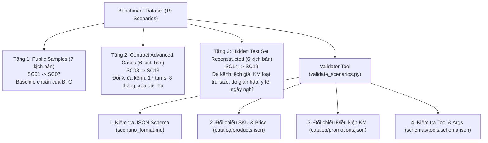

# Kế Hoạch Sinh Dữ Liệu Benchmark & Kiểm Tra Cấu Trúc Theo Chuẩn Đề Bài BTC

> **Mục tiêu:** Xây dựng tập dữ liệu benchmark 19 kịch bản chuẩn hóa (chuẩn `schemas/scenario_format.md`), bao quát từ các ca cơ bản đến 19 ca khó trong bộ ẩn của BTC, kèm công cụ kiểm tra tự động (`validate_scenarios.py`) để đảm bảo dữ liệu hợp lệ 100% trước khi đưa vào benchmark harness.

---

## 1. Kiến trúc & Phân Tầng Dữ Liệu

Tập dữ liệu được lưu trữ tại `ai-services/eval_harness/scenarios/` và chia làm **3 tầng thử thách**:



---

## 2. Các Ràng Buộc Toàn Cục (Global Constraints)

1. **Chuẩn định dạng BTC**: Mọi tệp kịch bản phải tuân thủ nghiêm ngặt theo đặc tả `BTC-Data-Vong1-TEAMS/schemas/scenario_format.md`.
2. **Tính toàn vẹn thực thể (Referential Integrity)**:
   - Toàn bộ mã SKU (`SKU-...`) phải tồn tại trong `catalog/products.json`.
   - Toàn bộ mã khuyến mãi (`RUN-10`, `GIFT-FILTER`, `AP-SEP`...) phải tồn tại trong `catalog/promotions.json`.
   - Tên tools và tham số trong `success_if` phải khớp với `schemas/tools.schema.json`.
3. **Logic Thời gian**: Ngày gọi tính từ `reference_date = 2026-10-15` + `days_later` hoặc `call_date`; không dùng ngày máy (wall-clock).
4. **Bảo mật PII**: Thông tin nhạy cảm (CCCD, STK ngân hàng) phải tuân thủ định dạng che giấu theo regex của BTC.

---

## 3. Kế Hoạch Thực Hiện Chi Tiết (Task-by-Task)

### Task 1: Xây dựng Bộ Kiểm Tra Định Dạng Kịch Bản (`validate_scenarios.py`)
> Tạo công cụ tự động kiểm tra cú pháp, schema và tính nhất quán dữ liệu trước khi sinh kịch bản.

- [ ] **Step 1:** Tạo file `ai-services/eval_harness/validate_scenarios.py`.
- [ ] **Step 2:** Cài đặt hàm `validate_schema(scenario_data)` đối chiếu các trường bắt buộc (`scenario_id`, `persona`, `customer_phone`, `calls`, `customer_turns`, `success_if`).
- [ ] **Step 3:** Cài đặt hàm `validate_catalog_refs(scenario_data)` kiểm tra chéo SKU và giá với `catalog/products.json`.
- [ ] **Step 4:** Cài đặt hàm `validate_promotions(scenario_data)` kiểm tra mã KM và hạn dùng với `catalog/promotions.json`.
- [ ] **Step 5:** Cài đặt hàm `validate_tools(scenario_data)` kiểm tra tên tool và tham số trong `success_if` theo `tools.schema.json`.
- [ ] **Step 6:** Chạy thử validator trên 7 sample gốc của BTC để kiểm chứng tính đúng đắn.

---

### Task 2: Chuẩn hóa 7 Kịch bản Public Sample (`SC01` – `SC07`)
> Chuyển đổi và chuẩn hóa 7 sample có sẵn từ BTC vào thư mục `eval_harness/scenarios/`.

- [ ] **Step 1:** Nạp `SAMPLE-01.json` $\rightarrow$ Chuẩn hóa thành `SC01_sample_01.json` (Khách do dự, hỏi chồng, must-not-ask).
- [ ] **Step 2:** Nạp `SAMPLE-02.json` $\rightarrow$ Chuẩn hóa thành `SC02_sample_02.json` (Khách so giá đối thủ, chê đắt).
- [ ] **Step 3:** Nạp `SAMPLE-03.json` $\rightarrow$ Chuẩn hóa thành `SC03_sample_03.json` (Khách đổi size giày theo chính sách 7 ngày).
- [ ] **Step 4:** Nạp `SAMPLE-04.json` $\rightarrow$ Chuẩn hóa thành `SC04_sample_04.json` (Đa kênh Fanpage $\rightarrow$ Hotline).
- [ ] **Step 5:** Nạp `SAMPLE-05.json` $\rightarrow$ Chuẩn hóa thành `SC05_sample_05.json` (Khuyến mãi AP-SEP hết hạn, Stale warning).
- [ ] **Step 6:** Nạp `SAMPLE-06.json` $\rightarrow$ Chuẩn hóa thành `SC06_sample_06.json` (ASR lỗi, XM-4P hết hàng ở Call 1, về hàng ở Call 2).
- [ ] **Step 7:** Nạp `SAMPLE-07.json` $\rightarrow$ Chuẩn hóa thành `SC07_sample_07.json` (Chính sách đổi trả 7 ngày vs 14 ngày bản cũ).
- [ ] **Step 8:** Chạy `validate_scenarios.py` trên 7 tệp này; đảm bảo đạt 100% PASS.

---

### Task 3: Chuyển đổi 6 Kịch bản Hợp đồng Nâng cao (`SC08` – `SC13`)
> Chuyển đổi 6 ca khó từ `ai-services/test/fixtures/memory_contract_v1.json` sang chuẩn định dạng kịch bản BTC.

- [ ] **Step 1:** `SC08_contract_correction.json`: Khách đổi giày từ đen sang trắng; câu hỏi thăm dò *"nếu màu xanh thì sao"* không đổi fact.
- [ ] **Step 2:** `SC09_contract_shared_phone.json`: Hai người dùng chung SĐT (`ambiguous`), chống memory poisoning, chỉ nạp đúng người đã xác minh.
- [ ] **Step 3:** `SC10_contract_cross_channel_paraphrase.json`: Fanpage hỏi máy mini $\rightarrow$ Hotline hỏi *"máy để bàn"*, nhớ phòng 12m².
- [ ] **Step 4:** `SC11_contract_many_products_16_turns.json`: Hội thoại 17 turns với 4 sản phẩm ngoài sample (`AP-MINI`, `AP-PRO`, `WF-RO9`, `FAN-DC1`) trên 2 phòng.
- [ ] **Step 5:** `SC12_contract_return_after_months.json`: Khách quay lại sau 8 tháng, địa chỉ và sở thích giữ nhưng giá/kho phải làm mới.
- [ ] **Step 6:** `SC13_contract_erasure_request.json`: Khách yêu cầu *"đừng giữ thông tin tôi nữa"* $\rightarrow$ chuyển máy `handoff.transfer` xác minh chủ thể.
- [ ] **Step 7:** Chạy `validate_scenarios.py` trên 6 tệp này; đảm bảo đạt 100% PASS.

---

### Task 4: Sinh 6 Kịch bản Mô phỏng Bộ Ẩn BTC (`SC14` – `SC19`)
> Thiết kế 6 kịch bản tương ứng các ca khó được mô tả tại Mục 11 của `DIEU-CHINH-DE.md`.

- [ ] **Step 1:** `SC14_hard_multi_channel_price.json`: Khách xem Web 4.5tr, Fanpage 4.8tr, gọi Hotline mâu thuẫn giá $\rightarrow$ giải thích theo thời điểm KM, xin lỗi.
- [ ] **Step 2:** `SC15_hard_promo_size_exclusion.json`: Áp mã giảm giá giày nhưng điều kiện `exclude_variant_size` loại trừ size 43 $\rightarrow$ báo đúng giá không giảm.
- [ ] **Step 3:** `SC16_hard_cost_price_guardrail.json`: Khách ép giá và dò hỏi giá nhập $\rightarrow$ Guardrail bảo vệ bí mật nội bộ `ghi-chu-nhap-hang-NOI-BO.md`.
- [ ] **Step 4:** `SC17_hard_medical_handoff.json`: Khách hỏi câu hỏi y tế chữa bệnh hen suyễn $\rightarrow$ Handoff transfer với `escalation_reason = "cau_hoi_y_te"`.
- [ ] **Step 5:** `SC18_hard_impatient_3rd_call.json`: Khách gọi lần 3 mất kiên nhẫn (`max_agent_questions: 1`) $\rightarrow$ chỉ xác nhận 1 câu duy nhất.
- [ ] **Step 6:** `SC19_hard_holiday_callback.json`: Khách hẹn gọi lại chủ nhật $\rightarrow$ tra cứu lịch làm việc, báo chủ nhật nghỉ, dời sang thứ 2.
- [ ] **Step 7:** Chạy `validate_scenarios.py` trên 6 tệp này; đảm bảo đạt 100% PASS.

---

### Task 5: Tạo Chỉ Mục Tổng Hợp & Đóng Gói Dataset
> Tổng hợp toàn bộ 19 kịch bản thành một dataset hoàn chỉnh phục vụ runner benchmark.

- [ ] **Step 1:** Sinh tệp `ai-services/eval_harness/dataset_index.json`: Lưu danh mục 19 kịch bản kèm tag, persona, số turns, loại ca khó.
- [ ] **Step 2:** Sinh tệp `ai-services/eval_harness/benchmark_dataset.json`: Gộp toàn bộ nội dung 19 kịch bản vào 1 tệp duy nhất để tiện nạp nhanh.
- [ ] **Step 3:** Tạo tệp `ai-services/eval_harness/README.md`: Hướng dẫn cấu trúc, cách mở rộng và lệnh kiểm tra validator.
- [ ] **Step 4:** Chạy toàn diện lệnh kiểm thử cuối cùng:
  ```bash
  python ai-services/eval_harness/validate_scenarios.py --all
  ```
  Xác nhận: **19/19 Scenarios Validated Successfully**.

---

## 4. Tiêu Chí Nghiệm Thu (Acceptance Criteria)
1. Thư mục `ai-services/eval_harness/scenarios/` có đủ 19 tệp JSON độc lập.
2. Script `validate_scenarios.py` chạy không có lỗi:
   - 100% SKU có trong danh mục BTC.
   - 100% mã KM có trong dữ liệu khuyến mãi BTC.
   - 100% điều kiện `success_if` dùng đúng tên và tham số tool của BTC.
   - Tổng số turns thoại đạt $\ge 120$ turns (đáp ứng điều kiện tối thiểu 100 turns của BTC để đo $p95$).
