# Báo cáo cách hoạt động của AI Service và Backend

> **Dự án:** TeleSale-SudoCode2026  
> **Ngày đối chiếu mã nguồn:** 17/11/2026  
> **Phạm vi chính:** `ai-services/`, `backend/`; đối chiếu thêm cấu hình Compose và trình khởi động ở thư mục gốc.  
> **Cơ sở báo cáo:** mã nguồn trong checkout hiện tại, bao gồm các thay đổi chưa commit. Chưa kiểm chứng trên hệ thống triển khai thực tế.

Hệ thống là trợ lý telesale tiếng Việt hỗ trợ chat chữ và giọng nói. Nó nhận diện khách hàng, tiếp nối tư vấn từ lịch sử, tra sản phẩm và chính sách, báo giá, tạo đơn, ghi nhận lịch gọi lại và chuyển yêu cầu cho nhân viên.

**Phân công chính:** backend quản lý đăng nhập và kết nối; AI service điều phối hội thoại; MCP server thực thi nghiệp vụ; worker nền cập nhật bộ nhớ dài hạn. Trả lời khách và cập nhật hồ sơ dài hạn là hai giai đoạn riêng.

## Mục lục

1. [Kiến trúc tổng thể](#kien-truc)
2. [Cấu trúc mã nguồn và entry point](#ma-nguon)
3. [Đăng nhập, danh tính và phiên hội thoại](#danh-tinh)
4. [Luồng chat chữ](#chat)
5. [Quy trình xử lý bên trong AI service](#ai-runtime)
6. [Công cụ nghiệp vụ và quy trình mua hàng](#nghiep-vu)
7. [Bộ nhớ ngắn hạn, dài hạn và worker](#bo-nho)
8. [Call Brief cho khách quay lại](#call-brief)
9. [Tra cứu chính sách và quản trị tri thức](#knowledge)
10. [Hội thoại giọng nói và ngắt lời](#voice)
11. [API, dữ liệu và các ranh giới bảo mật](#api-du-lieu)
12. [Chống lặp và xử lý lỗi](#loi-retry)
13. [Khởi động và cấu hình](#khoi-dong)
14. [Ví dụ xuyên suốt và giới hạn hiện tại](#vi-du-gioi-han)
15. [Bản đồ tệp tham chiếu](#tham-chieu)

### Cách đọc sơ đồ

- Sơ đồ `flowchart` mô tả quan hệ giữa thành phần hoặc nhánh xử lý.
- Sơ đồ `sequenceDiagram` đọc từ trên xuống: mỗi mũi tên là một lời gọi hoặc sự kiện.
- Sơ đồ `stateDiagram-v2` mô tả trạng thái của một đối tượng cụ thể, ví dụ cuộc gọi hoặc job.
- Các sơ đồ đã lược bớt bước kiểm tra nhỏ để dễ đọc. Một lượt thực tế không nhất thiết gọi tất cả thành phần được vẽ.
- Xem bằng trình đọc Markdown hỗ trợ Mermaid, chẳng hạn GitHub hoặc Markdown Preview có hỗ trợ Mermaid. Có mô tả chữ và bảng đi kèm để vẫn đọc được khi sơ đồ không render.

---

<a id="kien-truc"></a>
## 1. Kiến trúc tổng thể

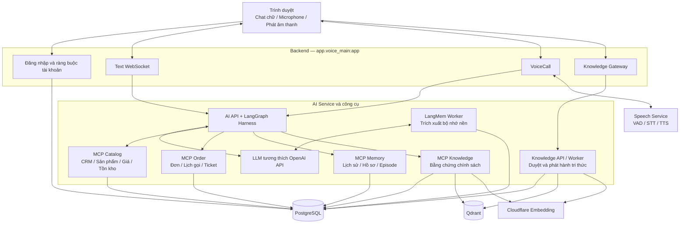

### 1.1. Trách nhiệm của từng khối

| Khối | Trách nhiệm | Dữ liệu/kết quả chính |
|---|---|---|
| Backend | Xác thực, tạo phiên, chuyển tiếp chat/voice, điều phối phát âm thanh | Kết nối và sự kiện gửi trình duyệt |
| AI Harness | Đọc ngữ cảnh, điều phối agent, kiểm chứng, lưu nội dung được phân phối | Câu trả lời, Call Brief, trạng thái memory |
| LLM | Hiểu và diễn đạt yêu cầu, đề xuất công cụ trong giới hạn cho phép | Bản nháp và lời gọi công cụ |
| MCP Catalog | Tra CRM, sản phẩm, tồn kho và báo giá | Dữ liệu kinh doanh có cấu trúc |
| MCP Order | Kiểm tra và ghi giao dịch nghiệp vụ | Đơn hàng, bản ghi cập nhật, lịch gọi, ticket |
| MCP Memory | Cung cấp lịch sử và bộ nhớ; ghi lượt và tạo job | Context, lượt đã lưu, trạng thái cập nhật |
| LangMem Worker | Trích xuất, kiểm tra và ghi facts/episodes | Bộ nhớ dài hạn theo khách hàng |
| MCP Knowledge | Tìm bằng chứng chính sách thuộc release xác định | Evidence và điều kiện áp dụng |
| Knowledge API/Worker | Xử lý tín hiệu thiếu tri thức, duyệt và phát hành | Gap, revision, regression case, release |
| Speech Service | Phát hiện tiếng nói, nhận dạng tiếng nói, tổng hợp giọng nói | Transcript và âm thanh |

### 1.2. Cách các dịch vụ liên lạc

- Trình duyệt ↔ backend: HTTP và WebSocket.
- Backend → AI service: HTTP nội bộ; chat chữ có luồng NDJSON.
- AI → MCP: giao thức MCP qua HTTP bằng `fastmcp.Client`.
- Backend ↔ speech: WebSocket nhận âm thanh/STT và HTTP SSE cho TTS.
- MCP/worker → PostgreSQL: truy vấn và giao dịch database.
- MCP Knowledge → Qdrant: tìm kiếm vector dense/sparse.
- MCP Knowledge → Cloudflare: lấy dense embedding.

**Điểm cần hiểu:** AI có đường truy cập nghiệp vụ thông qua MCP. Backend không phải nơi duy nhất được phép thực thi truy vấn kinh doanh. API quản trị knowledge cũng có kết nối database riêng.

Nguồn: [AI factory](../ai-services/app/agent/factory.py), [MCP Gateway](../ai-services/app/agent/mcp/gateway.py), [backend entry point](../backend/app/voice_main.py).

<a id="ma-nguon"></a>
## 2. Cấu trúc mã nguồn và entry point

### 2.1. Backend

```text
backend/app/
├── voice_main.py           Entry point demo đang được Docker/startup chọn
├── main.py                 Entry point còn import các router không có trong checkout
├── configs.py              Cấu hình backend và voice gateway
├── auth.py                 Cookie JWT, đăng nhập, ràng buộc danh tính
├── seed_demo_users.py      Khởi tạo hai tài khoản demo gắn hồ sơ BTC
├── api/
│   ├── text.py             Chat WebSocket và timeline
│   ├── voice.py            Voice WebSocket
│   └── knowledge.py        Proxy thao tác quản trị knowledge
├── services/
│   ├── text_stream.py      Kiểm tra luồng NDJSON của AI
│   ├── voice_call.py       Điều phối một cuộc gọi
│   ├── voice_turn.py       Trạng thái một lượt voice
│   └── voice_speech.py     Client speech và TTS
├── database/               Kết nối dữ liệu, truy vấn tài khoản
└── schemas/                Hợp đồng dữ liệu
```

`voice_main.py` phục vụ cả `/login`, `/`, `/chat`, `/knowledge` và các route API. Khi khởi động, nó tạo pool tài khoản PostgreSQL nếu được cấu hình, HTTP client gọi AI và speech client.

`main.py` đang import `app.api.chat`, `calls`, `health`, `operator_session`, `reference`, trong khi các tệp đó không có trong checkout đã đọc. Vì vậy, phần này không đồng bộ với cấu trúc hiện tại. Dockerfile backend và managed startup đều chọn `app.voice_main:app`.

### 2.2. AI service

```text
ai-services/app/
├── main.py                 FastAPI, vòng đời harness và knowledge repository
├── __main__.py             Chạy Uvicorn bằng python -m app
├── configs.py              Cấu hình model, MCP, memory, tracing
├── api/                    Chat API và Knowledge API nội bộ
├── agent/
│   ├── factory.py          Lắp model, gateway, memory và runtime
│   ├── graph.py            Đồ thị xử lý một lượt
│   ├── harness/            Phiên, context, kiểm chứng, streaming, lưu kết quả
│   ├── implementations/    Deep Agent, ReAct và công cụ nghiệp vụ
│   ├── guardrails/         Kiểm tra bằng chứng và câu trả lời
│   ├── memory/             Adapter memory, trích xuất và dữ kiện công cụ
│   └── mcp/                Gateway gọi MCP
├── mcp_servers/
│   ├── mcp_catalog/        CRM, catalog, giá, tồn kho
│   ├── mcp_order/          Đơn hàng, callback, handoff
│   ├── mcp_memory/         Memory và distillation worker
│   ├── mcp_knowledge/      Tra cứu chính sách hybrid
│   └── mcp_shared/         Quy tắc dùng chung và che PII
├── knowledge/              Nguồn chính sách và workflow quản trị tri thức
├── bootstrap/              Khởi tạo schema/store/policy cho fresh boot
├── infarstructure/llm.py   Khởi tạo model tương thích OpenAI API
└── system_start.py         Điều phối managed startup
```

Các MCP theo hướng `tools → services → repos`: handler kiểm đầu vào, service quyết định nghiệp vụ, repository sở hữu SQL. Riêng vòng quản trị knowledge tách khỏi công cụ model để kiểm soát quyền duyệt/phát hành.

<a id="danh-tinh"></a>
## 3. Đăng nhập, danh tính và phiên hội thoại

### 3.1. Bốn định danh khác nhau

| Định danh | Thuộc lớp nào? | Mục đích |
|---|---|---|
| ID tài khoản demo | Backend | Xác định tài khoản đăng nhập |
| `customer_id` | CRM và memory | Liên kết dữ liệu của một khách hàng |
| `session_id` | Cuộc hội thoại | Phân biệt các lần tương tác |
| `client_msg_id` | Lượt yêu cầu | Chống lặp, theo dõi kết quả và cập nhật memory |

Một khách có thể có nhiều phiên trên các kênh khác nhau. Trong demo, một kết nối WebSocket mới tạo một UUID phiên mới.

### 3.2. Đăng nhập và ràng buộc danh tính

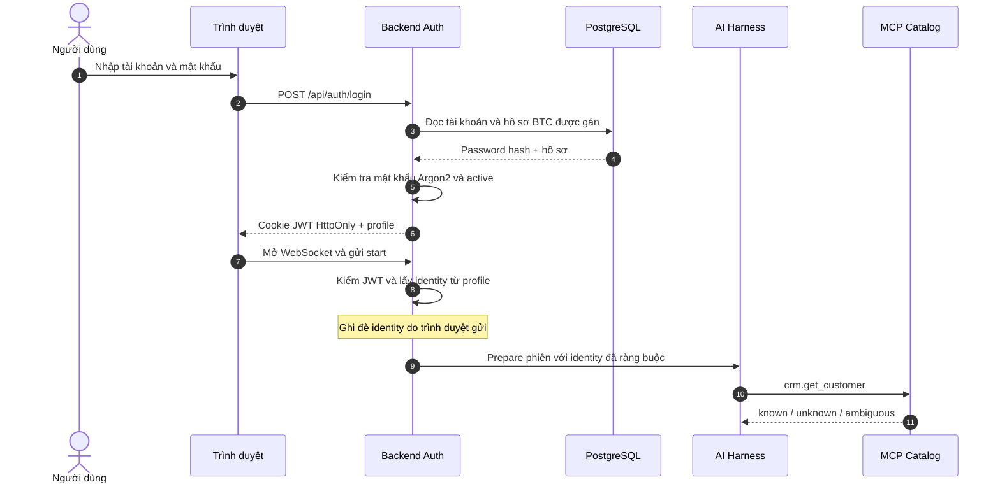

Ánh xạ kênh hiện có:

| Kênh | Trường định danh |
|---|---|
| `hotline` | `phone` |
| `chat_fanpage` | `fb_id` |
| `zalo_oa` | `zalo_id` |

Schema còn chấp nhận `web_chat`, `other`, nhưng `bind_start` của tài khoản demo chỉ ánh xạ ba kênh trên. Không nên suy từ schema rằng mọi kênh đã có tích hợp đầy đủ.

Cookie JWT dùng HS256, kiểm issuer/audience/expiry và thông tin tài khoản trong database. Mặc định token sống 60 phút, có thể cấu hình. WebSocket đang mở cũng bị đóng khi JWT hết hạn.

### 3.3. Trạng thái nhận diện phía AI

- **`known`:** tìm được khách; có thể dùng hồ sơ và đơn theo quyền sở hữu.
- **`unknown`:** chưa tìm được; vẫn có thể trả lời dữ liệu công khai.
- **`ambiguous`:** nhiều khách trùng định danh; không chọn một ứng viên tùy ý để thực hiện nghiệp vụ riêng.

Runtime ràng buộc phiên với dấu vân tay của kênh và identity. Một yêu cầu sau đó đổi identity trên cùng phiên bị xem là xung đột.

Nguồn: [auth.py](../backend/app/auth.py), [demo_users.py](../backend/app/database/demo_users.py), [session_identity.py](../ai-services/app/agent/harness/session_identity.py).

<a id="chat"></a>
## 4. Luồng chat chữ

### 4.1. Sơ đồ tuần tự

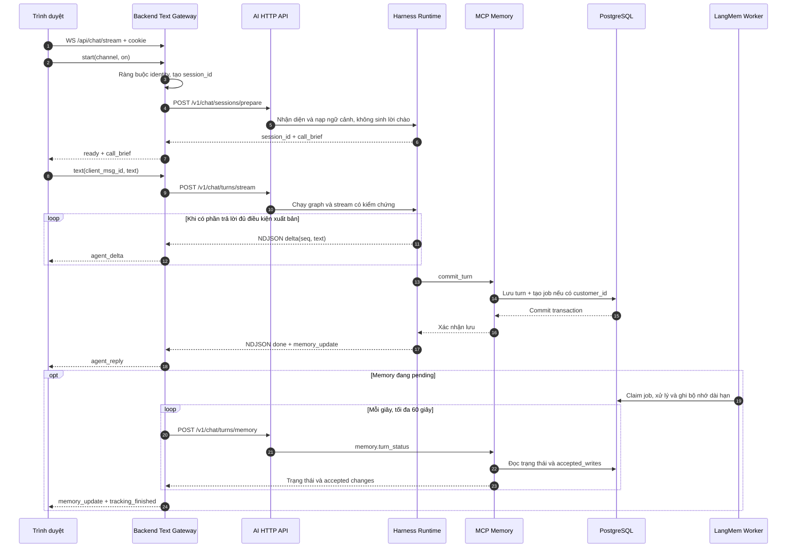

### 4.2. Chuẩn bị phiên

`prepare_session` nhận diện khách, đọc memory và tạo context/Call Brief. Nó không tạo một lượt khách giả, không sinh lời chào bằng model và không commit hội thoại.

Các kết quả đọc nghiệp vụ được chuẩn bị có thể được dùng một lần trong vòng 30 giây nếu khách và ngày vẫn khớp. Mỗi lượt thực vẫn đọc memory để kiểm quyền sở hữu, barrier xóa dữ liệu và lịch sử mới nhất.

### 4.3. Streaming được kiểm tra ở cả AI và backend

AI giữ lại các đoạn có lời gọi tool, nội dung nội bộ, PII hoặc các nội dung cần chờ kiểm chứng đầy đủ. Một số câu trả lời lấy trực tiếp từ bằng chứng có thể xuất hiện thành một delta lớn thay vì nhiều token nhỏ.

Backend kiểm:

1. `Content-Type` là `application/x-ndjson`.
2. ID phiên và lượt không đổi.
3. `seq` liên tục, bắt đầu từ 1.
4. Delta có nội dung hợp lệ.
5. Kết quả cuối `agent_text` bằng toàn bộ delta ghép lại.
6. Có sự kiện `done`.

Chuỗi kiểm tra này bảo vệ tính nhất quán của giao thức. Nó không thay thế bước kiểm chứng nội dung kinh doanh trong AI service.

Nguồn: [text.py](../backend/app/api/text.py), [text_stream.py](../backend/app/services/text_stream.py), [streaming.py](../ai-services/app/agent/harness/streaming.py).

<a id="ai-runtime"></a>
## 5. Quy trình xử lý bên trong AI service

### 5.1. Graph và nhánh xử lý

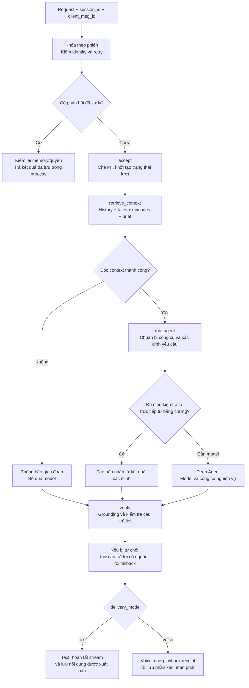

Đồ thị LangGraph thực tế có bốn node `accept → retrieve_context → run_agent → verify`. Khóa, cache và cơ chế commit ở sơ đồ là trách nhiệm runtime bao quanh graph.

### 5.2. Model nhận được ngữ cảnh gì?

Prompt được dựng từ:

- Ngày nghiệp vụ `on` và chế độ đầu vào.
- Trạng thái nhận diện và cách xưng hô đã biết.
- Thông tin khách trực tiếp cung cấp.
- Lịch sử báo giá, đơn và thao tác.
- Thông tin theo sản phẩm và phòng.
- Lịch sử cùng phiên, đặt đúng vai khách/AI.
- Các episode cũ được chọn theo câu hỏi.
- Call Brief và cảnh báo dữ liệu cũ.
- Kết quả công cụ đã được lọc.
- Nội dung khách hiện tại đã che PII.

Hệ thống cố gắng phân biệt lời khách, lời AI và dữ liệu công cụ. Một giá từng báo trong quá khứ không tự trở thành giá hợp lệ hôm nay.

### 5.3. Vai trò thực tế của Deep Agent

Luồng đang nối gọi `build_agent("deep", ...)`. Có implementation ReAct trong repository, nhưng không phải lựa chọn của node runtime hiện tại.

Middleware chỉ cho model thấy bộ công cụ nghiệp vụ đã khai báo. Các công cụ ngoài danh sách được chặn. Ngân sách mặc định là **3 lượt gọi công cụ do `BusinessTools` quản lý**, có thể cấu hình từ 3 đến 20. Con số này không phải tổng mọi lượt đọc CRM/memory/refresh ngoài lớp đó.

Một số nhánh không cần gọi model để tạo câu trả lời, chẳng hạn đặt lịch đủ rõ, yêu cầu gặp nhân viên, hoặc câu hỏi sản phẩm đã có đủ bằng chứng.

### 5.4. Kiểm chứng và phục hồi câu trả lời

| Phát biểu | Bằng chứng cần đối chiếu |
|---|---|
| Giá bán cuối | Quote đúng SKU và ngữ cảnh |
| Còn/hết hàng | `inventory.check` phù hợp |
| Tính năng | Thuộc tính catalog của đúng mẫu/variant |
| Ưu đãi | Chương trình thực sự áp dụng trong quote |
| Đã tạo đơn | `order.create` trả trạng thái thành công |
| Đã hẹn gọi | Công cụ trả lịch đã tạo |
| Đã chuyển yêu cầu | Có ticket được xếp hàng |
| Chính sách | Evidence có điều kiện áp dụng phù hợp |
| Ngày giao dự kiến | Kết quả nghiệp vụ có nguồn, diễn đạt đúng mức dự kiến |

Khi bản nháp bị từ chối, hệ thống thử các bộ dựng câu trả lời an toàn từ dữ liệu đã có. Nếu không dựng được nội dung hợp lệ, nó trả thông báo dự phòng.

`AGENT_GUARDRAILS_ENABLED=false` tắt một số kiểm tra bổ sung; grounding nền vẫn chạy. Các bộ kiểm này dùng quy tắc và nhận diện bằng mã, chưa phải bảo đảm mọi sai lệch ngữ nghĩa đều bị bắt.

Nguồn: [graph.py](../ai-services/app/agent/graph.py), [agent_nodes.py](../ai-services/app/agent/harness/agent_nodes.py), [checks.py](../ai-services/app/agent/guardrails/checks.py).

<a id="nghiep-vu"></a>
## 6. Công cụ nghiệp vụ và quy trình mua hàng

### 6.1. Danh sách công cụ và nơi xử lý

| Công cụ | Server | Vai trò |
|---|---|---|
| `crm.get_customer` | Catalog | Nhận diện khách và lấy CRM |
| `catalog.search` | Catalog | Tìm sản phẩm, đọc thuộc tính và variants |
| `inventory.check` | Catalog | Xác định tồn kho theo ngày |
| `pricing.get_quote` | Catalog | Giá cuối và ưu đãi của một sản phẩm |
| `pricing.quote_order` | Catalog | Báo giá giỏ hàng theo từng đơn vị |
| `order.status` | Order | Đọc đơn thuộc khách |
| `order.create` | Order | Tạo đơn sau khi kiểm tra nghiệp vụ |
| `order.update` | Order | Ghi yêu cầu/kết quả đổi, trả, cập nhật đơn |
| `schedule.callback` | Order | Lưu lịch gọi lại |
| `handoff.transfer` | Order | Lưu ticket cùng Handoff Brief |
| `policy.search` | Knowledge | Tra bằng chứng chính sách công khai |
| `memory.read/write/turn_status/timeline` | Memory | Công cụ hạ tầng memory, do harness sử dụng |

Model không tự quyết định identity nguồn, ngày nghiệp vụ đáng tin cậy hoặc operation key. Harness lọc/bổ sung các trường này trước khi gọi MCP.

### 6.2. Giá, tồn kho và khuyến mãi

`catalog.search` có thể lọc theo tên, loại, SKU, giá niêm yết và diện tích. **Giá niêm yết chỉ phục vụ tìm kiếm; quote mới xác nhận giá bán cuối.**

`inventory.check` đọc sản phẩm và `inventory_events` theo ngày `on`; có thể trả tình trạng ngừng kinh doanh, mẫu thay thế và ngày nhập lại dự kiến.

Quote xét thời gian hiệu lực, SKU/danh mục, số lượng, khu vực, sản phẩm đã sở hữu, chương trình dùng một lần và quy tắc cộng dồn/loại trừ. Kết quả phân biệt mã áp dụng, hết hạn, không đủ điều kiện và bị loại do ưu đãi khác.

Giỏ nhiều sản phẩm dùng `pricing.quote_order`. Đơn giá được tính theo từng đơn vị, kể cả hai máy cùng SKU có ưu đãi khác nhau.

### 6.3. Các trạng thái trước khi mua

| Trạng thái | Ý nghĩa | Có đủ để tạo đơn? |
|---|---|---|
| `candidates` | Các sản phẩm đang xem xét | Chưa |
| `recommended_sku` | AI đã đề xuất | Chưa |
| `selected_sku` | Khách đã chọn sản phẩm | Chưa chắc |
| Quote đã lấy | Hệ thống đã biết giá | Chưa |
| `presented_offer` | Điều kiện đã thực sự được trình bày | Chưa |
| `accepted_offer` | Khách đồng ý offer xác định | Còn kiểm các điều kiện khác |
| Ý định mua hiện tại + đủ bằng chứng | Có thể tiếp tục tạo đơn | Có, nếu mọi gate hợp lệ |

Các thông tin này có tham chiếu nguồn khách/AI/công cụ. Memory không tự cấp sự đồng ý mua trong phiên mới.

### 6.4. Sơ đồ kiểm tra tạo đơn

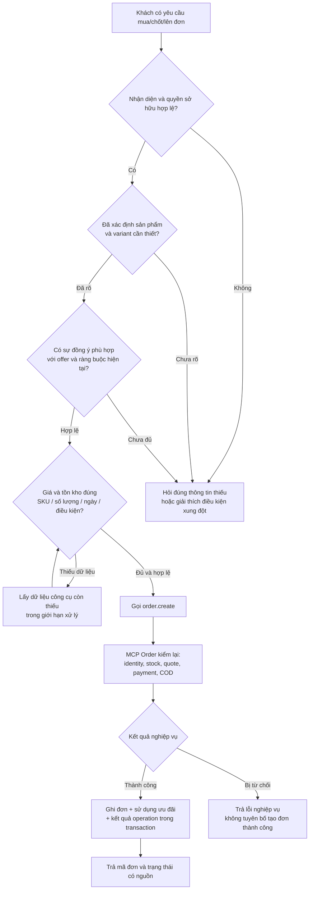

Sơ đồ thể hiện các điều kiện logic; không có nghĩa hệ thống luôn hỏi khách từng câu theo đúng thứ tự này. Mã có thể xử lý tiếp và tạo đơn ngay trong cùng lượt khi đủ điều kiện.

Các quy tắc cụ thể hiện có:

- Sản phẩm có variants phải chọn được SKU biến thể; không tự ghép mã.
- Mặc định số lượng 1 và COD khi còn hợp lệ, đồng thời tôn trọng thông tin khách đã nêu.
- Đổi SKU, số lượng hoặc điều kiện giao có thể làm bằng chứng cũ không còn phù hợp.
- Giá tăng hoặc mất quyền lợi có thể yêu cầu xác nhận lại offer.
- COD trên 10 triệu đồng bị từ chối; trên 2 triệu đồng đánh dấu cần gọi xác nhận.
- `order.create` ghi `runtime.tool_orders`; trong luồng này chưa thấy giữ/trừ kho hoặc gọi cổng thanh toán.

### 6.5. Callback, handoff và cập nhật đơn

`schedule.callback` lưu lịch và điều chỉnh thời điểm theo quy tắc giờ/ngày. `handoff.transfer` lưu ticket với brief gồm tóm tắt, lý do, câu hỏi mở và hành động tiếp theo. Đây là việc ghi nhận nghiệp vụ; chưa thể đồng nhất với quay số hoặc nối máy thật.

`order.update` có các action đổi size, đổi sản phẩm, trả hàng và cập nhật địa chỉ. Phải đọc từng nhánh để biết mức tác động: nhánh cập nhật địa chỉ hiện trả và lưu kết quả `updated`, chưa thấy ghi địa chỉ mới vào đơn trong service/repository đã đọc.

Nguồn: [BusinessTools](../ai-services/app/agent/implementations/business_agent.py), [tool policy](../ai-services/app/agent/harness/policy.py), [commerce rules](../ai-services/app/mcp_servers/mcp_shared/commerce_rules.py), [order service](../ai-services/app/mcp_servers/mcp_order/services/order.py).

<a id="bo-nho"></a>
## 7. Bộ nhớ ngắn hạn, dài hạn và worker

### 7.1. Bốn lớp thông tin

| Lớp | Nội dung | Ví dụ |
|---|---|---|
| History | Các lượt trong phiên | Khách hỏi giá, AI báo giá |
| Profile facts | Thông tin có cấu trúc theo khách | Ngân sách, phản đối, phương thức thanh toán |
| Scoped facts | Thông tin theo phòng/sản phẩm | Diện tích phòng A; màu của sản phẩm B |
| Episode | Diễn biến tư vấn | Nhu cầu, tư vấn đã đưa ra, blocker và câu hỏi mở |

Facts có thông tin nguồn như `source_turn_id`, `session_id`, `evidence_quote`, ngày và thời hạn hiệu lực nếu có. Những trường này giúp đối chiếu nguồn lịch sử; chúng không xác nhận giá/tồn kho hiện tại.

### 7.2. Sơ đồ lưu lượt và trích xuất nền

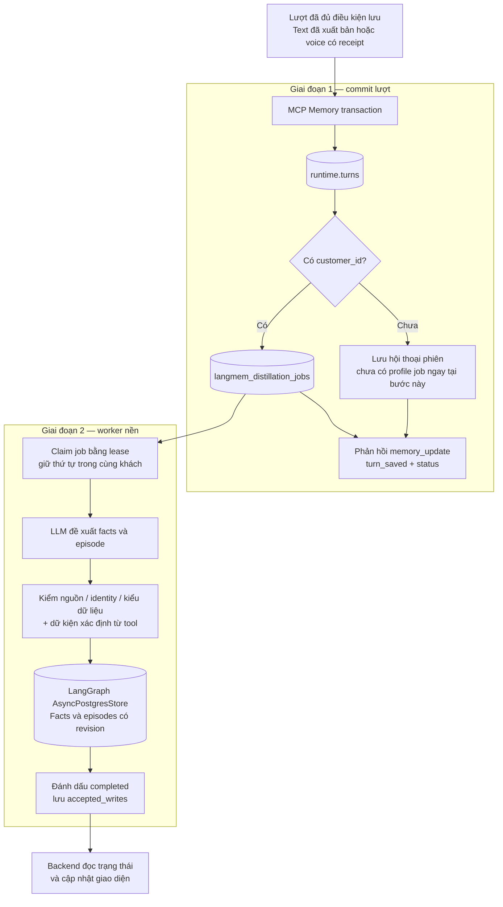

### 7.3. Worker kiểm tra những gì?

1. Job vẫn thuộc lần claim hiện hành và chưa bị barrier xóa dữ liệu chặn.
2. Lượt nguồn tồn tại và thuộc đúng khách/phiên.
3. Đề xuất của model có bằng chứng trong lời khách hoặc công cụ hợp lệ.
4. Slot, kiểu giá trị và scope đúng hợp đồng.
5. Các đề xuất mâu thuẫn trong cùng phạm vi không được nhận tùy ý.
6. Thông tin công cụ như đơn/giá/variant được suy ra từ kết quả xác minh.
7. Những mục episode được đánh dấu đã giải quyết phải có bằng chứng phù hợp.

Worker có lưu đề xuất đã xử lý để retry có thể dùng lại. Dữ liệu projection mang revision gắn job; luồng đọc chỉ công nhận các revision đã hoàn tất, tránh coi một lần ghi dở là thông tin cuối.

Job dùng lease 120 giây, nhận lại khi hết lease và có giới hạn retry. Cùng một khách giữ thứ tự job giữa các phiên/kênh; các khách khác có thể được xử lý đồng thời.

### 7.4. Cách tìm lại episode

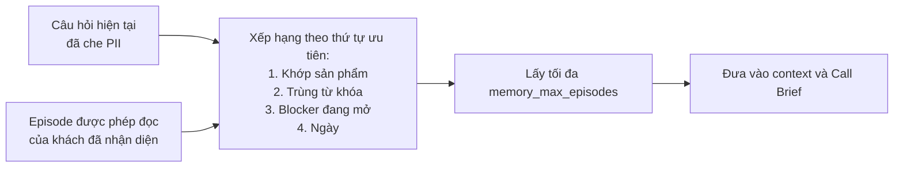

Đây là xếp hạng từ vựng bằng quy tắc. Bộ nhớ khách trong đường này dùng PostgreSQL/LangGraph Store, không dùng Qdrant hay gọi embedding để xếp hạng.

Lịch sử cùng phiên được lấy lại từ MCP khi xử lý lượt. Bộ nhớ bền và trạng thái phiên trong process có vai trò riêng: khởi động lại process không có nghĩa mọi lượt đã commit mất đi, nhưng cũng không có nghĩa toàn bộ trạng thái live được khôi phục.

### 7.5. Trạng thái hiển thị cho người dùng

| Trạng thái | Diễn giải |
|---|---|
| `pending` | Đã có job chờ/đang xử lý |
| `completed` | Job hoàn tất; `changes` có thể rỗng |
| `failed` | Job thất bại |
| `not_applicable` | Chưa áp dụng cập nhật profile dài hạn cho identity hiện tại |
| `unavailable` | Không xác nhận được trạng thái |

`turn_saved=true` chỉ xác nhận lưu hội thoại. Chỉ job hoàn tất mới trả các thay đổi thực sự đã ghi: `added`, `updated`, `deleted`. Backend theo dõi tối đa 60 giây; hết thời gian theo dõi không tự biến `pending` thành `completed` hoặc `failed`.

Nguồn: [memory service](../ai-services/app/mcp_servers/mcp_memory/services/memory.py), [worker](../ai-services/app/mcp_servers/mcp_memory/distiller_worker.py), [admission](../ai-services/app/mcp_servers/mcp_memory/services/langmem_admission.py), [store](../ai-services/app/mcp_servers/mcp_memory/repos/langmem_projection.py), [retrieval](../ai-services/app/mcp_servers/mcp_shared/memory_retrieval.py).

<a id="call-brief"></a>
## 8. Call Brief cho khách quay lại

### 8.1. Dữ liệu đầu vào và kết quả

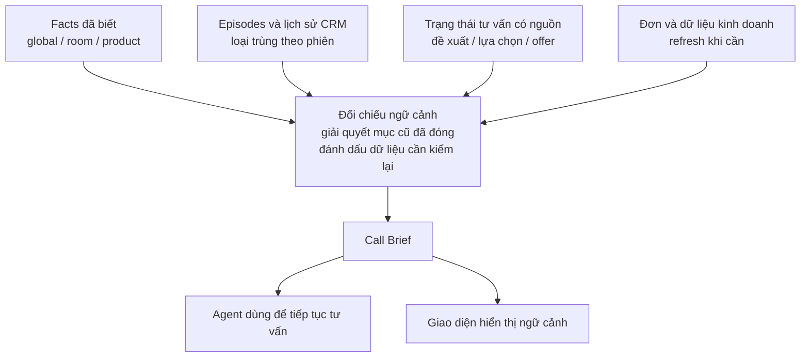

Brief có thể chứa `last_session`, `products_advised`, `recommended_sku`, `selected_sku`, `orders`, `profile_facts`, `open_blockers`, `open_questions`, `must_not_ask`, `suggested_opening`, `suggested_next_action`, `stale_warnings`.

`must_not_ask` được tạo từ các slot đã biết trong context, nhằm hạn chế hỏi lại. Nó không cấm xác nhận một thông tin đã hết hạn, mâu thuẫn hoặc cần thiết cho giao dịch hiện tại.

### 8.2. Các cảnh báo quan trọng

- Giá mới khác báo giá cũ hoặc chưa kiểm lại được.
- Ưu đãi cũ không còn xuất hiện trong quote hiện tại.
- Sản phẩm hết hàng, ngừng kinh doanh hoặc có mẫu thay thế.
- Fact có `valid_until` đã qua.
- Phiên trước cách hơn 180 ngày, cần xác nhận lại thông tin giao hàng.
- Có các sản phẩm lịch sử chưa được tự động làm mới.

Mã hiện tại ưu tiên refresh sản phẩm đang có trọng tâm rõ ràng, hoặc ứng viên lịch sử duy nhất. Không mặc nhiên refresh mọi SKU từng tư vấn.

Trong chat chữ, brief chuẩn bị có thể được trả trong `ready`. Với voice, bước prepare không phát lời chào/brief thành tiếng; brief được dựng lại theo phát ngôn thực và có thể đi kèm `agent_reply`.

Nguồn: [context.py](../ai-services/app/agent/harness/context.py), [brief schema](../ai-services/app/schemas/brief.py).

<a id="knowledge"></a>
## 9. Tra cứu chính sách và quản trị tri thức

### 9.1. Luồng RAG phục vụ câu hỏi

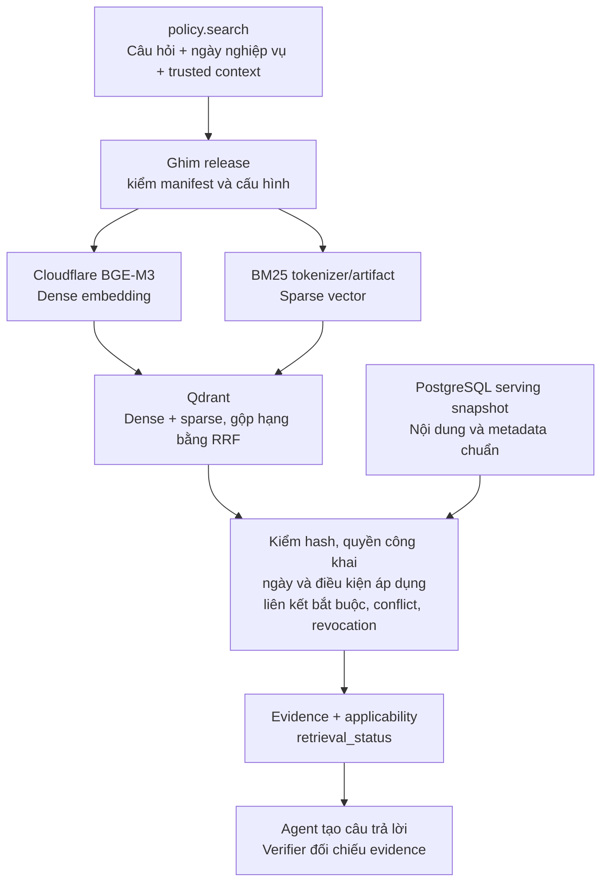

Cấu hình model embedding hiện khai báo `@cf/baai/bge-m3`, với vector mặc định 1024 chiều. Qdrant thực hiện tìm kiếm dense/sparse và hợp nhất thứ hạng bằng Reciprocal Rank Fusion.

PostgreSQL sở hữu snapshot nội dung phục vụ. Với nội dung bổ sung có nguồn từ khách hàng, Qdrant không sao chép nguyên nội dung đó vào payload; đây là một phần của thiết kế kiểm soát/xóa bằng chứng.

Tool phân biệt các trạng thái `ok`, `no_evidence`, `unavailable`, `timeout`, `overloaded`. Tool trả bằng chứng; câu trả lời cuối do agent và verifier xử lý.

### 9.2. Thời gian và nguồn chính sách

- `on`: ngày nghiệp vụ đang xử lý.
- Ngày đơn đã xác minh: có nguồn từ công cụ đơn hàng, được ràng buộc vào trusted context.
- Ngày đơn khách tự khai: được giữ riêng, chưa tự cấp quyền lợi.
- Release: phiên bản nguồn/index dùng trong lượt.
- Applicability: đủ điều kiện, có điều kiện, xung đột hoặc thiếu ngữ cảnh theo quy tắc.

Một kết quả có cùng chủ đề chưa đủ để hứa đổi trả/hoàn tiền. Agent phải giữ điều kiện và ngoại lệ quan trọng của bằng chứng.

### 9.3. Vòng cập nhật tri thức

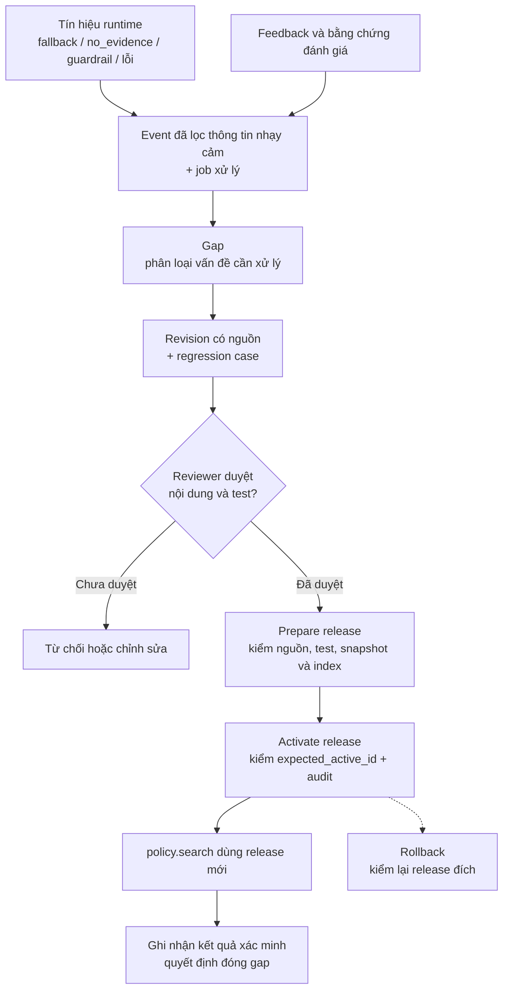

Phân tích event mặc định có logic thận trọng bằng từ khóa và nguồn công khai; có điểm mở để inject model. Không nên diễn giải workflow này thành hệ thống tự học rồi tự xuất bản mọi câu trả lời.

Mỗi lần duyệt cần quyền `knowledge_review`. Việc activate kiểm phiên bản active mong đợi để tránh ghi đè thay đổi của người khác. Release mới kích hoạt chưa tự chứng minh gap đã giải quyết; có bước xác minh sau đó.

`KNOWLEDGE_ENABLED` mặc định false và điều khiển vòng gap/nội dung bổ sung. Runtime hiện vẫn yêu cầu MCP Knowledge để dùng chính sách nền. Gateway gán reviewer bằng cấu hình máy chủ; tài khoản demo chưa có vai trò reviewer riêng theo từng người.

Nguồn: [search service](../ai-services/app/mcp_servers/mcp_knowledge/services/knowledge.py), [Qdrant repository](../ai-services/app/mcp_servers/mcp_knowledge/repos/qdrant.py), [knowledge lifecycle](../ai-services/app/knowledge/services/lifecycle.py), [release service](../ai-services/app/knowledge/services/releases.py).

<a id="voice"></a>
## 10. Hội thoại giọng nói và ngắt lời

### 10.1. Luồng âm thanh và transcript

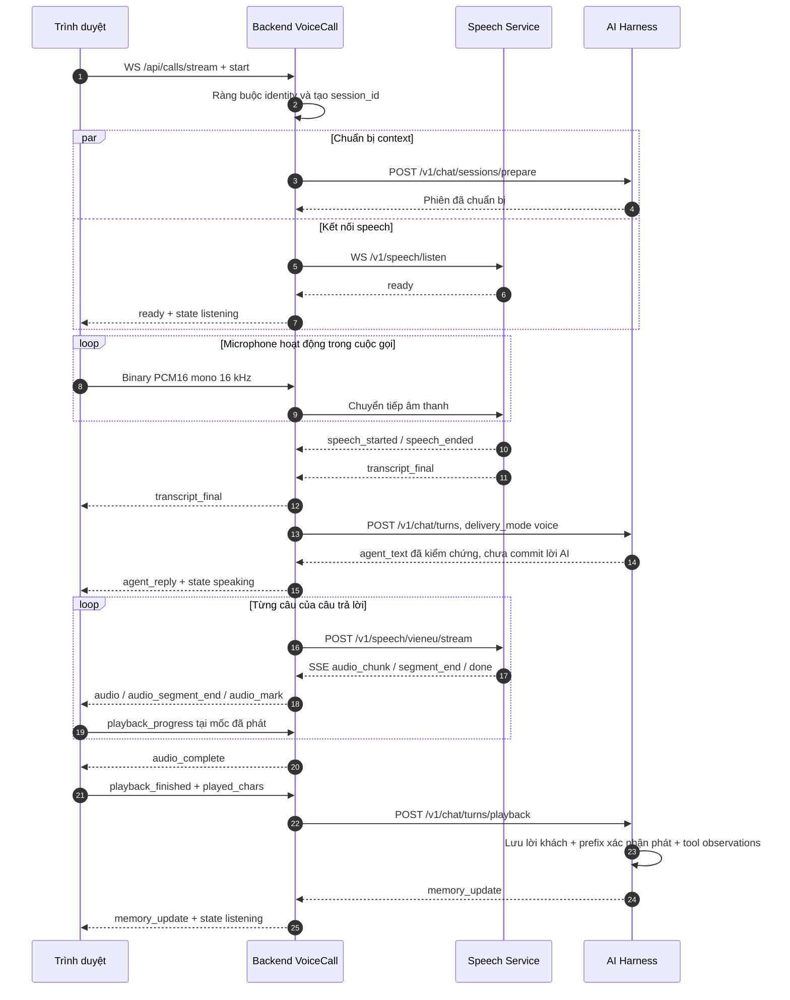

Đầu vào là raw PCM16 little-endian, mono, 16 kHz; mỗi thông điệp tối đa 32.000 byte. Backend không giải mã WebM/Opus, không resample và không tự làm VAD. Định dạng thực tế phải do trình duyệt/speech tuân thủ.

`speech_ended` chưa đủ để gọi agent. Chỉ transcript cuối có nội dung mới tạo lượt. Backend ánh xạ ID lượt speech thành UUID riêng của cuộc gọi.

### 10.2. Trạng thái cuộc gọi

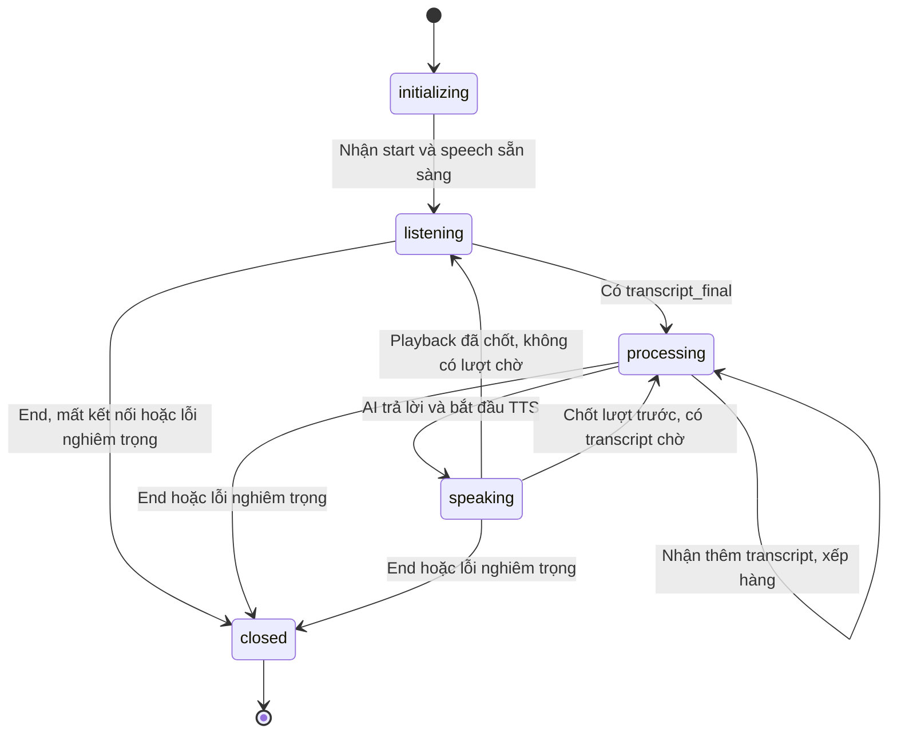

Đây là trạng thái điều phối của backend. Microphone và speech connection vẫn hoạt động trong `processing` và `speaking`.

### 10.3. Khi khách ngắt lời

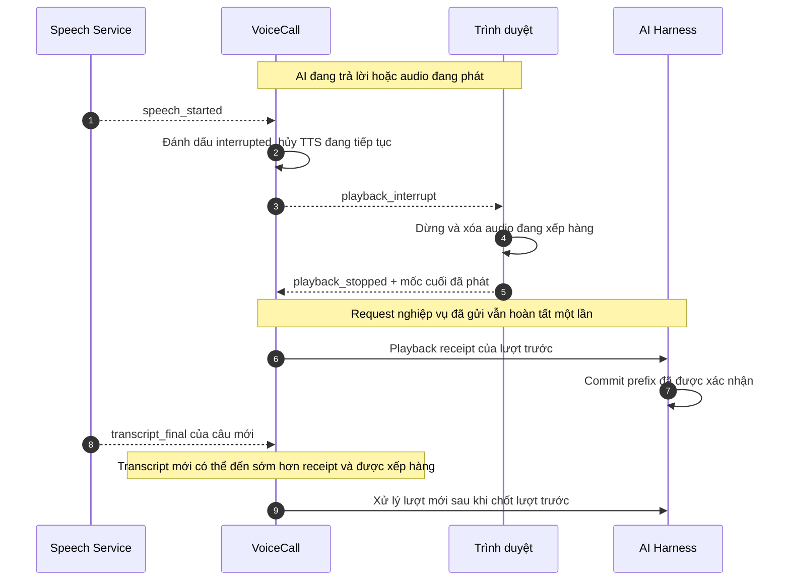

Hàng đợi cho phép tối đa bốn transcript chờ sau lượt đang chạy. Tràn hàng đợi đóng với lỗi quá tải thay vì bỏ mất lời khách âm thầm.

### 10.4. Vì sao cần playback receipt?

Sinh ra câu trả lời chưa chứng minh khách đã nghe. Nếu AI sinh ba câu nhưng khách ngắt sau câu đầu, việc lưu cả ba có thể khiến lượt sau tưởng báo giá hoặc offer đã được trình bày.

Backend cấp `audio_mark` theo vị trí ký tự của câu gốc đã kiểm chứng. Trình duyệt chỉ xác nhận các mốc đã được phát. Mốc gắn với văn bản gốc, kể cả TTS chuyển số thành cách đọc tiếng Việt.

Receipt lưu phần đầu được xác nhận; câu phát dở có thể bị bỏ vì chưa có timestamp ở mức từ. Nó vẫn giữ lời khách và quan sát công cụ thành công. Receipt không chạy lại công cụ hay sinh câu trả lời mới.

Các giới hạn thời gian hiện có: TTS 120 giây, chờ playback 120 giây, chờ stop receipt sau ngắt lời 5 giây; harness có fallback 300 giây cho receipt bị bỏ quên. Trạng thái pending này nằm trong process, chưa có phục hồi bền khi process chết.

Nguồn: [VoiceCall](../backend/app/services/voice_call.py), [SpeechClient](../backend/app/services/voice_speech.py), [voice contract](../backend/VOICE_API_CONTRACT.md), [playback runtime](../ai-services/app/agent/harness/runtime.py).

<a id="api-du-lieu"></a>
## 11. API, dữ liệu và các ranh giới bảo mật

### 11.1. API backend đang nối

| Giao thức | Endpoint | Vai trò |
|---|---|---|
| POST | `/api/auth/login` | Đăng nhập, đặt cookie |
| GET | `/api/auth/me` | Lấy tài khoản và hồ sơ được gán |
| POST | `/api/auth/logout` | Xóa cookie phía trình duyệt |
| WebSocket | `/api/chat/stream` | Hội thoại chữ |
| POST | `/api/chat/timeline` | Đọc lịch sử tương tác qua session đã chuẩn bị |
| WebSocket | `/api/calls/stream` | Hội thoại âm thanh |
| GET | `/api/knowledge/{resource}` | Đọc tài nguyên review |
| POST | `/api/knowledge/commands` | Thực thi lệnh review/phát hành |

### 11.2. API nội bộ AI

| Endpoint POST | Vai trò |
|---|---|
| `/v1/chat/sessions/prepare` | Nhận diện và chuẩn bị ngữ cảnh |
| `/v1/chat/turns` | Xử lý một lượt |
| `/v1/chat/turns/stream` | Stream chữ dạng NDJSON |
| `/v1/chat/sessions/timeline` | Đọc timeline theo quyền của phiên |
| `/v1/chat/turns/memory` | Đọc trạng thái job theo lượt |
| `/v1/chat/turns/playback` | Chốt nội dung voice được xác nhận phát |

AI còn có `GET /v1/knowledge/{resource}`, `POST /v1/knowledge/commands`, `POST /v1/knowledge/events`.

Ví dụ payload của một lượt từ gateway, dùng ID minh họa:

```json
{
  "session_id": "11111111-1111-4111-8111-111111111111",
  "client_msg_id": "22222222-2222-4222-8222-222222222222",
  "channel": "chat_fanpage",
  "channel_identity": "identity-do-backend-rang-buoc",
  "on": "2026-11-17",
  "text": "Phòng 25 m2 thì nên chọn mẫu nào?",
  "input_mode": "clean",
  "delivery_mode": "text"
}
```

Giá trị mặc định và ví dụ không xác nhận cấu hình `.env` đang chạy. Schema AI hiện cho phép `session_id=null` ở đầu vào `ChatRequest`, rồi Python entry point tạo UUID; gateway demo chủ động tạo UUID trước khi gọi.

### 11.3. Bản đồ lưu trữ

| Khu vực | Nội dung |
|---|---|
| `btc_source` | Dữ liệu nguồn khách, sản phẩm, khuyến mãi, tồn kho và CRM |
| `runtime.demo_users` | Tài khoản và liên kết khách hàng |
| `runtime.turns` | Hội thoại đã commit |
| `runtime.tool_orders` | Đơn phát sinh |
| `runtime.tool_updates` | Bản ghi cập nhật đơn |
| `runtime.tool_callbacks` | Lịch gọi lại |
| `runtime.tool_handoffs` | Ticket và brief chuyển yêu cầu |
| `runtime.promo_uses` | Theo dõi ưu đãi đã dùng |
| `runtime.tool_operations`, `write_operations` | Kết quả thao tác phục vụ chống lặp |
| `runtime.langmem_distillation_jobs` | Job, lease, đề xuất và accepted writes |
| LangGraph Store trong `runtime` | Facts và episodes theo namespace khách |
| `knowledge` | Events, gaps, revisions, tests, releases, audit, nguồn phục vụ |
| Qdrant | Chỉ mục chính sách dense/sparse theo release |

Schema còn có `chat_sessions`, `chat_messages`. Không nên đồng nhất các bảng đó với đường lưu lượt hiện hành của harness, vốn ghi `runtime.turns`.

Redis có trong Compose và module kết nối backend. Tuy nhiên, `voice_main.py` không khởi tạo Redis, còn khóa/cache của harness được giữ trong process. Vì vậy, Redis không phải nơi quản lý trạng thái chat trong luồng demo đã đọc.

### 11.4. Các lớp bảo mật

| Ranh giới | Kiểm soát |
|---|---|
| Trình duyệt → backend | Cookie JWT, tài khoản active, kiểm tra Origin, hết hạn WebSocket |
| Tài khoản → khách | Danh tính kênh lấy từ hồ sơ máy chủ |
| Backend → AI | `X-AI-Internal-Token` |
| AI → MCP | MCP token và đầu vào được harness kiểm soát |
| Policy context | Chữ ký gắn yêu cầu/ngày/provenance |
| Truy cập đơn | Kiểm ownership ở harness và MCP service |
| Model/memory/log | Che các dạng PII được nhận diện và lọc trường |
| Duyệt knowledge | Permission, content hash/version, audit |
| Yêu cầu xóa | Xác minh nội bộ, scope và barrier theo khách |

Che PII hiện dùng quy tắc cho số dài, email, địa chỉ và một số dạng tên. Đây là cơ chế giảm lộ thông tin, chưa phải chứng minh mọi cách viết PII đều bị nhận diện.

Yêu cầu xóa toàn bộ dữ liệu qua chat được chuyển để xác minh; agent không có công cụ cho phép tự tuyên bố đã purge toàn bộ. Executor nội bộ xử lý phần memory theo scope và có thể trả `partial` nếu các kho khác còn chờ.

Nguồn: [auth](../backend/app/auth.py), [AI chat API](../ai-services/app/api/chat.py), [PII](../ai-services/app/mcp_servers/mcp_shared/pii.py), [schema](../ai-services/app/bootstrap/schema.sql), [erasure executor](../ai-services/app/mcp_servers/mcp_memory/services/erasure_executor.py).

<a id="loi-retry"></a>
## 12. Chống lặp và xử lý lỗi

### 12.1. Hai cấp chống lặp

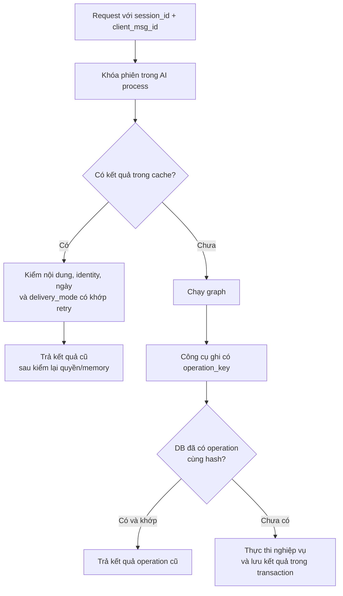

Cùng key nhưng tham số khác có thể bị từ chối. Operation key bảo vệ thao tác cụ thể; cache phản hồi/khóa phiên không tồn tại qua nhiều process. Không nên diễn giải toàn bộ hệ thống thành bảo đảm thực thi đúng một lần qua mọi kiểu crash/retry.

**Hai giao dịch riêng:** tạo đơn và lưu hội thoại không nằm trong một transaction xuyên hệ thống. Nếu tạo đơn thành công rồi commit memory lỗi, không thể kết luận đơn đã bị rollback.

### 12.2. Hành vi khi lỗi

| Tình huống | Hành vi quan sát được |
|---|---|
| CRM lỗi khi nhận diện | Không tự gán thành khách lạ; chuẩn bị/xử lý có thể thất bại |
| Memory đọc lỗi | Bỏ qua model và trả thông báo gián đoạn |
| Model lỗi | Chuyển sang đường dự phòng hoặc nội dung có nguồn nếu dựng được |
| Tool nghiệp vụ bị từ chối | Không tuyên bố thao tác đã thành công |
| Bản nháp thiếu bằng chứng | Thử recovery; không đủ thì fallback |
| Ghi turn lỗi | Request thất bại; không xác nhận đã lưu |
| Worker memory lỗi | Retry nền; hết giới hạn có thể failed |
| Theo dõi memory quá 60 giây | Kết thúc theo dõi, có thể giữ pending |
| Voice TTS lỗi | Giữ kết quả chữ, dừng playback và chốt phần đã xác nhận |
| Voice AI/receipt lỗi | Có thể đóng cuộc gọi; không tự chạy lại nghiệp vụ |
| Trình duyệt rời khi request đã gửi | Để request nghiệp vụ hoàn tất một lần và dọn tài nguyên |
| Policy không sẵn sàng | Trả trạng thái lỗi tra cứu, không tự tạo bằng chứng |

Chạy nhiều AI worker cần xử lý việc đưa cùng phiên về cùng process nếu tiếp tục dùng thiết kế trạng thái hiện tại. Chưa thấy cơ chế khôi phục receipt pending xuyên crash.

<a id="khoi-dong"></a>
## 13. Khởi động và cấu hình

### 13.1. Những gì Compose và managed startup thực hiện

Compose khai báo PostgreSQL, Redis, Qdrant, bước provision role, bốn MCP server và LangMem worker. Managed startup demo khởi chạy thêm AI API, knowledge worker và backend trên máy host. Speech service cần sẵn sàng theo URL cấu hình.

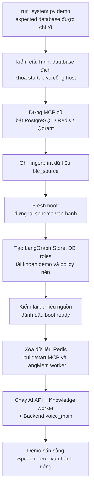

**Fresh demo là thao tác reset:** các schema `knowledge`, `runtime`, `app_runtime`, `ai_memory`, `langmem_store` được xóa nếu tồn tại rồi dựng lại; Redis bị `FLUSHDB`. Dữ liệu `btc_source` được giữ và kiểm fingerprint. Approved gap knowledge cũ không được giữ như tri thức đã duyệt của demo mới.

Đây là lý do không nên dùng lệnh fresh demo như một lệnh restart thông thường nếu cần giữ dữ liệu vận hành.

Boot marker chung giúp các process kiểm tra chúng đang nối vào đúng thế hệ dữ liệu đã `ready`. Đây là cơ chế nhất quán khi khởi động, không phải lưu bền toàn bộ trạng thái live.

### 13.2. Các nhóm cấu hình đáng chú ý

| Nhóm | Biến tiêu biểu | Ý nghĩa |
|---|---|---|
| Model | `LLM_BASE_URL`, `LLM_MODEL`, `LLM_API_KEY` | Nhà cung cấp tương thích OpenAI API |
| Model budget | `LLM_TIMEOUT_SECONDS`, `LLM_MAX_TOKENS`, `AGENT_MAX_TOOL_CALLS` | Giới hạn thời gian và tài nguyên |
| Context | `AGENT_PROMPT_HISTORY_TURNS`, `MEMORY_MAX_EPISODES` | Lượng lịch sử đưa vào xử lý |
| Nội bộ | `AI_INTERNAL_TOKEN`, `MCP_INTERNAL_TOKEN`, bốn MCP URL | Kết nối tin cậy giữa dịch vụ |
| Memory worker | `LANGMEM_MODEL`, `LANGMEM_MAX_TOKENS` | Model/tài nguyên trích xuất nền |
| Knowledge | Policy config/source dir, Cloudflare, Qdrant, DB URLs | Nguồn và hạ tầng chính sách |
| Knowledge loop | `KNOWLEDGE_ENABLED`, release pin | Tín hiệu và nội dung bổ sung |
| Demo auth | Database URL, JWT secret, lifetime, secure cookie | Tài khoản và phiên đăng nhập |
| Speech | HTTP URL, listen URL, voice, timeout | Kết nối STT/TTS |
| Quan sát | `LOG_LEVEL`, các cờ Langfuse | Log, trace và prompt quản lý |

Model hội thoại được khởi tạo bằng `ChatOpenAI`; URL và tên model cấu hình được nên không nên gắn hệ thống với một model cố định. Langfuse là tùy chọn, có thể cung cấp prompt nhãn `production`; nếu không lấy được thì dùng prompt local. Capture nội dung Langfuse bị cấu hình chặn trong production.

Các giá trị trên mô tả khả năng/cấu hình mặc định trong mã. Báo cáo không đọc hoặc xác nhận các bí mật trong `.env`.

Nguồn: [system_start.py](../ai-services/app/system_start.py), [bootstrap database](../ai-services/app/bootstrap/database.py), [Compose](../docker-compose.yml), [AI settings](../ai-services/app/configs.py), [backend settings](../backend/app/configs.py).

<a id="vi-du-gioi-han"></a>
## 14. Ví dụ xuyên suốt và giới hạn hiện tại

### 14.1. Ví dụ minh họa: khách quay lại mua máy lọc không khí

Đây là ví dụ giải thích luồng, không phải kết quả chạy thử hay dữ liệu khách thực.

| Thời điểm | Khách/hệ thống | Xử lý tương ứng |
|---|---|---|
| Phiên 1, lượt 1 | Khách nói phòng 25 m², có trẻ nhỏ, nêu ngân sách | Đọc catalog, giữ ràng buộc sử dụng/an toàn/ngân sách; hỏi rõ nếu cần |
| Phiên 1, lượt 2 | AI đề xuất một mẫu sau kiểm tra | Giá/thuộc tính phải có nguồn; đề xuất chưa tạo consent |
| Sau lượt | Worker xử lý | Chỉ nhận facts có bằng chứng; cập nhật diễn biến và blocker |
| Khách nói cần hỏi người thân | Hội thoại tạm dừng mua | Lưu vướng mắc nếu đủ bằng chứng; không tự tạo đơn |
| Phiên 2 | Khách đăng nhập và mở kết nối mới | Session mới; CRM nhận ra cùng customer; đọc memory cũ |
| Chuẩn bị | Dựng Call Brief | Nhắc nhu cầu đã biết và tiến độ blocker; cảnh báo giá cũ |
| Khách hỏi giá hiện tại | Tra quote phù hợp | Không dùng giá lịch sử để xác nhận giá mới |
| Khách đồng ý mua | Kiểm ý định, lựa chọn, offer, giá và tồn kho | Tạo đơn ngay nếu mọi điều kiện đủ; thiếu gì hỏi đúng phần đó |
| Nếu dùng voice và bị ngắt | Chốt playback prefix | Lượt sau không coi toàn bộ nội dung chưa phát là đã nói |

### 14.2. Những chức năng đã có và giới hạn cần diễn đạt đúng

| Chức năng | Mức thực hiện thấy trong mã |
|---|---|
| Chat chữ | Gateway WebSocket nối cùng AI runtime, có guarded streaming |
| Voice | Điều phối speech ngoài, phát TTS, ngắt lời và receipt |
| Khách quay lại | CRM + facts/episodes + Call Brief |
| Tạo đơn | Ghi PostgreSQL sau các kiểm tra nghiệp vụ |
| Thanh toán | Ghi phương thức; chưa thấy gọi cổng thanh toán |
| Tồn kho | Tính từ dữ liệu nguồn/sự kiện; chưa thấy giữ/trừ kho khi tạo đơn |
| Chuyển nhân viên | Tạo ticket/brief; chưa thấy nối tổng đài thật |
| Hẹn gọi | Lưu lịch; chưa thấy bộ quay số tự động trong hai phần đã đọc |
| Kênh hotline/Facebook/Zalo | Có mô hình identity; chưa chứng minh tích hợp trực tiếp các nền tảng |
| Knowledge Gap Loop | Có workflow nguồn/test/duyệt/phát hành; tùy cấu hình |
| Xóa dữ liệu | Có xác minh/scope/barrier và executor từng phần; chat không tự purge toàn hệ thống |
| Đa process và crash recovery | Lưu bền một phần dữ liệu nghiệp vụ/memory; trạng thái phiên/receipt live còn trong process |
| Redis | Có hạ tầng và client; chưa tham gia state của demo entry point hiện tại |
| Entry point backend | `voice_main` đang được chọn; `main.py` còn import router thiếu |

### 14.3. Mức kiểm chứng của báo cáo

Đã đọc và lần theo entry point, router, runtime, graph, adapter MCP, service nghiệp vụ, memory worker, knowledge search/lifecycle, schema và startup. Đã đối chiếu tĩnh danh sách route và sự tồn tại của router mà `backend/app/main.py` import.

Không khởi động stack, không reset database, không chạy model, speech inference, benchmark hoặc live evaluation. Không chạy bộ kiểm thử ứng dụng vì yêu cầu là đọc và viết tài liệu. Các sơ đồ mô tả đường đi trong mã; chúng chưa xác nhận chất lượng hội thoại, độ trễ, độ chính xác ASR hoặc tình trạng triển khai hiện tại.

<a id="tham-chieu"></a>
## 15. Bản đồ tệp tham chiếu

| Nội dung cần đọc sâu | Tệp |
|---|---|
| Backend hiện hành | [voice_main.py](../backend/app/voice_main.py) |
| Entry point backend còn thiếu router | [main.py](../backend/app/main.py) |
| Đăng nhập và ràng buộc tài khoản | [auth.py](../backend/app/auth.py) |
| Chat gateway | [api/text.py](../backend/app/api/text.py) |
| Kiểm luồng NDJSON | [services/text_stream.py](../backend/app/services/text_stream.py) |
| Điều phối voice | [services/voice_call.py](../backend/app/services/voice_call.py) |
| Giao tiếp speech | [services/voice_speech.py](../backend/app/services/voice_speech.py) |
| Hợp đồng voice chi tiết | [VOICE_API_CONTRACT.md](../backend/VOICE_API_CONTRACT.md) |
| Proxy knowledge | [api/knowledge.py](../backend/app/api/knowledge.py) |
| AI HTTP boundary | [api/chat.py](../ai-services/app/api/chat.py) |
| Lắp runtime | [factory.py](../ai-services/app/agent/factory.py) |
| Graph một lượt | [graph.py](../ai-services/app/agent/graph.py) |
| Phiên, cache, receipt, commit | [harness/runtime.py](../ai-services/app/agent/harness/runtime.py) |
| Nhận diện CRM | [harness/session_identity.py](../ai-services/app/agent/harness/session_identity.py) |
| Nạp context và Call Brief | [harness/context.py](../ai-services/app/agent/harness/context.py) |
| Node xử lý và verifier | [harness/agent_nodes.py](../ai-services/app/agent/harness/agent_nodes.py) |
| Guarded streaming | [harness/streaming.py](../ai-services/app/agent/harness/streaming.py) |
| Ranh giới tool và prompt | [implementations/business_agent.py](../ai-services/app/agent/implementations/business_agent.py) |
| Quy tắc tham số công cụ | [harness/policy.py](../ai-services/app/agent/harness/policy.py) |
| Trạng thái tư vấn và consent | [consultation.py](../ai-services/app/mcp_servers/mcp_shared/consultation.py) |
| Kiểm chứng câu trả lời | [guardrails/checks.py](../ai-services/app/agent/guardrails/checks.py) |
| MCP transport | [mcp/gateway.py](../ai-services/app/agent/mcp/gateway.py) |
| Quy tắc thương mại | [commerce_rules.py](../ai-services/app/mcp_servers/mcp_shared/commerce_rules.py) |
| Catalog service | [catalog.py](../ai-services/app/mcp_servers/mcp_catalog/services/catalog.py) |
| Order service | [order.py](../ai-services/app/mcp_servers/mcp_order/services/order.py) |
| Memory read/write | [memory.py](../ai-services/app/mcp_servers/mcp_memory/services/memory.py) |
| Memory worker | [distiller_worker.py](../ai-services/app/mcp_servers/mcp_memory/distiller_worker.py) |
| Memory admission | [langmem_admission.py](../ai-services/app/mcp_servers/mcp_memory/services/langmem_admission.py) |
| LangGraph Store | [langmem_projection.py](../ai-services/app/mcp_servers/mcp_memory/repos/langmem_projection.py) |
| Episode retrieval | [memory_retrieval.py](../ai-services/app/mcp_servers/mcp_shared/memory_retrieval.py) |
| Chính sách hybrid | [knowledge.py](../ai-services/app/mcp_servers/mcp_knowledge/services/knowledge.py) |
| Qdrant dense/sparse | [qdrant.py](../ai-services/app/mcp_servers/mcp_knowledge/repos/qdrant.py) |
| Knowledge commands | [lifecycle.py](../ai-services/app/knowledge/services/lifecycle.py) |
| Release workflow | [releases.py](../ai-services/app/knowledge/services/releases.py) |
| Schema fresh boot | [schema.sql](../ai-services/app/bootstrap/schema.sql) |
| Managed startup | [system_start.py](../ai-services/app/system_start.py) |
| Reset schema và boot marker | [bootstrap/database.py](../ai-services/app/bootstrap/database.py) |
| Hạ tầng | [docker-compose.yml](../docker-compose.yml) |

