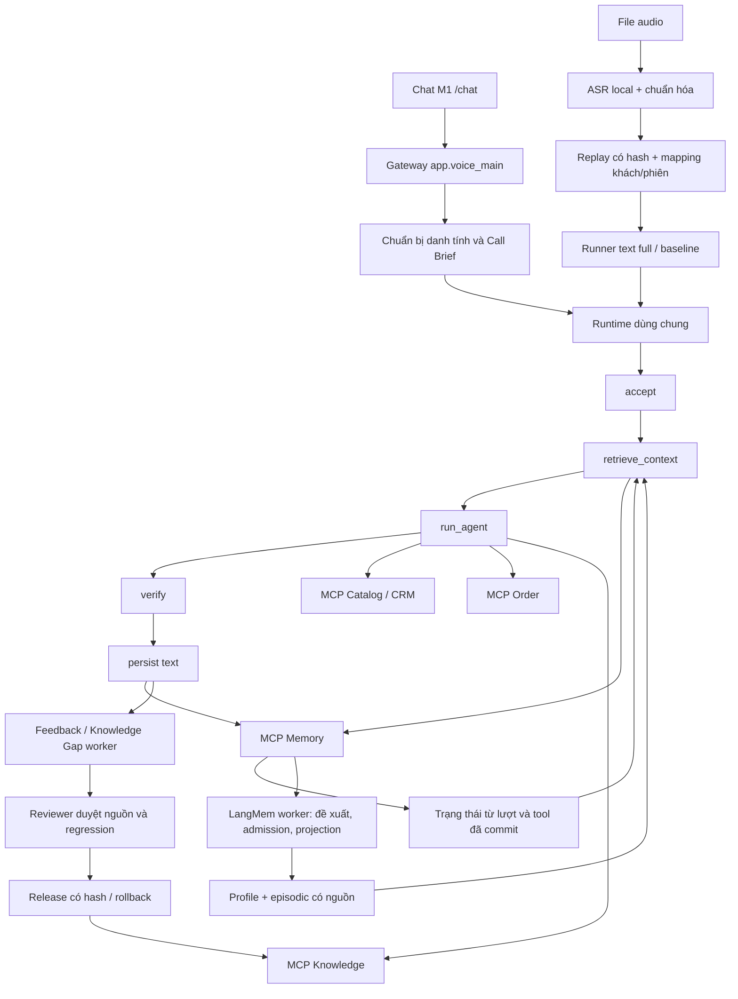

# Kiến trúc M1 hiện tại

Đây là mô tả implementation trong checkout, không phải bằng chứng đạt KPI runtime.
Hướng dẫn chạy/nghiệm thu: [m1-acceptance.md](m1-acceptance.md).

## Ranh giới trách nhiệm

- Gateway giữ định danh và session trong một kết nối. Trình duyệt không gửi token
  nội bộ, customer_id đã xác minh hoặc yêu cầu gọi tool. Kết thúc rồi mở kết nối
  mới tạo session mới; CRM/memory quyết định đó có phải cùng khách hay không.
- `AgentHarnessRuntime` quản lý khóa session, response cache và lịch sử tool.
  Cả chat/voice/runner dùng chung graph và business tools, không có agent riêng
  được viết để trả lời đúng scenario ID.
- LLM hiểu lời nói, tham chiếu và đề xuất hành động. Harness kiểm schema,
  danh tính, bằng chứng, điều kiện giao dịch và trạng thái thực thi.
- Catalog/Order/Memory/Knowledge là các MCP riêng. Tool nghiệp vụ nhận ngày `on`
  từ request tin cậy, không lấy ngày model tự suy đoán.

## Memory ba tầng

| Tầng | Nội dung | Cách kiểm soát |
|---|---|---|
| Working | Các lượt và quan sát tool trong session | Khóa session; history giới hạn trong prompt; ownership |
| Episodic | Mục tiêu, tư vấn, blocker, outcome và consultation snapshot | Chỉ nhận dữ liệu có bằng chứng từ lượt đã commit; có source turn |
| Profile | Nhu cầu/sở thích bền vững của khách | Fact có scope global/room/product; admission trước projection; set/supersede/delete |

Không đồng nhất ba trạng thái: **đã tư vấn**, **khách đã chọn**, **khách đồng ý
điều kiện mua**. Một catalog result hoặc giá tool trả về không tự tạo consent.
Giá đã nói trong phiên trước là lịch sử; quote/stock hiện tại phải đúng SKU,
variant, số lượng, ngày và địa chỉ liên quan.

Model extraction chỉ đề xuất. Admission đối chiếu customer/tool evidence, người
sở hữu session và nguồn từng turn. Câu hỏi, giả định, lời agent hoặc fact của
khách khác không được tự biến thành profile của khách hiện tại. Khách đổi ý dùng
supersede/delete; omission không tự được coi là xóa.

Trạng thái cần cho lượt kế tiếp được dựng từ lượt và tool đã commit, kể cả khi
LangMem còn pending hoặc chưa có episode projection. Đây là read view của bằng
chứng hiện có, không phải một kho lịch sử thứ hai. Các fact xác định được ngay
vẫn qua admission và giữ source/revision; tombstone mới không bị job cũ hồi sinh.
Worker chỉ trích xuất lượt nguồn mới với lời agent trước đó làm ngữ cảnh tham
chiếu và các fact/open item đã nhận. Job cùng khách được xử lý theo thứ tự giữa
các phiên; retry dùng proposals đã lưu và kiểm attempt trước khi publish.

## Vòng đời chat và voice

**Chat M1:** chuẩn bị identity/brief lúc bắt đầu session -> nhận text -> graph ->
verify -> commit turn -> trả lời -> worker distill nền. UI theo dõi kết quả memory
riêng, không coi pending là đã có fact mới.

**Voice:** chuẩn bị session -> sinh reply -> xác nhận phần đã phát -> commit đúng
phần được nghe -> worker nền. Text chưa được phát không được đưa vào memory như
khách đã nghe. Phần này không phải điều kiện để được tính hoàn thành chat M1.

Call Brief trước câu trả lời không có nghĩa đã có consent hoặc đơn mới. Memory
advice có nguồn có thể cho phép lấy lại catalog để hiểu “mẫu hôm trước”, nhưng
không được tự chọn một sản phẩm giữa nhiều lựa chọn mơ hồ.

Call Brief được dựng lại ở mọi lượt của khách quay lại. `SessionState` giữ view
context và consultation decision theo owner/ngày/full-baseline; memory read mới
thay thế view để không hồi sinh fact bị xóa. Read lỗi vô hiệu view và chặn model
dùng context cũ; retry response cũng kiểm lại memory và không đổi chế độ full/baseline.
Sau restart, committed tool observations khôi phục bằng chứng trong phiên, kể cả
barrier của read thất bại. Prepared reads được commit cùng lượt thật sử dụng chúng;
báo giá voice chỉ thành offer khi đã phát. Render brief không tự gọi lại quote/stock.

Nếu khách muốn mua và nêu mã/tên model cụ thể nhưng thiếu metadata, runtime tra
catalog trong tool budget trước câu hỏi chọn mẫu. Query mơ hồ không kích hoạt tìm
rộng; kết quả nhiều SKU không tự chọn. Lỗi local tool output, schema, parser và
context overflow có mã diagnostics an toàn, không lưu raw exception/body.

Eval dùng cùng lifecycle, chỉ chuyển lượt sau khi xác nhận `turn_saved=True`.
Không đợi enrichment giữa các lượt; cuối cuộc gọi mới drain worker và thu writes
đúng source trước khi chuyển phiên/chấm điểm. Timing tách response, essential
commit và background finalize; commit text nằm trong response nên không cộng
hai trường này lần nữa. Chưa có phép đo live chứng minh mức giảm latency.

## Giao dịch và recovery

Luồng hiện có resolve sản phẩm/variant, lấy quote và stock tương thích, kiểm
permission/accepted offer rồi mới ghi order. Tạo đơn có kiểm idempotency; trạng
thái created không được suy từ câu LLM nói. Thay đổi giá/quyền lợi xấu hơn cần
xác nhận lại. Lỗi phải trả fallback hoặc câu hỏi làm rõ đúng phần thiếu.

Theo hợp đồng BTC tháng 11, giỏ hàng dùng `pricing.quote_order(lines)` và
`order.create(lines)` với đơn giá từng máy từ `units`. Tồn kho cộng gộp theo SKU;
ưu đãi máy thứ hai chỉ áp dụng một lần theo quy tắc cùng ngày/khách. Báo giá và
tạo đơn cùng kiểm lịch sử sử dụng ưu đãi. Phần giá/quyền lợi đã nói phải thực sự
được phát/commit trước khi lời đồng ý của khách có thể cho phép tạo đơn.

Giá bán không được kiểm bằng tập số tiền lẫn với discount. Grounding và answer
checks là các lớp khác nhau; khi cấu hình tắt answer guardrails, không được tuyên
bố đã chống bịa giá/KM chỉ vì grounding vẫn chạy.

Handoff cần tool thành công và brief hợp lệ, không chỉ câu “em sẽ chuyển”. Danh
tính mơ hồ giữ profile rỗng; erasure có barrier ngăn đọc/ghi trước khi purge.

## Feedback và cách chứng minh cải tiến

Outcome/fallback có thể tạo event nền. Điểm eval được xuất thành evaluation_result
có score hash và idempotency key, rồi nhập vào cùng queue khi được phép. Execution
chưa xác minh được phân loại technical, không tự tạo bản vá chính sách.

Nguồn, draft và regression cần reviewer duyệt trước phát hành. So sánh hai vòng
phải giữ nguyên test, model/tham số, source, seed và phần cứng; thay knowledge
release có kiểm soát. Offline tests của workflow không thay thế số liệu hai vòng.

## Giới hạn đã biết

- Lock/cache runtime là process-local: giữ một worker AI cho demo hiện tại.
- Chưa có số nghiệm thu mới sau thay đổi; run cũ vẫn giữ nguyên.
- Chat nonstreaming áp dụng TTFT=Total theo quy tắc 7 BTC, cần đo đủ >=100 lượt.
- Dữ liệu và ASR đủ quy mô, chi phí model đích, hai vòng và video demo thật còn
  cần artifact thực tế. Không suy ra các kết quả đó từ số lượng unit test.
