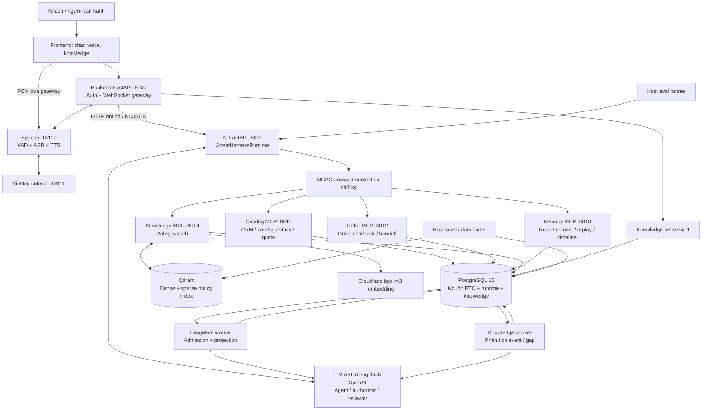
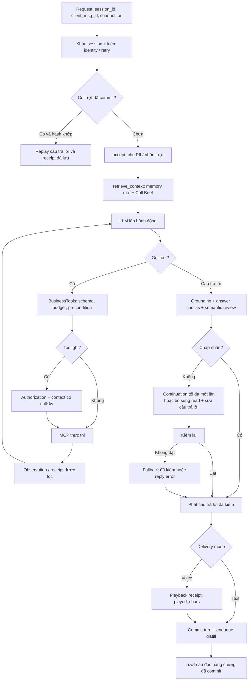

# Tài liệu kiến trúc TeleSale SudoCode 2026

Ngày rà soát: **27/11/2026**. Mốc Git: `a4a816732987f69b805f76d47b12491bce73e8fb`, cộng thay đổi chưa commit đang có trong `claims.py` và ba file test guardrail/review. Tài liệu mô tả implementation trong checkout; kết quả thực nghiệm nằm ở [Báo cáo đánh giá](bao-cao-danh-gia.md).

## 1. Phạm vi và bản đồ mã nguồn

Hệ thống là trợ lý telesale tiếng Việt đa phiên, đa kênh, hỗ trợ tư vấn, báo giá, đặt/đổi/trả hàng, hẹn gọi lại và chuyển nhân viên. Chat, voice và runner đánh giá dùng chung runtime nghiệp vụ. Bộ nhớ cá nhân của khách và kho chính sách cửa hàng là hai luồng dữ liệu riêng.

| Khu vực | Trách nhiệm và điểm đọc chính |
|---|---|
| `frontend/` | HTML/CSS/JavaScript thuần; chat WebSocket, Call Brief, trạng thái memory, timeline; thu/phát audio và xác nhận phần đã nghe; UI review knowledge |
| `backend/app/` | FastAPI gateway, đăng nhập và ràng buộc tài khoản/kênh, chuyển tiếp chat/voice/knowledge; entrypoint Compose là [`voice_main.py`](../backend/app/voice_main.py), khác app backend tổng quát ở `main.py` |
| `ai-services/app/agent/` | Runtime, StateGraph, ngữ cảnh, LLM agent, BusinessTools, authorization, kiểm câu trả lời, commit lượt |
| `ai-services/app/mcp_servers/` | Bốn server Catalog, Order, Memory, Knowledge; schemas, service, repository; `mcp_shared/` giữ identity, PII, commerce rules/evidence và lịch nghiệp vụ |
| `ai-services/app/knowledge/` | Event → gap → revision → review/test → release; nguồn, quyền truy cập, audit và rollback |
| `ai-services/app/bootstrap/` | Schema SQL, role/grant, bootstrap dữ liệu và policy; kiểm boot readiness |
| `speech/` | ASR/chuẩn hóa tiếng Việt, tạo/kiểm corpus, replay có provenance, WER/CER; `serving/` cung cấp ASR/VAD/TTS realtime và VieNeu sidecar |
| `dataloader_offline/`, `seed_btc.py` | Kiểm nguồn BTC, nhập PostgreSQL, chuẩn bị hybrid policy index, đối chiếu dữ liệu sau nhập |
| `ai-services/eval_harness/`, `eval/` | Runner Full/baseline, extractor/scorer adapter, bằng chứng stage/trace, semantic/tool/RAG evaluation, ablation, simulator và kiểm khả năng so sánh |
| `scripts/`, `config/`, `Dockerfile`, `docker-compose.yml` | Khởi động CPU/GPU, chờ seed, cấu hình service, tokenizer, đóng gói và dependencies |
| Các thư mục `test/`, `fixtures/`, `eval/scenario_final/` | Kiểm thử offline và hợp đồng dữ liệu; fixture/scenario không phải logic trả lời riêng theo scenario ID |

Phạm vi rà soát bao phủ các khối mã nguồn trên và đường nối giữa chúng. Model weights, audio, cache, virtualenv và kết quả sinh sẵn được xem là tài sản/dữ liệu, không phải mã ứng dụng. Tài liệu không khẳng định toàn bộ suite đã được chạy.

## 2. Sơ đồ hệ thống



Sơ đồ biểu diễn phụ thuộc logic. Runner chuẩn dựng runtime cùng code trực tiếp trong tiến trình host và gọi các MCP; không bắt buộc đi qua HTTP AI/backend. Voice dùng gateway để điều phối speech; sơ đồ không có nghĩa trình duyệt giữ token nội bộ hay tự gọi MCP.

Compose có PostgreSQL, Qdrant, Redis, bốn MCP, hai worker, AI, backend, speech và VieNeu. Redis được cấp trong stack, có helper ở backend tổng quát; runtime hội thoại trong `voice_main.py` dùng bộ nhớ tiến trình và PostgreSQL, không dùng Redis làm nguồn bộ nhớ cá nhân. Port trên hình là port service; host mapping mặc định nằm trong [Compose](../docker-compose.yml), ví dụ PostgreSQL `15432`, Qdrant `16333`, AI `18001`, MCP `18011`–`18014`.

## 3. Vòng lặp harness

Graph thực tế chỉ có bốn node: **accept → retrieve_context → run_agent → verify**. Persist do runtime gọi sau khi xử lý ranh giới phát câu trả lời; không phải node thứ năm trong StateGraph. Vòng lặp model/tool nằm bên trong `run_agent`; recovery hữu hạn nằm trong `verify`.



1. **Chuẩn bị phiên:** gateway gắn kênh với tài khoản, tạo UUID; runtime tra CRM và dựng brief. `known`, `unknown`, `ambiguous` là ba trạng thái khác nhau. `verified_customer_id` và `verified_phone` phải là cặp tin cậy từ tầng gọi, được đối chiếu CRM. ID Facebook/Zalo không tự được chuyển thành SĐT.
2. **Nhận lượt và ngữ cảnh:** khóa theo `session_id`; `(session_id, client_msg_id)` nhận diện retry. Request hash gồm nội dung request và chế độ Full/baseline. Memory mới thay thế view cũ; read lỗi không cho dùng tiếp profile cache cũ. Ngày nghiệp vụ lấy từ `request.on`.
3. **Suy luận và công cụ:** mặc định dùng Deep Agent; ReAct có builder dùng chung BusinessTools. Middleware chỉ công bố 12 business tools, loại tool hệ thống của Deep Agent ngoài allowlist. Model đề xuất args; harness bổ sung identity/ngày/operation key và kiểm sản phẩm/biến thể trước thực thi.
4. **Quyền ghi:** tạo/sửa đơn, callback, handoff phải được kiểm riêng. Fast path chỉ nhận dạng một nhóm yêu cầu tạo đơn tường minh, khớp sản phẩm, số lượng, payment và bằng chứng hiện tại; các trường hợp khác qua LLM authorizer. Thiếu context đầy đủ hoặc authorization unavailable thì không ghi. Gateway ký binding tool/args/actor; Order MCP kiểm lại.
5. **Xác minh:** kiểm giá, KM, tồn kho, giao hàng, thông số/chính sách và receipt thao tác; sau đó semantic reviewer đối chiếu ngữ nghĩa. Reviewer lỗi/timeout hiện trả `grounding_review_unavailable`; verifier vẫn cho qua nếu lớp deterministic đã đạt. Đây là giới hạn thực tế: bật semantic review không đồng nghĩa mọi câu luôn được review thành công.
6. **Recovery:** một continuation có tools dùng lại BusinessTools, budgets và receipt cache; các read bổ sung vẫn tính budget. Sau đó có tối đa một vòng viết lại mặc định từ factory, không được tự thực hiện giao dịch trong lời sửa. Fallback phải có nguồn cho sản phẩm được nhắc; không được chọn quà làm sản phẩm chính. Recovery không bảo đảm task đã hoàn tất.
7. **Công bố và lưu:** `GuardedStream.feed()` hiện chỉ nhận state, chưa phát draft; `finish()` phát câu đã khớp `verified_answer`. Text commit trước terminal response; voice chỉ commit prefix được xác nhận đã phát. Voice hết hạn 300 giây mà không có receipt thì ghi phần nghe là 0. Enrichment chạy nền; `turn_saved=True` khác `status=completed` của distillation.

Nguồn: [`graph.py`](../ai-services/app/agent/graph.py), [`runtime.py`](../ai-services/app/agent/harness/runtime.py), [`agent_nodes.py`](../ai-services/app/agent/harness/agent_nodes.py), [`business_agent.py`](../ai-services/app/agent/implementations/business_agent.py), [`streaming.py`](../ai-services/app/agent/harness/streaming.py), [`authorization.py`](../ai-services/app/agent/harness/authorization.py).

### Ngân sách và kiểm soát chạy

| Tham số mặc định | Giá trị / tác dụng |
|---|---|
| Business tool calls | 8/lượt; settings cho phép 3–20 |
| Tool attempts / model tool exposure | Giới hạn liên quan bằng 2 lần tool budget; recursion limit của agent ít nhất 12 |
| Lịch sử đưa vào prompt | 6 lượt; settings cho phép 1–12 |
| Episode truy hồi | 5; settings cho phép 0–20 |
| Timeout | Turn 90 giây; LLM 30 giây; review authorization/semantic 5 giây; MCP gateway 10 giây |
| Context | Bound theo từng trường, tổng khoảng 70.000 ký tự JSON; ghi nhận `omitted_fields` và chặn authorization khi thiếu nguồn |
| Cache runtime | Process-local, tối đa 128 session; prune theo tuổi/truy cập; cache không thay thế durable replay |

Các giới hạn là giá trị code mặc định, có thể khác cấu hình triển khai. Policy service có deadline riêng 60 giây nhưng caller MCP timeout 10 giây; deadline hiệu dụng của một request phụ thuộc cả hai tầng.

## 4. Thiết kế bộ nhớ

### Ba tầng, cùng khóa chủ sở hữu

| Tầng | Nội dung | Nơi lưu / cách dùng |
|---|---|---|
| Working | Lượt hội thoại và tool observations đã commit; context view, sản phẩm đang trao đổi, private delivery | `runtime.turns` trong PostgreSQL; `SessionState` là view/cache; khôi phục từ bằng chứng khi tiến trình restart |
| Episodic | Mục tiêu, tư vấn, next step, blocker/câu hỏi còn mở, outcome, resolved items theo phiên/chủ đề | LangGraph `AsyncPostgresStore` qua `LangMemProjection`, namespace `customers/{customer_id}/episodes`; scope topic global/product/room |
| Profile | Fact bền vững: nhu cầu, ngân sách, diện tích, sở thích; facts lịch sử về tư vấn/giá/đơn được phân loại riêng | Namespace `customers/{customer_id}/facts`; key logic gồm scope, scope_id, slot và revision |

Memory cá nhân dùng PostgreSQL; `LangMemProjection` mở store với `index=None`. Qdrant phục vụ policy retrieval, không phải vector database mặc định cho profile khách. Episode được xếp hạng theo SKU trong query, giao từ khóa, blocker đang mở và ngày.

Một fact giữ `schema_version`, `key`, `value`, `scope_type`, `scope_id`, `source_kind`, `source_tool`, `source_turn_id`, `session_id`, `evidence_quote`, `on`, `valid_until`, `revision`, `write_op`, `status`. Các trường này dùng để truy nguồn, kiểm kiểu, hiệu lực và chọn phiên bản; không chỉ lưu cặp key/value.

### Luồng ghi và độ nhất quán

```mermaid
sequenceDiagram
    participant RT as Runtime
    participant MM as Memory MCP
    participant DB as PostgreSQL
    participant WK as LangMem worker
    participant LM as Extraction / review LLM
    RT->>MM: memory.write(commit_turn, operation_key)
    MM->>DB: Transaction: turn + observations + job + order links
    DB-->>RT: turn_no; lượt đã lưu, enrichment pending
    WK->>DB: Claim job có lease / kiểm attempt / erasure
    WK->>LM: Đề xuất facts và episode từ lượt nguồn
    LM-->>WK: Structured candidates
    WK->>WK: Admission + fact/episode review + deterministic receipts
    WK->>DB: Lưu accepted proposals; publish revision
    WK->>DB: Đánh dấu job completed
    RT->>MM: memory.read ở lượt sau
    MM->>DB: Completed revisions + read view từ turns đã commit
    DB-->>RT: Working + profile + episodes có provenance
```

Commit turn và enqueue job nằm cùng transaction. Operation key và args hash tránh retry ghi trùng hoặc dùng lại key với nội dung khác. Worker xử lý thứ tự theo khách, có lease/attempt và kiểm claim còn hiệu lực trước publish. Proposals đã chấp nhận được lưu để retry không tự sinh một bộ trích xuất mới. Reader chỉ công bố revision hoàn tất, kết hợp operational read view từ các lượt đã commit khi worker chưa kịp chạy.

**Admission:** LLM chỉ đề xuất; kiểm nguồn turn đúng khách/phiên, loại slot và quote. Facts khách cần phát ngôn khách có evidence; giá/đơn/khuyến mãi phải có tool evidence thích hợp. Kết quả search/quote không tự chứng minh khách đã chọn/mua; quà được tra giá/kho không tự thành `product_advised`. Chỉ receipt tạo đơn hợp lệ mới tạo bằng chứng mua tương ứng.

**Cập nhật:** `set`, `supersede`, `delete`; cùng giá trị và `valid_until` có thể bỏ ghi revision trùng. Giá trị cũ bị thay thế có liên kết revision mới; delete là tombstone. Khi compact phải giữ barrier phiên bản để job cũ không hồi sinh dữ liệu đã xóa. Không nhắc lại fact không có nghĩa khách đã yêu cầu xóa.

**Hiệu lực:** TTL fact mặc định 240 ngày theo ngày nghiệp vụ, bỏ fact tương lai/hết hạn; `valid_until` kiểm riêng. Giá/KM cũ vẫn là lịch sử, không phải báo giá hiện hành. Quote/stock dùng cho mua phải đúng SKU/variant, số lượng, ngày và ngữ cảnh giỏ/địa điểm.

**Định danh và riêng tư:** session ownership ngăn đọc chéo khách. Danh tính mơ hồ không mở profile. PII được che trước đưa vào LLM và proposal; địa chỉ thực có private delivery context riêng để thực thi khi có quyền. Điều này không có nghĩa PostgreSQL không chứa dữ liệu riêng tư. Erasure có barrier chặn read/write, purge memory/knowledge evidence và vô hiệu cache runtime; agent không có tool tự xóa dữ liệu tùy ý.

Nguồn: [`store.py`](../ai-services/app/agent/memory/store.py), [`memory.py`](../ai-services/app/mcp_servers/mcp_memory/services/memory.py), [`distiller_worker.py`](../ai-services/app/mcp_servers/mcp_memory/distiller_worker.py), [`langmem_admission.py`](../ai-services/app/mcp_servers/mcp_memory/services/langmem_admission.py), [`langmem_projection.py`](../ai-services/app/mcp_servers/mcp_memory/repos/langmem_projection.py), [`schema.sql`](../ai-services/app/bootstrap/schema.sql).

### Truy hồi và Call Brief

`load_context()` đọc mới theo owner; tách customer facts khỏi sales history; lọc TTL/scope; nạp history, current episode, episode trước và đơn thuộc khách. Call Brief tổng hợp nhu cầu, tư vấn trước, blocker, điểm cần hỏi và dữ kiện không nên hỏi lại. Brief không cấp consent và không xác nhận đơn mới.

Khi cần hiểu “mẫu hôm trước”, runtime có thể refresh catalog/quote/stock từ advice có nguồn, nhưng nhiều sản phẩm còn mơ hồ thì vẫn cần làm rõ. Render brief không phải mỗi lần lại gọi tool thương mại. Read lỗi loại bỏ view cũ; retry cache cũng kiểm memory để tôn trọng xóa dữ liệu và lỗi nguồn.

## 5. Danh sách tools và quyền sử dụng

### 12 business tools cho model

Tên canonical dùng trong trace/MCP; alias dấu gạch dưới dùng trong function calling. Model không tự truyền verified identity hay operation key.

| Tool canonical → alias | MCP | Đầu vào nghiệp vụ chính | Kết quả / ràng buộc |
|---|---|---|---|
| `catalog.search` → `catalog_search` | Catalog | Query/category/SKU, bộ lọc thuộc tính/diện tích/giá niêm yết | Ứng viên và variants; thiếu thông số nghĩa là chưa biết; giá niêm yết không phải giá sau KM |
| `catalog.get_details` → `catalog_get_details` | Catalog | SKU/variant | Chi tiết, technical evidence, nguồn/conflict; không dùng thông số mẫu khác |
| `inventory.check` → `inventory_check` | Catalog | SKU, ngày do harness gắn | `in_stock`, `qty`; mua cần đủ lượng cộng gộp |
| `pricing.get_quote` → `pricing_get_quote` | Catalog | SKU, qty, địa điểm, ngữ cảnh giỏ | Giá cuối, applied promos, freeship, ngày giao dự kiến; khuyến nghị cho 1 đơn vị |
| `pricing.quote_order` → `pricing_quote_order` | Catalog | `lines`, địa điểm | Giá theo từng `unit`, tổng và ưu đãi đơn; dùng cho nhiều món/đơn vị |
| `order.status` → `order_status` | Order | Order ID hoặc lookup khách đã xác minh | Chỉ đơn thuộc owner; có thể tra danh sách mà không hỏi lại SĐT |
| `order.preview_update` → `order_preview_update` | Order | Đơn, action, dòng/qty, variant mới | Phương án và số tiền dự kiến; không tạo phiếu |
| `order.create` → `order_create` | Order | SKU/giá hoặc `lines`, payment, địa điểm | Tool ghi; cần identity, authorization, quote/stock; receipt `created` và order ID |
| `order.update` → `order_update` | Order | Đơn, action, dòng/qty, variant/địa chỉ mới | Tool ghi; ownership/authorization; `review_pending` chỉ là chờ duyệt |
| `schedule.callback` → `schedule_callback` | Order | Thời điểm, ghi chú | Tool ghi; chuẩn hóa lịch làm việc; receipt giữ thời điểm thực tế và việc dời |
| `handoff.transfer` → `handoff_transfer` | Order | Brief lý do, tóm tắt, câu hỏi mở, next action | Tool ghi; harness gắn identity; thành công cần ticket và `queued` |
| `policy.search` → `policy_search` | Knowledge | Query, order/product đã xác minh, ngày khách tự khai nếu có | Evidence, applicability, dependencies, release; nội dung public theo ngày và đối tượng |

### Tools nội bộ do harness/runner gọi

| Tool | Người gọi / mục đích |
|---|---|
| `crm.get_customer` | Identity bootstrap; lookup phone/FB/Zalo, phát hiện ambiguous; không nằm trong 12 tools model |
| `memory.read` | Runtime lấy working/profile/episodes; `include_prior` điều khiển bộ nhớ liên phiên |
| `memory.write` | Runtime commit turn; chỉ `action=commit_turn`, không nhận facts/episode tùy ý từ caller |
| `memory.turn_status` | UI/runner xem enrichment pending/completed/failed và public changes |
| `memory.replay` | Khôi phục lượt đã commit, kiểm request hash |
| `memory.timeline` | Lịch sử phân trang đúng owner/ngày; không áp dụng khi baseline/không xác minh |
| `eval.database_identity` | Có ở cả bốn MCP; preflight xác nhận cùng DB trước reset/eval |
| `eval.knowledge_release` | Knowledge MCP; pin release ID/hash cho phép so sánh |

Nguồn hợp đồng: [`tool_names.py`](../ai-services/app/agent/implementations/tool_names.py), [`BusinessTools`](../ai-services/app/agent/implementations/business_agent.py), các `mcp_*/tools/handlers.py` và [`gateway.py`](../ai-services/app/agent/mcp/gateway.py). Đây là tools của dự án, không phải tools của trợ lý viết báo cáo.

## 6. Kho chính sách và vòng cải tiến tri thức

Policy source được parse theo chunk ID, quyền public/restricted, hiệu lực và date basis. Dense embedding Cloudflare `@cf/baai/bge-m3` 1024 chiều kết hợp sparse BM25; Qdrant hybrid query, PostgreSQL giữ source snapshot/hash. Cấu hình hiện tại lấy 30 dense và 30 sparse candidates; `top_k` thường 5, hard limit 20 có thể chứa thêm dependencies.

Search kiểm release/config/model fingerprint, hash nguồn và ngày/sản phẩm có chữ ký. Các mục phụ thuộc được duyệt bắc cầu, có chống vòng lặp/giới hạn; thiếu mục bắt buộc hạ applicability thành conditional thay vì cho phép kết luận chắc chắn. Kết quả phân biệt `ok`, `no_evidence`, `unavailable`, `timeout`, `overloaded`. Cấu hình `relevance_verified=false` là giới hạn hiệu chuẩn retrieval hiện có.

Vòng knowledge: sự kiện fallback/guardrail/no-evidence hoặc evaluation → worker phân tích gap → draft có nguồn → reviewer duyệt nội dung và regression case → chuẩn bị index/release có manifest hash → activate theo expected active ID → đánh giá lại hoặc rollback. Release mới là thay đổi kho tri thức, không phải huấn luyện lại model. Nguồn không đủ hoặc lỗi thực thi không tự trở thành chính sách mới.

Nguồn: [`knowledge.py`](../ai-services/app/mcp_servers/mcp_knowledge/services/knowledge.py), [`policy-runtime.json`](../config/policy-runtime.json), [`releases.py`](../ai-services/app/knowledge/services/releases.py), [`publish.py`](../ai-services/app/knowledge/services/publish.py), [`lifecycle.py`](../ai-services/app/knowledge/services/lifecycle.py).

## 7. Các quyết định thiết kế và lý do

Các lý do dưới đây được diễn giải từ ràng buộc và cách code thực thi, trừ khi đã có tài liệu lịch sử ghi rõ; không giả định đây là biên bản quyết định của tác giả.

| Quyết định hiện có | Lý do và đánh đổi |
|---|---|
| Một runtime cho chat/voice/eval | Giảm lệch logic giữa demo và đánh giá; latency runner vẫn không bao gồm toàn bộ gateway/audio |
| Graph nhỏ, LLM quyết định trong vòng tools | Dễ tách lifecycle khỏi suy luận; vẫn phụ thuộc khả năng gọi tool và hiểu ngữ nghĩa của model |
| Bốn MCP và DB roles riêng | Tách hợp đồng/quyền nghiệp vụ, kiểm chéo identity; thêm network calls và vận hành nhiều service |
| PostgreSQL làm canonical memory | Transaction, ownership, provenance, retry và erasure có cùng nền dữ liệu; đọc/review nhiều phiên vẫn có chi phí |
| Distillation nền và operational read view | Trả lời không phải đợi LLM trích xuất; lượt kế tiếp vẫn có dữ kiện đã commit; phải xử lý revision/barrier/lease |
| Scope global/room/product | Tránh trộn ngân sách/phòng/sản phẩm; model và admission phải giải đúng phạm vi |
| Tách advice, selection và consent | Không biến catalog hoặc lịch sử thành đơn hàng; có thể giảm TSR nếu agent hỏi lại hoặc authorizer từ chối nhầm |
| Kiểm ghi ở harness và MCP | Prompt không đủ làm biên quyền; chữ ký ràng buộc đúng actor/args; thêm chi phí review |
| Deterministic checks + semantic review | Kết hợp kiểm số/receipt với điều kiện ngôn ngữ; reviewer cũng có thể sai hoặc unavailable |
| Buffer toàn câu trước phát | Tránh phát draft sai rồi chắp fallback/sửa câu; TTFT có thể gần Total, số streaming cũ không đại diện bản hiện tại |
| Hybrid retrieval + version/dependency checks | Tìm cả nghĩa và từ khóa, giữ ngoại lệ/ngày áp dụng; hit một chunk chưa đủ trả lời multi-hop |
| Baseline tắt prior memory, giữ memory trong phiên | Đo phần đóng góp liên phiên trên cùng harness; không có nghĩa baseline không lưu bất cứ dữ liệu nào |
| Release có hash, review, rollback | Theo dõi nguồn gây thay đổi và ngăn ghi đè phát hành cạnh tranh; test offline không chứng minh chất lượng live |
| ASR/ITN/TTS tách service | Tái sử dụng text harness, CPU/GPU riêng; thêm model startup, audio latency và playback accounting |

## 8. Giới hạn triển khai và khả năng quan sát

Lock/cache đang process-local; chưa có bằng chứng điều phối session giữa nhiều AI workers. Durable replay và idempotency bảo vệ các trường hợp retry đã hỗ trợ, không tự chứng minh hệ thống đạt exactly-once cho mọi lỗi phân tán.

Logs/events ghi node timing, model phase, tool failure, rejection/recovery và memory status; Langfuse tracing/managed prompts là tùy chọn. Trace chấm giữ các args thực thi theo hợp đồng BTC, còn prompt/log bên ngoài phải đi qua che PII; không nên coi mọi artifact có cùng mức redaction.

Luồng seed kiểm fingerprint và bản ghi nguồn trước dùng lại DB; ứng dụng có boot/seed readiness. Bản sửa agent và worker phải cùng phiên bản khi triển khai để tránh runtime đã sửa nhưng projection còn hành vi cũ. Cấu hình managed prompt cũng cần được ghi nhận riêng.

Báo cáo đánh giá đi kèm ghi rõ những chỉ số đã có, các ca sai và các mục còn thiếu phép đo. Thiết kế hỗ trợ an toàn/khôi phục không phải bằng chứng hệ thống đã đạt KPI hoặc mọi trường hợp sai đã được giải quyết trên model thật.
