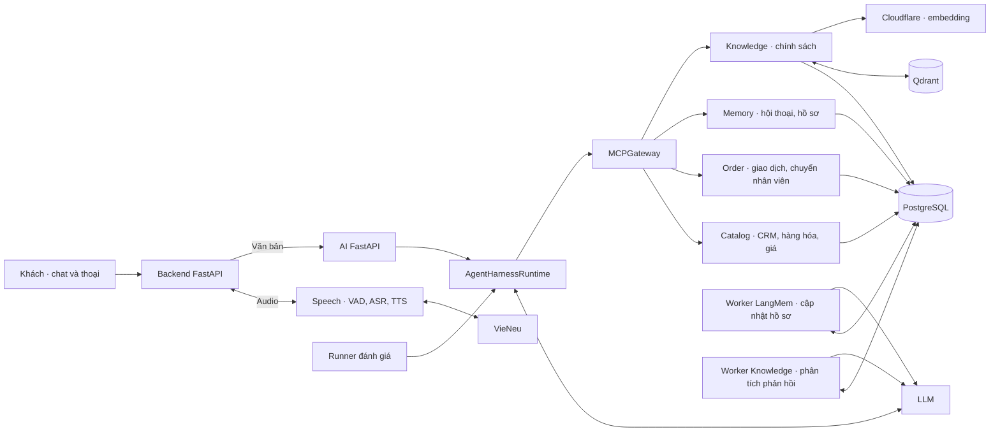
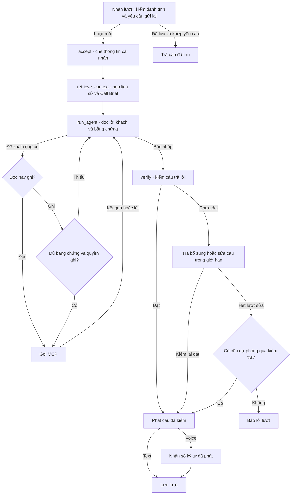

# Kiến trúc trợ lý telesale đa phiên

TeleSale SudoCode 2026 dùng chung một bộ điều phối hội thoại (*harness*) cho chat, thoại và đánh giá. Khi khách quay lại, hệ thống dùng bộ nhớ để tiếp tục đúng nhu cầu. Trước khi báo giá hoặc ghi đơn, agent phải lấy bằng chứng thương mại theo ngày giao dịch và kiểm tra yêu cầu hiện tại của khách. [Báo cáo đánh giá](bao-cao-danh-gia.md)

## 1. Sơ đồ hệ thống

Backend xác thực người dùng và giữ kết nối với trình duyệt. Với chat, backend nhận WebSocket, chuẩn bị phiên rồi chuyển tiếp dòng sự kiện từ AI. Với thoại, backend gửi âm thanh tới Speech, chuyển bản chép lời cuối cùng cho cùng harness, rồi gửi câu trả lời sang TTS. Khi khách ngắt lời, backend dừng phát và xác nhận đoạn đã phát cho AI. Runner đánh giá dựng harness trực tiếp và gọi cùng các MCP. [Chat](../backend/app/api/text.py) · [Thoại](../backend/app/services/voice_call.py) · [Runner](../ai-services/eval_harness/benchmark_runner.py)

**Hệ thống chọn MCP (Model Context Protocol).** Catalog, Order, Memory và Knowledge là bốn dịch vụ có hợp đồng và quyền truy cập dữ liệu riêng. PostgreSQL giữ dữ liệu nghiệp vụ, lịch sử và nguồn chính sách. Qdrant lập chỉ mục phục vụ tìm kiếm chính sách. Worker LangMem cập nhật trí nhớ của từng khách. Worker Knowledge phân tích phản hồi để người duyệt cải tiến tri thức dùng chung. [Cấu hình triển khai](../docker-compose.yml) · [Định tuyến công cụ](../ai-services/app/agent/mcp/gateway.py)

## 2. Vòng lặp harness

Bốn node của LangGraph là `accept → retrieve_context → run_agent → verify`. Vòng gọi công cụ nằm trong `run_agent`. Phần sửa câu thuộc `verify`. Runtime bao ngoài graph quản lý khóa phiên, phát lại câu đã lưu và ghi nhận nội dung đã gửi. [Graph](../ai-services/app/agent/graph.py) · [Runtime](../ai-services/app/agent/harness/runtime.py)

1. **Nhận diện và chống ghi trùng.** Runtime khóa theo phiên, tra CRM bằng số hotline hoặc định danh Facebook/Zalo trên đúng kênh. Khi kết quả chưa rõ hoặc có nhiều khách trùng khớp, agent chỉ dùng ngữ cảnh được phép. Nếu nhận lại cùng `session_id` và `client_msg_id`, runtime đối chiếu dấu vân tay của yêu cầu. Yêu cầu khớp có thể nhận lại câu đã lưu. Nếu sổ giao dịch đã ghi thao tác mà thiếu câu trả lời, runtime báo cần khôi phục. [Định danh](../ai-services/app/agent/harness/session_identity.py) · [Phục hồi lượt](../ai-services/app/mcp_servers/mcp_memory/services/replay.py)
2. **Dựng prompt.** Agent nhận lời khách hiện tại, mặc định 6 lượt lịch sử gần nhất, hồ sơ đúng phạm vi, các lần tư vấn liên quan, Call Brief và kết quả công cụ. Lời khách và lời agent giữ vai trò riêng. Khi ngữ cảnh dài, harness giới hạn từng nhóm dữ liệu, ưu tiên phần tử gần nhất trong danh sách, ghi lại trường đã lược và giữ tổng ngữ cảnh trong khoảng 70.000 ký tự JSON. Bộ duyệt từ chối thao tác ghi nếu thiếu nguồn. [Dựng ngữ cảnh](../ai-services/app/agent/harness/context.py) · [Duyệt quyền ghi](../ai-services/app/agent/harness/authorization.py)
3. **Quyết định và thực thi.** Deep Agent có thể trả lời ngay khi đã đủ bằng chứng. Cần báo giá mới, xác nhận tồn kho hay tra điều kiện đổi trả thì agent đề xuất đúng công cụ ở mục 4. Mặc định mỗi lượt có ngân sách 8 lần gọi nghiệp vụ. Với thao tác ghi, harness kiểm yêu cầu hiện tại và các điều kiện của thao tác. Trường hợp tạo đơn tường minh, đủ điều kiện có thể được duyệt bằng quy tắc. Với các đề xuất còn lại, bộ duyệt đối chiếu thao tác với lời khách và bằng chứng của lượt hiện tại. Gateway ký ngữ cảnh, Order MCP kiểm lại trước khi ghi. [Công cụ của agent](../ai-services/app/agent/implementations/business_agent.py) · [Kiểm chữ ký](../ai-services/app/mcp_servers/mcp_order/write_authorization.py)
4. **Kiểm tra và xử lý lỗi.** Bộ kiểm đối chiếu lời agent với thông số, giá, ưu đãi, điều kiện chính sách và biên nhận. Khi thiếu bằng chứng, agent có tối đa một lần tiếp tục dùng công cụ và mặc định một lần sửa lời. Nếu vẫn sai, runtime dùng câu dự phòng đã kiểm hoặc trả lỗi. Chẳng hạn, khi tra chính sách bị timeout, công cụ trả trạng thái nguồn chưa sẵn sàng và danh sách bằng chứng rỗng. Agent chưa thể xác nhận quyền lợi từ lượt tra đó. Riêng khi bộ duyệt ngữ nghĩa không khả dụng, câu đã qua kiểm tra bằng quy tắc vẫn có thể được phát. [Xác minh và sửa câu](../ai-services/app/agent/harness/agent_nodes.py) · [Tra chính sách](../ai-services/app/agent/mcp/gateway.py)
5. **Giao câu trả lời.** Chat chữ giữ bản nháp đến khi duyệt xong. Với thoại, backend bỏ qua bản chép lời rỗng và báo lỗi nhận dạng nếu Speech trả lỗi. Khi câu trả lời đã phát được một phần, runtime lưu đúng phần đầu theo `played_chars`. Nếu hết 300 giây vẫn chưa có xác nhận phát, số ký tự ghi nhận là 0. [Phát text](../ai-services/app/agent/harness/streaming.py) · [Nhận transcript và ngắt lời](../backend/app/services/voice_call.py) · [Ghi nhận playback](../ai-services/app/agent/harness/runtime.py)

**Khi chuyển nhân viên.** Nếu khách yêu cầu gặp người hoặc hỏi vấn đề y tế cần người có chuyên môn, agent đề xuất `handoff.transfer`. Bản bàn giao có lý do, tóm tắt cuộc trao đổi, sản phẩm và giá đã tư vấn nếu xác minh được, câu hỏi còn mở và hành động tiếp theo. Runtime gắn danh tính từ phiên. Chỉ khi công cụ trả trạng thái `queued` cùng mã phiếu thì hệ thống mới báo yêu cầu đã vào hàng đợi. [Hợp đồng bàn giao](../ai-services/app/schemas/brief.py) · [Dựng brief có nguồn](../ai-services/app/agent/harness/handoff_brief.py)

## 3. Bộ nhớ và tính liên tục giữa các phiên

| Tầng | Khóa và nơi lưu | Dữ liệu được dùng ở lượt sau |
|---|---|---|
| Hội thoại (*working*) | PostgreSQL, bảng `runtime.turns`. Khóa chính gồm `session_id` và `turn_no`. Cặp `session_id`, `client_msg_id` nhận diện lượt gửi lại. | Lời khách, phần trả lời đã phát, kết quả công cụ và kết quả nghiệp vụ. Runtime dựng lại lịch sử từ các lượt đã ghi. |
| Lần tư vấn (*episodic*) | LangMem lưu tại `customers/{customer_id}/episodes` trong PostgreSQL, có tham chiếu phiên. | Sản phẩm đã tư vấn, trở ngại, câu hỏi còn mở, kết quả và hành động tiếp theo. Dùng để chọn phiên liên quan khi khách quay lại. |
| Hồ sơ (*profile*) | LangMem lưu tại `customers/{customer_id}/facts` trong PostgreSQL. Mỗi dữ kiện có phạm vi (chung, phòng hoặc sản phẩm), khóa thông tin và phiên bản. | Nhu cầu, ngân sách, diện tích, sở thích. Lượt nguồn, trích dẫn bằng chứng, ngày ghi nhận và thời hạn giúp đánh giá dữ kiện còn dùng được hay không. |

**Từ lời thoại đến hồ sơ.** Memory MCP lưu lượt trong PostgreSQL. Với khách đã xác định, nó đưa việc trích xuất vào hàng đợi trong cùng giao dịch. Worker nhận việc, đề xuất dữ kiện và đối chiếu với lượt nguồn trước khi công bố phiên bản. Lời khách có thể chứng minh ngân sách. Báo giá chỉ chứng minh giá đã tra, còn việc mua hàng cần biên nhận tạo đơn. Nếu worker chưa xong, lượt kế tiếp vẫn đọc được hội thoại đã ghi. [Schema lưu trữ](../ai-services/app/bootstrap/schema.sql) · [Ghi và đọc lượt](../ai-services/app/mcp_servers/mcp_memory/services/memory.py) · [Worker LangMem](../ai-services/app/mcp_servers/mcp_memory/distiller_worker.py)

**Khi khách đổi ý hoặc dữ kiện hết hạn.** Trong cùng phạm vi, giá trị mới đã được duyệt thay thế phiên bản cũ. Dữ kiện của hai phòng hoặc hai sản phẩm khác nhau giữ khóa riêng. Dấu xóa ngăn tác vụ cũ khôi phục giá trị đã xóa. Khi đọc, hệ thống lọc theo ngày nghiệp vụ, thời hạn riêng và tuổi tối đa của dữ kiện hồ sơ (mặc định 240 ngày). Runtime che thông tin cá nhân trước khi đưa vào prompt và giữ địa chỉ giao hàng trong ngữ cảnh riêng cho thao tác đã được phép. [Lưu phiên bản](../ai-services/app/mcp_servers/mcp_memory/repos/langmem_projection.py) · [Lọc và che dữ liệu](../ai-services/app/agent/harness/context.py)

**Ví dụ minh họa hai cuộc gọi.** Ở cuộc đầu, khách cho biết phòng 25 m², đã xem một mẫu máy lọc và còn chờ hỏi ý gia đình. Diện tích được ghi vào hồ sơ theo phòng. Mẫu đã tư vấn và việc còn chờ được ghi vào bản tóm tắt lần tư vấn. Ở cuộc sau, khi nhận diện đúng khách, runtime dựng Call Brief với sản phẩm cũ, giá từng báo, trở ngại còn mở, thông tin đã biết và câu mở đầu gợi ý. Agent có thể xác nhận “Chị gọi lại về mẫu cho phòng 25 m² hôm trước ạ?” rồi tra lại giá và tồn kho theo ngày hiện tại. Nếu khách đổi sang một mẫu khác, agent phải xác định lại SKU và báo giá của mẫu mới trước khi nhận yêu cầu đặt hàng. [Cấu trúc Call Brief](../ai-services/app/schemas/brief.py) · [Nạp và làm mới brief](../ai-services/app/agent/harness/context.py)

## 4. Danh sách công cụ và quyền sử dụng

Model đề xuất **12 công cụ nghiệp vụ** qua `BusinessTools`. Bảng dùng tên chuẩn xuất hiện trong trace. Các tham số dưới đây là đầu vào nghiệp vụ chính. Danh tính tin cậy, ngày giao dịch và khóa chống ghi trùng do harness bổ sung khi công cụ yêu cầu. [Ánh xạ tên công cụ](../ai-services/app/agent/implementations/tool_names.py) · [Gateway MCP](../ai-services/app/agent/mcp/gateway.py)

| MCP | Công cụ | Quyền | Đầu vào chính → kết quả dùng được |
|---|---|---|---|
| Catalog | `catalog.search` | Đọc | Tên, loại hoặc bộ lọc → danh sách mẫu và biến thể phù hợp. |
| Catalog | `catalog.get_details` | Đọc | SKU hoặc mã biến thể → thông số và nguồn kỹ thuật của đúng mẫu. |
| Catalog | `inventory.check` | Đọc | SKU và ngày → trạng thái, số lượng còn trong kho. |
| Catalog | `pricing.get_quote` | Đọc | SKU, ngày, địa điểm nếu cần → giá cuối, ưu đãi và điều kiện giao hàng cho sản phẩm. |
| Catalog | `pricing.quote_order` | Đọc | Các dòng hàng và số lượng → giá từng đơn vị, tổng tiền và ưu đãi của giỏ. |
| Order | `order.status` | Đọc | Định danh khách, mã đơn nếu có → trạng thái đơn thuộc khách. |
| Order | `order.preview_update` | Đọc | Đơn, phương án đổi/trả, dòng hàng → phương án và số tiền dự kiến. |
| Order | `order.create` | Ghi | Sản phẩm hoặc giỏ đã xác nhận, giá và phương thức thanh toán → mã đơn khi tạo thành công. |
| Order | `order.update` | Ghi | Đơn thuộc khách và yêu cầu thay đổi → biên nhận, trạng thái xử lý. Với `review_pending`, agent chỉ báo đã gửi yêu cầu chờ duyệt. |
| Order | `schedule.callback` | Ghi | Thời điểm khách hẹn và ghi chú → thời điểm gọi lại thực tế theo lịch làm việc. |
| Order | `handoff.transfer` | Ghi | Bản bàn giao có nguồn → mã phiếu và trạng thái vào hàng đợi. |
| Knowledge | `policy.search` | Đọc | Câu hỏi, ngày và ngữ cảnh đơn/sản phẩm nếu có → đoạn nguồn, điều kiện áp dụng, ngoại lệ và phiên bản chính sách. |

**Công cụ nội bộ.** Harness và runner có quyền riêng để tra danh tính, quản lý bộ nhớ và kiểm tra môi trường đánh giá.

| MCP | Công cụ nội bộ | Ai gọi và để làm gì |
|---|---|---|
| Catalog | `crm.get_customer` | Harness tra khách theo điện thoại, Facebook hoặc Zalo và phát hiện trường hợp trùng định danh. |
| Memory | `memory.read`, `memory.timeline` | Runtime nạp ngữ cảnh hoặc đọc lịch sử phân trang theo khách đã xác minh. |
| Memory | `memory.write`, `memory.turn_status` | Runtime ghi lượt qua thao tác `commit_turn` và kiểm tra trạng thái cập nhật bộ nhớ. |
| Memory | `memory.replay` | Runtime kiểm tra yêu cầu gửi lại và lấy câu đã lưu. |
| Cả bốn MCP | `eval.database_identity` | Runner kiểm tra cơ sở dữ liệu mà từng MCP đang sử dụng. |
| Knowledge | `eval.knowledge_release` | Gateway hoặc runner lấy mã phiên bản và mã băm của bộ chính sách được dùng. |

Có thể đối chiếu tên và tham số trong hợp đồng của từng server. [Catalog](../ai-services/app/mcp_servers/mcp_catalog/tools/handlers.py) · [Order](../ai-services/app/mcp_servers/mcp_order/tools/handlers.py) · [Memory](../ai-services/app/mcp_servers/mcp_memory/tools/handlers.py) · [Knowledge](../ai-services/app/mcp_servers/mcp_knowledge/tools/handlers.py)

## 5. Quyết định thiết kế và đánh đổi

| Quyết định | Lý do lựa chọn và đánh đổi |
|---|---|
| Dùng một harness cho chat, thoại và đánh giá | Cùng yêu cầu mua hàng phải đi qua cùng kiểm tra dù đến từ văn bản hay bản chép lời. Độ trễ của runner chỉ bao phủ một phần đường đi thực tế của thoại. |
| Tách bốn miền nghiệp vụ bằng MCP | Agent dùng hợp đồng có kiểu dữ liệu. Catalog có quyền đọc, còn Order kiểm quyền ghi tại chính nơi thực hiện giao dịch. Đổi lại, hệ thống phải xử lý timeout giữa các dịch vụ. |
| Lưu bộ nhớ cá nhân ở PostgreSQL, dùng Qdrant cho chính sách | Lịch sử khách cần giao dịch nguyên tử, chủ sở hữu và phiên bản. Tra chính sách cần tìm theo cả nghĩa và từ khóa, sau đó kiểm điều kiện trên văn bản nguồn. Chỉ mục phải khớp với phiên bản nguồn được phát hành. |
| Lưu bằng chứng và quyền ghi tách biệt | Agent có thể nhớ sản phẩm khách từng hỏi. Đặt hàng vẫn cần sự đồng ý cho giao dịch hiện tại. Kiểm thêm bước này có thể tăng độ trễ hoặc dẫn đến hỏi lại. |
| Trích xuất bộ nhớ ở nền | Khách nhận trả lời trước khi hồ sơ cập nhật xong. Worker phải bảo đảm thứ tự theo khách, kiểm phiên bản và xử lý được việc chạy lại. |
| Duyệt toàn câu trước khi phát | Tránh phát giá sai rồi nối thêm câu đính chính. Đổi lại, khách phải đợi đến khi có câu trả lời hoàn chỉnh. |
| Khóa phiên trong tiến trình, lưu lượt bền vững | Một tiến trình tuần tự hóa các lượt cùng phiên. Cần kiểm chứng điều phối phiên và biên nhận thoại khi triển khai nhiều worker AI. |

**Kho chính sách.** Knowledge MCP tìm các đoạn chính sách trong Qdrant bằng độ gần về nghĩa của vector BGE-M3 và độ khớp từ khóa theo BM25. PostgreSQL giữ văn bản nguồn và mã băm. Khi trả kết quả, Knowledge MCP kiểm phiên bản, ngày áp dụng, quyền công khai và các điều khoản liên quan. Nếu thiếu điều khoản bắt buộc, kết quả chỉ còn giá trị có điều kiện. [Truy hồi chính sách](../ai-services/app/mcp_servers/mcp_knowledge/services/knowledge.py) · [Cấu hình](../config/policy-runtime.json)

**Cải tiến có kiểm soát.** Worker phân tích các lượt thiếu bằng chứng hoặc phản hồi đánh giá, ghi nhận lỗ hổng và tạo bản nháp gắn nguồn. Người duyệt kiểm nội dung và ca hồi quy trước khi phát hành. Mỗi bản phát hành có mã băm và có thể quay lại bản trước để đối chiếu kết quả. [Vòng đời tri thức](../ai-services/app/knowledge/services/lifecycle.py)
