# `speech/` — Pipeline âm thanh Việt–Anh cho M1 (offline)

Module này biến audio cuộc gọi tiếng Việt có chen tiếng Anh ("size", "ship", "COD", "AirPure"…) thành
`hypotheses.json` đúng format BTC. Kết quả được chấm bằng chính `eval/reference_eval.py` của BTC.

**Tra cứu ít tốn context:** đọc [FILE_MAP.md](FILE_MAP.md) trước, chọn đúng file theo công việc.
Baseline B0/B1/B2 và gói replay offline được mô tả ở §10/§11 bên dưới.

Module chạy độc lập và không chặn luồng chat text (`backend/` → `ai-services/`). Ở M2, phần streaming sẽ nối vào
`ai-services/app/infarstructure/{VAD,STT,TTS}.py` (hiện các file này vẫn trống).

## 1. Bức tranh tổng thể

```mermaid
flowchart LR
    subgraph S1["① synth — tạo dữ liệu"]
        K["Kịch bản JSON<br/>(GT của BTC hoặc nhóm tự viết)"] --> P["Phiên âm từ tiếng Anh<br/>pronounce / tts_text"]
        P --> T["TTS: edge-tts | ElevenLabs | VieNeu | MMS<br/>(có cache)"]
        T --> G["Ghép lượt + khoảng nghỉ<br/>nhiễu SNR 10 dB, kênh thoại 300–3400 Hz μ-law"]
    end
    subgraph S2["② transcribe — nhận dạng (local)"]
        V["Silero VAD<br/>cắt từng câu"] --> W["faster-whisper<br/>PhoWhisper / Whisper<br/>language=vi + hotwords"]
        W --> F["Lọc ảo giác,<br/>lặp n-gram"]
    end
    subgraph S3["③ chuẩn hóa Việt–Anh"]
        L["Lexicon: biến thể → dạng chuẩn<br/>kê ô đê → COD, síp → ship"]
        L --> SP["spoken: đọc số, đọc viết tắt<br/>→ text để chấm WER"]
        L --> WR["written: ITN ra chữ số<br/>→ agent + entity"]
    end
    G -- "audio/*.wav" --> V
    F --> L
    WR --> E["Trích entity<br/>SKU, tiền, SĐT, mã đơn…"]
    SP --> H["hypotheses.json<br/>(format BTC)"]
    E --> H
    H --> R["④ eval: reference_eval.wer_cer của BTC<br/>WER / CER / Entity + WER thô + oracle"]
```



| Bước | Lệnh | Đầu vào → đầu ra |
|---|---|---|
| ① Tạo dữ liệu | `python -m speech synth` | kịch bản JSON → `audio/<id>.wav`, `audio/<id>.segments.json`, `ground_truth.json`, `manifest.json` |
| ② Nhận dạng | `python -m speech transcribe` | thư mục audio → `hypotheses.json`, `run.json` |
| ②' Chuẩn hóa lại | `python -m speech renormalize` | sửa `lexicon.json`/luật entity xong, chạy lại bước ③ trên chữ thô đã lưu (`asr_segments[].raw`), không cần chạy lại ASR |
| ③ Chấm | `python -m speech eval` | dataset + nhiều run → bảng WER/CER/Entity (markdown) |
| Gỡ lỗi | `python -m speech normalize "câu"` | in các dạng raw → canonical → written → spoken và entity |

## 2. Hai dạng chữ — điểm quan trọng nhất

BTC chấm WER trên **dạng nói** (`normalization_rule`: số viết bằng chữ, tên hãng phiên âm như trong GT).
Entity được so khớp chính xác theo **giá trị**. Vì vậy mỗi câu ASR được tách thành hai dạng:

| Ví dụ | `spoken` (nộp vào `text`) | `written` (cho agent và entity) |
|---|---|---|
| Tiền | năm triệu hai trăm nghìn | 5,2 triệu → `price_vnd = 5200000` |
| Số điện thoại | không chín ba tám năm năm… | 0938 55… → `phone` |
| Viết tắt | cê ô đê | COD → `payment = "COD"` |
| Tên hãng | e pia y | AirPure Y → `sku` theo catalog |
| Từ mượn GT giữ chữ Anh | size, ship, shop | size, ship, shop |

```text
chữ thô ASR ─► canonicalize (lexicon.json) ─┬─► spell_numbers → spoken_terms → spell_acronyms → btc_norm ─► spoken
                                             └─► itn (chữ số, giữ tên hãng) ───────────────────────────────► written ─► entities
```

Có một bất biến được kiểm thử: nếu ASR nghe đúng từng chữ của GT thì `spoken` phải giữ nguyên câu đó.
Ngược lại, WER sẽ bị phạt oan vì lỗi chuẩn hóa.

## 3. Vì sao chọn VAD/ASR này (research)

### VAD không phụ thuộc ngôn ngữ

VAD chỉ trả lời câu hỏi "có tiếng người hay không". Vì vậy chuyện tiếng Việt hay tiếng Anh nằm ở ASR và hậu xử lý,
không nằm ở VAD.

| VAD | Nhận xét | Dùng |
|---|---|---|
| **Silero VAD** (MIT) | Học trên hơn 6000 ngôn ngữ, chạy được 8/16 kHz, model ~2 MB. Có sẵn trong faster-whisper (ONNX, không cần torch). | M1 (đang dùng) |
| TEN VAD | Độ trễ thấp hơn, phù hợp streaming | Thử ở M2 |
| WebRTC VAD | Nhẹ nhưng nhiều báo động giả khi có nhiễu | Không dùng |
| pyannote | Nặng, mạnh ở diarization (ai nói khi nào) | Có thể dùng ở M2 cho `turns[]` |

### ASR chạy local (M1 bắt buộc, xem `GIAI-DAP-MENTOR.md`)

| Model (faster-whisper / CTranslate2) | Điểm mạnh | Điểm yếu |
|---|---|---|
| **Whisper large-v3-turbo** (đa ngữ, mặc định) | Chính xác nhất khi thử (§8): WER 6,9 %, giữ được chữ tiếng Anh ("voucher", "Windbreak") | Chậm trên CPU (~1–1,4× thời gian thực), model ~1,6 GB. Chữ thô ra chữ số và viết tắt nên **bắt buộc** qua lớp chuẩn hóa |
| PhoWhisper-small (VinAI, fine-tune 844 giờ tiếng Việt nhiều vùng miền) | Tiếng Việt tốt, nhanh gấp ~2 lần turbo trên CPU | Hay Việt hóa từ tiếng Anh: "check" → "chết", "voucher" → "vâu chơi", "size M" → "sai e mờ" |
| Whisper small (đa ngữ) | Nhẹ | Kém nhất khi thử (WER 18,1 %) |
| gpt-4o-transcribe / Realtime, ElevenLabs Scribe (cloud) | Nhanh, giỏi chen ngôn ngữ | **Không được dùng làm ASR ở M1**; gửi giọng/PII ra ngoài. Chỉ để so sánh độ trễ ở M2 |

### Cách xử lý câu chen tiếng Anh

1. **Khóa `language="vi"`.** Tiếng Việt là ngôn ngữ nền; tiếng Anh chỉ chen vài từ trong câu. Nếu để Whisper tự
   nhận ngôn ngữ trên đoạn ngắn, nó dễ nhảy sang "en" và dịch sai cả câu. `--language auto` chỉ đổi sang "en"
   khi xác suất ≥ 0,75.
2. **Hotwords** lấy từ lexicon (tên hãng, COD, size…) giúp mồi cho decoder. Peng et al. (Interspeech 2023)
   cho thấy prompt giúp Whisper nhận dạng câu chen ngôn ngữ tốt hơn mà không cần huấn luyện lại.
3. **Lexicon hậu xử lý** (`lexicon.json`) gom cách viết Việt hóa về dạng chuẩn:
   - Biến thể thường: "kê ô đê" → COD, "síp" → ship.
   - Biến thể theo ngữ cảnh: "rô" chỉ thành RO sau "lọc/màng/lõi"; "sai" chỉ thành size khi đứng gần giày/áo và một con số.
   - Khóa viết tắt phân biệt hoa/thường để "rủi ro" không bị đổi thành "rủi RO".
4. **TN/ITN tiếng Việt** (`vi_numbers.py`): đọc số đúng kiểu GT ("một trăm linh năm", "năm triệu hai trăm nghìn",
   số điện thoại đọc từng chữ số) và viết ngược lại thành chữ số cho entity.
5. **Không fine-tune** (luật cuộc thi). Mọi cải thiện đều nằm ở prompt, lexicon và chuẩn hóa.

Nguồn tham khảo: [Silero VAD](https://github.com/snakers4/silero-vad), [faster-whisper](https://github.com/SYSTRAN/faster-whisper),
[PhoWhisper](https://github.com/VinAIResearch/PhoWhisper), Peng et al. 2023 ([arXiv:2305.11095](https://arxiv.org/abs/2305.11095)),
ViMedCSS ([arXiv:2602.12911](https://arxiv.org/abs/2602.12911)).

## 4. Cấu trúc thư mục

```text
speech/
├── __main__.py              CLI: voices | synth | manual-export | validate | transcribe | renormalize | eval | normalize
├── audio.py                 đọc/ghi wav 16 kHz, kênh thoại 300–3400 Hz + μ-law, trộn nhiễu theo SNR
├── tts.py                   edge-tts / ElevenLabs / VieNeu (+ clone ref_audio) / MMS / files, cache, chọn giọng, ghép hội thoại
├── manual.py                ElevenLabs thủ công: checklist Markdown/CSV, ghép clip trong inbox, kiểm tốc độ đọc
├── team.py                  bản mẫu giọng clone (tv1–tv3, {kh}), đọc team_voices.json (bắt buộc consent)
├── validate.py              kiểm kịch bản: định dạng, dạng nói, giá/KM/tồn kho theo mock_tools BTC
├── asr.py                   Silero VAD → faster-whisper, lọc ảo giác, xuất hypotheses
├── lexicon.py, lexicon.json biến thể Việt hóa ↔ dạng chuẩn ↔ dạng đọc theo GT
├── vi_numbers.py            đọc số (TN) và viết số (ITN) tiếng Việt
├── normalize.py             raw → canonical → written / spoken
├── entities.py              trích entity theo key của BTC
├── btc.py                   tìm dữ liệu BTC, nạp reference_eval.py / mock_tools.py (không chép dữ liệu BTC vào repo)
├── evaluate.py              chấm + bảng so sánh nhiều run
├── examples/team_dialogues.sample.json   2 kịch bản mẫu ban đầu (T01, T02)
├── dialogues/team_synthetic.json         11 kịch bản cho ElevenLabs thủ công (T01, T03–T12)
├── dialogues/team_clone.template.json    11 bản mẫu cho giọng clone VieNeu (T02, T13–T22)
├── voices.example.json      cấu hình giọng; chép thành voices.json để điền voice_id thật
├── team_voices.example.json mẫu khai báo giọng thành viên; chép thành data/team_voices.json
├── requirements.txt
├── test/                    unittest (không gọi mạng, không tải model)
└── data/                    (.gitignore) datasets/, runs/, tts_cache/, inbox/elevenlabs/, voice_refs/, team_voices.json
```

## 5. Cài đặt và chạy

```powershell
python -m venv .venv-speech
.\.venv-speech\Scripts\pip install -r speech\requirements.txt
$env:BTC_DATA_DIR = "<đường dẫn>\BTC-Data-Vong1-TEAMS"   # hoặc đặt thư mục này cạnh repo, hoặc --data-dir
$py = ".\.venv-speech\Scripts\python.exe"

# ① audio thử từ 4 hội thoại của BTC bằng edge-tts (miễn phí, cần mạng)
& $py -m speech synth --dialogues btc --engine edge --out speech\data\datasets\btc-edge
# ② nhận dạng (lần đầu tự tải model vào ~/.cache/telesale-speech/models, đổi bằng SPEECH_MODEL_DIR)
& $py -m speech transcribe --audio speech\data\datasets\btc-edge\audio --model whisper-turbo `
    --out speech\data\runs\btc-edge__whisper-turbo
# ③ chấm và so sánh (truyền nhiều run sau --runs để ra một bảng)
& $py -m speech eval --dataset speech\data\datasets\btc-edge `
    --runs speech\data\runs\btc-edge__whisper-turbo --out speech\data\runs\report.md
# sửa lexicon.json hoặc luật entity xong: chuẩn hóa lại run cũ (vài giây, không chạy lại ASR) rồi chấm lại như ③
# (renormalize ghi lexicon_sha256/rules_sha256 mới vào run.json; eval cảnh báo nếu run tạo bằng bộ luật cũ)
& $py -m speech renormalize --runs speech\data\runs\btc-edge__whisper-turbo
# gỡ lỗi một câu
& $py -m speech normalize "dạ máy e pia y giá 5.200.000đ anh chốt kê ô đê nha"
```

- Preset model: `whisper-turbo` (mặc định), `whisper-small`, `whisper-large-v3`, `phowhisper-small|medium|large`.
  Cũng có thể truyền thẳng một thư mục CTranslate2. Cần nhanh trên CPU thì dùng `--model phowhisper-small`.
- `--device auto` dùng GPU nếu CTranslate2 thấy CUDA, nếu không thì chạy CPU int8.
- `--no-hotwords`, `--language auto`, `--segmentation file` dùng cho ablation.
- Khi BTC phát audio thật, chạy `transcribe --audio <BTC>\asr\audio`, rồi `eval --dataset <BTC>\asr`.
- Kiểm thử: `python -m unittest discover -s speech/test -t .`. Các test cần dữ liệu BTC sẽ tự bỏ qua nếu không có `BTC_DATA_DIR`.
- `eval` từ chối chấm nếu `hypotheses.json` thiếu ID có trong `ground_truth.json`, vì `reference_eval.wer_cer` của BTC
  lặng lẽ bỏ qua ID thiếu và làm WER đẹp giả. File rỗng vẫn được chấm (WER 100 %) và được đếm ở `score.json` → `dialogues`.
- Truy vết nguồn: `manifest.json` của dataset ghi `source` (đường dẫn đầy đủ + sha256 file kịch bản), `noise` (file nhiễu
  hoặc `null`), `team_preview`, `ground_truth_sha256`; engine `files` ghi thêm `clips` (`<ID>/<tên file>` + sha256 từng
  clip). `transcribe` ghi `ground_truth_sha256` của `ground_truth.json` cạnh thư mục audio vào `run.json`; `eval` so với
  dataset đang chấm và **cảnh báo** nếu khác (hai dataset có thể trùng ID như `T02` nhưng khác kịch bản), ghi chú nếu run
  cũ chưa có trường này (`score.json` → `ground_truth_match`: `true`/`false`/`null`). Hash đọc file đã đổi CRLF → LF.
  Đường dẫn đầy đủ lộ cấu trúc máy và đổi theo máy, nên khi so dataset giữa các máy hãy so `sha256`, không so `file`.

## 6. Tạo dữ liệu bằng ElevenLabs

BTC cũng sinh audio bằng Gemini TTS / ElevenLabs / F5-TTS (xem `README.md` của BTC). Đề cho phép audio TTS,
nhưng **ASR phải chạy local**: không dùng ElevenLabs Scribe hay API speech-to-text cloud để nhận dạng.

1. Lấy API key và đặt vào biến môi trường: `$env:ELEVENLABS_API_KEY = "..."`. Không ghi key vào file, không commit.
2. Tìm giọng tiếng Việt: `& $py -m speech voices --engine elevenlabs --accent southern --gender female`.
3. Thêm giọng vào My Voices (bắt buộc trước khi gọi TTS): `& $py -m speech voices --engine elevenlabs --add OWNER_ID:VOICE_ID --name nam_f`.
4. Chép `voices.example.json` thành `voices.json` (đã .gitignore) và điền `voice_id` cho `bac_f`, `bac_m`, `trung_f`, `trung_m`, `nam_f`, `nam_m`.
   Khóa `A:`/`C:` (ví dụ `C:bac_f`) cho phép agent và khách cùng vùng dùng hai giọng khác nhau.
5. Xem trước số ký tự và credit:
   `& $py -m speech synth --engine elevenlabs --dialogues speech\examples\team_dialogues.sample.json --out x --dry-run`.
6. Chạy thật với `--out speech\data\datasets\team-11labs`. Câu đã có trong `tts_cache` sẽ không tốn credit lần nữa.

Lưu ý:
- Model mặc định là `eleven_flash_v2_5`. Model này có `language_code="vi"` và tốn khoảng 0,5 credit/ký tự qua API; con số thật xem trên trang Usage.
- Gói Free không có giấy phép thương mại (trang giá liệt kê *Commercial License* từ gói Starter) và yêu cầu ghi nguồn ElevenLabs; đọc kỹ điều khoản trước khi dùng.
- Không clone giọng người thật nếu chưa được đồng ý.
- Nhóm hiện **không dùng API** (gói Free): tạo clip thủ công trên web theo §6c.

### 6b. TTS offline: VieNeu-TTS và MMS-TTS (thử nghiệm)

`vieneu` phụ thuộc `kaldi-native-fbank`, gói này chưa có wheel cho Python 3.14, nên cần một venv riêng chạy Python 3.12
(chỉ dùng cho bước synth; ASR và eval vẫn chạy trong `.venv-speech`, nhờ vậy mọi run cùng một môi trường ASR):

```powershell
uv venv .venv-vieneu --python 3.12
uv pip install --python .venv-vieneu\Scripts\python.exe vieneu faster-whisper "av==18.1.0"
# chỉ cần nếu dùng MMS:
uv pip install --python .venv-vieneu\Scripts\python.exe torch --index-url https://download.pytorch.org/whl/cpu
uv pip install --python .venv-vieneu\Scripts\python.exe transformers
$tts = ".\.venv-vieneu\Scripts\python.exe"
& $tts -m speech voices --engine vieneu                      # 25 giọng có sẵn, có cả Bắc / Trung / Nam
& $tts -m speech synth --engine vieneu --dialogues btc --out speech\data\datasets\btc-vieneu
```

- `faster-whisper` chỉ được cài để dùng bộ giải mã/resample PyAV giống edge. Phải ghim `av==18.1.0`, vì `av` 19 không
  chạy với faster-whisper 1.2.1.
- **VieNeu-TTS** v3 Turbo (Apache-2.0) chạy trên CPU, nhanh hơn thời gian thực, và tự đọc được câu chen tiếng Anh nên
  không cần `pronounce`. Bộ chuẩn hóa của nó đọc chữ cái đơn kiểu Việt ("size m" → "size mờ"). Mô hình lấy mẫu ngẫu
  nhiên (`temperature` mặc định 0,4), nên thỉnh thoảng đọc chệch hoặc bỏ từ; có thể chỉnh `temperature` trong
  `voices.json`. Watermark ẩn (Resemble Perth) chỉ bật khi cài thêm `vieneu[watermark]` (cần torch); `.venv-vieneu`
  hiện chưa cài nên audio **không** có watermark.
- **MMS-TTS** (`facebook/mms-tts-vie`, VITS, CC-BY-NC 4.0) chỉ có một giọng, không đọc được tiếng Anh, và đọc líu nhiều
  đến mức nhãn không còn khớp audio. Chỉ giữ engine này để làm mốc so sánh, không dùng để tạo dữ liệu.

### 6c. Bộ dữ liệu của nhóm: ElevenLabs thủ công + giọng clone (22 hội thoại)

**Cập nhật lựa chọn dataset:** hiện dùng `team22-edge-synth` + `team22-edge-clone` (11 + 11 file),
cả hai có engine **edge**, kênh phone và 7 hội thoại nhiễu. “clone” trong tên chỉ nguồn template;
`team_preview=true` không chứng minh clone giọng thật. Chỉ hai giọng edge, không chứng minh đa vùng miền.
Quy trình ElevenLabs/clone dưới đây giữ lại như **tùy chọn**, không còn là bước bắt buộc.

| File | Hội thoại | Nguồn audio | Split |
|---|---|---|---|
| `dialogues/team_synthetic.json` | T01, T03–T12 (11) | ElevenLabs tạo **thủ công trên web**, nhập bằng engine `files` | T01 `dev`, còn lại `holdout` |
| `dialogues/team_clone.template.json` | T02, T13–T22 (11) | VieNeu-TTS clone giọng 3 thành viên (`tv1`–`tv3`), offline | T02 `dev`, còn lại `holdout` |

`dev` là hai hội thoại đã nhìn thấy khi chỉnh luật chuẩn hóa; chỉ báo kết quả `holdout` như số liệu độc lập. Trước khi
tạo audio, luôn kiểm kịch bản (sự thật đối chiếu `eval/mock_tools.py` của BTC tại `call_date` của từng hội thoại):

```powershell
& $py -m speech validate --dialogues speech\dialogues\team_synthetic.json speech\dialogues\team_clone.template.json
```

**ElevenLabs thủ công (gói Free, không dùng API, không cần API key):**

```powershell
& $py -m speech manual-export --dialogues speech\dialogues\team_synthetic.json   # → speech\data\inbox\elevenlabs\checklist.md/.csv
# tạo từng câu trên elevenlabs.io theo checklist, lưu mp3 vào speech\data\inbox\elevenlabs\<ID>\<ID>_<idx>_<A|C>.mp3
& $py -m speech synth --engine files --inbox speech\data\inbox\elevenlabs `
    --dialogues speech\dialogues\team_synthetic.json --out speech\data\datasets\team-11labs --dry-run   # chỉ kiểm
& $py -m speech synth --engine files --inbox speech\data\inbox\elevenlabs `
    --dialogues speech\dialogues\team_synthetic.json --out speech\data\datasets\team-11labs
```

- Checklist ghi tên file, khóa giọng + giọng gợi ý (từ mục `elevenlabs` của `voices.json`), **câu cần dán** (`tts_text`
  nếu có, không thì `text`), số ký tự và credit. 11 hội thoại = 9 961 ký tự: ≈ 4 980 credit nếu web tính như API Flash
  (0,5/ký tự), nhưng trang giá ghi mức giảm này áp dụng *for API usage* và Help Center nói credit phụ thuộc tạo qua
  website hay API → tính trước mức xấu nhất ≈ 9 961 credit, sát hạn mức 10 000 credit/tháng của gói Free (không cộng
  dồn). Tạo một hội thoại ngắn trước rồi xem trang Usage; nếu đúng 1 credit/ký tự thì chia lô theo cột *lũy kế*
  (ví dụ hai tài khoản Free của hai thành viên, hoặc hai tháng).
- Chưa kịp đổi tên file thì để nguyên tên tải về trong `<ID>/`: nếu số file đúng bằng số lượt, `files` gán theo thứ tự
  tên file (tên mặc định có mốc thời gian) và in ghi chú để nghe lại. Thiếu file, sai vai, hai file cho một lượt → dừng.
  Clip có tốc độ đọc ngoài 2–8 âm tiết/giây (dán nhầm câu, bị cắt) → cảnh báo.
- Ghi nguồn: gói Free không có giấy phép thương mại; khi công bố nội dung tạo bằng gói Free phải ghi
  “elevenlabs.io” (hoặc “11.ai”) trong tiêu đề ([Help Center](https://help.elevenlabs.io/hc/en-us/articles/13313564601361-Can-I-publish-the-content-I-generate-on-the-platform)).
  Dataset này chỉ dùng nội bộ để chấm ASR; nếu đưa audio vào báo cáo/demo công khai thì ghi nguồn như trên.

**Giọng clone của thành viên (VieNeu, chạy offline trong `.venv-vieneu`):**

```powershell
Copy-Item speech\team_voices.example.json speech\data\team_voices.json   # rồi điền gender/region/ref_audio, consent
$tts = ".\.venv-vieneu\Scripts\python.exe"
& $tts -m speech synth --engine vieneu --dialogues speech\dialogues\team_clone.template.json `
    --team-voices speech\data\team_voices.json --out speech\data\datasets\team-clone --cache-dir speech\data\tts_cache
# nghe thử bản mẫu khi chưa có mẫu giọng: đội giả lập, giọng edge có sẵn (không dùng để chấm)
& $py -m speech synth --engine edge --dialogues speech\dialogues\team_clone.template.json --preview-team `
    --channel none --no-noise --out speech\data\datasets\team-clone-edge-preview
```

- Bản mẫu chỉ ghi `agent_voice`/`customer_voice` = `tv1`–`tv3` và `{kh}` thay cho “anh/chị”. Khi synth, `team_voices.json`
  điền vùng miền/giới tính **thật** của người đọc vào `ground_truth.json` đầu ra và thay `{kh}` theo giới tính khách.
- `ref_audio`: 6–15 giây, một người, phòng yên tĩnh, không nhạc nền (wav). VieNeu `add_voice(..., denoise=True, save=False)`
  một lần cho mỗi mẫu; không lưu vào thư viện giọng của VieNeu. Cache audio khóa theo sha256 nội dung mẫu, nên thay mẫu
  thì câu được tạo lại; `manifest.json` chỉ ghi `clone-<hash>`, không ghi tên/đường dẫn mẫu (nhưng có ghi đường dẫn
  đầy đủ của file kịch bản ở `source`, xem §5).
- Đã chạy thử với 3 mẫu tham chiếu **tạo bằng edge-tts** (`speech/data/team_voices.tts-demo.json`), không dùng giọng người thật.

**Đồng ý và quyền riêng tư (giọng nói là dữ liệu cá nhân, đủ để nhận ra người nói):**

- Chỉ clone giọng của chính thành viên trong nhóm sau khi người đó đồng ý (ghi lại bằng tin nhắn/biên bản nội bộ);
  `consent` khác `true` thì lệnh synth từ chối. Không clone giọng người ngoài nhóm, người nổi tiếng hay khách hàng.
- Mẫu giọng, `team_voices.json` và audio sinh ra chỉ nằm trong `speech/data/` (đã .gitignore), không commit, không tải
  lên dịch vụ cloud (VieNeu chạy local). Thành viên rút lại đồng ý → xóa mẫu, xóa dataset clone và `speech/data/tts_cache/vieneu-*.wav`.
- Audio clone chỉ dùng để chấm ASR nội bộ. GT (`tts_engine`) và `manifest.json` (`engine`) ghi rõ audio do TTS tạo;
  watermark ẩn chỉ có khi cài `vieneu[watermark]` (xem §6b).

## 7. Định dạng kịch bản và yêu cầu dữ liệu của nhóm

Kịch bản dùng cùng format với `asr/ground_truth.json` của BTC, thêm vài trường riêng của nhóm:

```json
{
  "reference_date": "2026-10-15", "tts_engine": "elevenlabs",
  "dialogues": [{
    "id": "T03", "split": "holdout", "call_date": "2026-10-16", "noisy": false,
    "agent_region": "bac", "agent_gender": "f", "customer_region": "nam", "customer_gender": "m",
    "turns": [
      {"idx": 1, "speaker": "C", "text": "phí ship bao nhiêu em", "entities": {}},
      {"idx": 2, "speaker": "A", "text": "dạ đơn từ hai triệu được miễn phí giao hàng ạ",
       "tts_text": "(tùy chọn) câu riêng cho TTS đọc", "entities": {"min_free_ship_vnd": 2000000}}
    ],
    "entities": {"min_free_ship_vnd": 2000000},
    "checks": [], "tool_context": {}
  }]
}
```

- `text` là ground truth ở **dạng nói**: số viết bằng chữ, tên hãng phiên âm như GT ("e pia", "ka rô phi", "cê ô đê").
  Theo GT BTC: mã đơn đọc như số lượng ("ô đê ba trăm mười hai nghìn…", D02/D04), size số đọc đầy đủ ("size bốn mươi
  mốt", D04), SĐT đọc từng số (D03). Viết tắt nhiều chữ cái thì đánh vần ("size ích eo"); size một chữ giữ chữ ("size l").
- `tts_text` chỉ dùng để ép cách đọc; viết thường từ không phải viết tắt (edge đánh vần "ISOFIX" thành từng chữ). Nó bị
  bỏ khỏi `ground_truth.json` đầu ra, cùng với `checks`/`tool_context`
  (chỉ dùng cho `validate`: gọi thêm tool BTC, hoặc giả lập CRM trong bộ nhớ cho khách/đơn hư cấu).
- `entities` chỉ dùng key BTC; entity hội thoại = gộp entity các lượt (lượt sau ghi đè). `split`: `dev` | `holdout`.
- Bản mẫu clone thay vùng/giới bằng `agent_voice`/`customer_voice` (`tv1`–`tv3`) và dùng `{kh}` cho “anh/chị” (§6c).
- Bảng `pronounce` trong `voices.example.json` Việt hóa từ tiếng Anh cho giọng edge ("size" → "sai"). Dùng `--no-pronounce` để tắt.
- BTC đo WER/CER/Entity trên audio BTC **cộng ít nhất 20 file của nhóm** (`DIEU-CHINH-DE.md`). Nhóm có 22
  kịch bản (§6c), dataset hiện dùng edge cho cả hai nguồn template; 7/22 có `noisy: true`;
  `call_date` 16–29/10/2026; `validate` báo 0 lỗi.

Nguồn BTC đã dùng để viết và kiểm 22 kịch bản (chỉ đọc, không chép vào repo): `catalog/products.json`,
`catalog/promotions.json`, `catalog/inventory_timeline.json`, `eval/mock_tools.py`, `catalog/crm_seed.json` (chỉ để tránh trùng
SĐT/mã đơn), `policy/chinh-sach-van-chuyen-thanh-toan.md` (VC), `chinh-sach-doi-tra.md` (DT), `chinh-sach-bao-hanh.md` (BH),
`quy-trinh-cod-hoan-hang.md` (QT), `spec-gia-dung.md`, `spec-thoi-trang-me-be.md`, `playbook-telesale.md` (PB), `faq.md`,
`dieu-khoan-khuyen-mai.md` (KM), `thong-bao-lich-nghi.md` (LN), `DIEU-CHINH-DE.md`, `GIAI-DAP-MENTOR.md`. **Không** dùng
ghi chú nội bộ (`ghi-chu-nhap-hang-NOI-BO.md`), chính sách hết hiệu lực, `test_set/`, `rag/`, simulator hay eval runs của BTC.

## 8. Kết quả thử nghiệm

Điều kiện chạy:
- Audio sinh bằng edge-tts với 2 giọng `vi-VN-HoaiMyNeural` và `vi-VN-NamMinhNeural` (đều giọng Bắc), qua kênh thoại
  300–3400 Hz + μ-law. Hội thoại `noisy` (D02) được trộn nhiễu hồng SNR 10 dB.
- ASR chạy CPU int8 (Ryzen 7 4800H), `language=vi`, beam 5, VAD cắt câu, có hotwords.
- Chấm bằng `reference_eval.wer_cer` của BTC. RTF = thời gian xử lý ÷ thời lượng audio (nhỏ hơn 1 là nhanh hơn thời gian thực).
  **Giây ASR/phút audio** = tổng thời gian ASR ÷ tổng phút audio, không tính thời gian nạp model; đây là đơn vị
  `eval/huong-dan-do-latency.md` của BTC yêu cầu cho M1 (`score.json` có thêm p50/p95 theo từng file).
  Máy chạy song song việc khác nên số thời gian chỉ để tham khảo.
- **Đây là tập dev**: luật lexicon/TN/entity được chỉnh khi đã xem lỗi trên chính các run này, nên mọi con số dưới đây
  lạc quan. Số khách quan phải đo trên kịch bản nhóm viết mới (holdout) sau khi khóa luật — `run.json` ghi
  `rules_sha256` để biết run được chuẩn hóa bằng bộ luật nào.

**4 hội thoại mẫu của BTC** (34 lượt, 29 entity):

| Cấu hình | WER % | CER % | WER thô % | Entity % | RTF | Giây ASR/phút audio |
|---|---:|---:|---:|---:|---:|---:|
| PhoWhisper-small, TTS đọc nguyên chữ tiếng Anh (`--no-pronounce`) | 12,1 | 7,2 | 12,9 | 69,0 | 0,58 | 34,6 |
| PhoWhisper-small | 11,2 | 6,1 | 12,5 | 62,1 | 0,65 | 39,1 |
| PhoWhisper-small, không hotwords | 11,7 | 6,7 | 13,1 | 58,6 | 0,43 | 26,0 |
| Whisper small | 18,1 | 10,9 | 39,1 | 51,7 | 0,59 | 35,3 |
| **Whisper large-v3-turbo** | **6,9** | **3,6** | 28,7 | **93,1** | 1,35 | 81,0 (p95 99,0) |

**2 kịch bản mẫu của nhóm** (T01, T02; nhiều từ tiếng Anh hơn; 14 entity):

| Cấu hình | WER % | CER % | WER thô % | Entity % | RTF | Giây ASR/phút audio |
|---|---:|---:|---:|---:|---:|---:|
| PhoWhisper-small | 24,1 | 13,6 | 26,9 | 50,0 | 0,57 | 34,2 |
| **Whisper large-v3-turbo** | **7,0** | **4,2** | 26,1 | **100** | 1,05 | 63,2 |

- **WER thô**: chữ ASR chỉ qua chuẩn hóa tối thiểu của BTC (chữ thường, bỏ dấu câu), chưa qua lexicon/TN.
- **Oracle entity**: chạy bộ trích entity trên chính GT. Con số này là 100 % ở mọi run, nên entity bị mất là do ASR nghe sai,
  không phải do bộ trích.

Đọc kết quả:

1. **Whisper large-v3-turbo tốt nhất**, nhất là khi câu có nhiều từ tiếng Anh (WER 7,0 % so với 24,1 % của PhoWhisper-small).
   M1 xử lý file offline và thời gian ASR chỉ được ghi riêng ("ASR time / phút audio", xem `eval/huong-dan-do-latency.md`),
   nên `transcribe` mặc định dùng `whisper-turbo`.
2. **Whisper đa ngữ bắt buộc phải qua lớp chuẩn hóa.** Chữ thô của nó ra chữ số và viết tắt ("5.200.000", "COD"), nên WER thô
   là 28,7 %; qua lexicon + TN còn 6,9 %. PhoWhisper vốn ra chữ nên lợi ích nhỏ hơn (12,5 → 11,2).
3. **Hotwords** giúp PhoWhisper-small một chút (WER 11,7 → 11,2; Entity 58,6 → 62,1). Tập nhỏ nên chỉ xem là xu hướng.
4. **PhoWhisper-small** nhanh gấp khoảng 2 lần trên CPU nhưng hay Việt hóa từ tiếng Anh: "check" → "chết",
   "voucher" → "vâu chơi", "size M" → "sai e mờ", "navy" → "li vi". Chỉ nên dùng khi cần tốc độ, ví dụ M2 mà không có GPU.
5. **Lỗi còn lại của turbo** chủ yếu là tên model đọc kiểu Việt: "e pia y" (AirPure Y) bị viết thành "EPE", "EPX",
   nên mất `sku` ở D01, D02. Đã thử đưa dạng đọc ("e pia", "ka rô phi") vào hotwords trên D01–D02 nhưng không đỡ,
   nên chưa đưa vào code. Ngoài ra là lỗi nghe nhầm tiếng Việt thường ("thanh toán" → "thanh quán", "dạ" → "từ").
6. Ba luật ở bộ trích entity và ITN được rút ra từ chính lỗi của các run này:
   - câu đọc lại "… đúng không ạ?" được khách đáp "đúng rồi" thì tính là khẳng định;
   - "à" cuối câu mà không có "?" là "ạ" bị nghe nhầm, không phải câu hỏi;
   - "5 triệu 7" là 5,7 triệu.

   Đây là quy tắc chung của tiếng Việt, nhưng vì rút ra từ chính các run này nên cột Entity ở trên hơi lạc quan.
7. Sau review độc lập, lexicon được bổ sung theo **catalog và chính sách BTC**, không theo lỗi của run: từ model còn thiếu
   (Swing, Maxi, Pact, Sugocal, AX, TS, Lite), từ mô tả (sneaker, trekking) và từ mượn trong chính sách (fanpage,
   isofix, video, SMS). Từ một âm tiết trùng tiếng Việt chỉ được nhận khi có ngữ cảnh ("lai" sau "smart/4"; "phát" giữa
   "sữa … 4" cho Fatz). Test kiểm mọi từ Latin trong tên sản phẩm đều có trong lexicon và tên sản phẩm đọc ra → viết lại
   → ra đúng SKU. Chuẩn hóa lại 7 run cũ: không transcript hay entity nào đổi, điểm giữ nguyên.
8. Sửa luật tiền: "giá sau khi giảm là 5 triệu" giờ là `price_vnd`, không còn bị hiểu là `discount_vnd`.
   Sửa TN: chuỗi ≥3 số nối gạch ("RO 1-2-3") đọc "một hai ba", không còn đọc thành khoảng "một đến hai ba".

Tái lập: chạy các lệnh ở §5 cho từng model (`--model`), với `--no-hotwords` hoặc `synth --no-pronounce` cho các dòng ablation.

**So sánh nguồn TTS** (cùng ASR whisper-turbo, cùng kênh thoại và luật hậu kỳ; chỉ khác engine TTS, xem §6b):

| Tập | TTS | WER % | CER % | Entity % | Ghi chú |
|---|---|---:|---:|---:|---|
| BTC D01–D04 | edge-tts (2 giọng Bắc, có `pronounce`) | 6,9 | 3,6 | 93,1 | |
| BTC D01–D04 | VieNeu v3 Turbo (giọng Bắc/Nam thật) | 11,7 | 7,3 | 69,0 | |
| BTC D01–D04 | MMS-TTS vie | 35,5 | 26,4 | 55,2 | đọc líu, nhãn không khớp |
| Nhóm T01–T02 | edge-tts | 7,0 | 4,2 | 100 | |
| Nhóm T01–T02 | VieNeu | 18,2 | 12,0 | 50,0 | T01 7,5; T02 30,0 |
| Nhóm T01–T02 | VieNeu, không qua kênh thoại | 13,4 | 7,9 | 57,1 | |
| Nhóm T01–T02 | VieNeu, không kênh thoại, `temperature` 0,2 | 11,5 | 6,5 | 57,1 | T01 2,1; T02 21,8 (sau sửa TN ở mục 10) |
| Nhóm T01–T02 | MMS-TTS vie | 38,9 | 30,5 | 14,3 | |

9. Edge "dễ" với ASR vì giọng chuẩn, rõ và đã được phiên âm sẵn. VieNeu gần giọng người hơn và có giọng Trung/Nam thật,
   nên lộ ra hai loại lỗi mà edge che mất:
   - lỗi ASR thật: giọng Trung của khách T02 làm "hơi" → "hớ", "đổi" → "đội"; "size mờ/lờ" → "redstyle", "scyler";
   - lỗi nhãn do TTS: có câu TTS bỏ từ ("năm năm" chỉ đọc một lần) hoặc đọc chệch, nên WER bị cộng cả lỗi không phải của ASR.

   Muốn dùng VieNeu làm dữ liệu chấm thì cần thêm bước QC từng câu: tạo xong → ASR → câu nào lệch nhiều thì tạo lại hoặc nghe lại.
10. Sửa TN từ thí nghiệm này: chuỗi ≥ 7 chữ số viết liền ("3851246") đọc từng chữ số. Lý do: theo chính tả, số đếm lớn
    được viết có dấu chấm hàng nghìn. Mã 6 chữ số như OD487215 vẫn đọc như số đếm, đúng GT của BTC. Chuẩn hóa lại tất cả run:
    chỉ đúng run có chuỗi này thay đổi.

## 9. Giới hạn hiện tại

- Audio thử là TTS. edge-tts chỉ có 2 giọng, đều thiên miền Bắc. VieNeu có giọng Trung/Nam nhưng đôi khi đọc sai so với kịch bản
  (§8 mục 9). WER trên audio thật hoặc audio của BTC sẽ cao hơn.
  Chưa có audio BTC, cũng chưa thử giọng ElevenLabs bằng key thật.
- Bảng `pronounce` (phía TTS) và biến thể trong lexicon (phía ASR) do cùng một nhóm viết, nên phép thử có phần "vòng tròn".
  Cần audio của người khác hoặc của BTC để đo khách quan.
- Tên model/hãng đọc kiểu Việt ("e pia", "ka rô phi") vẫn là điểm yếu lớn nhất của entity `sku` (xem §8).
- HikePro đọc "hai pro" trùng "2 Pro" (GT D04: "giày run lai hai pro" = RunLite 2 Pro), nên lexicon không tự đổi
  "hai pro" thành HikePro; chỉ nhận khi ASR viết "HikePro"/"hike pro". Biến thể mới của lexicon đều là phỏng đoán
  (`source: guess`), cần nghe audio thật để xác nhận.
- Lệnh `transcribe` cũ dùng một `reference_date` cho cả batch; truyền ngày rõ ràng nếu input không cùng ngày.
  Lệnh `baseline` mới lấy ngày riêng từng hội thoại, `export-replay` lấy ngày từng phiên từ mapping tin cậy.
- VAD gộp hai lượt nếu khoảng nghỉ dưới khoảng 0,5 s. Chưa có diarization nên chưa xuất `turns[]` (việc của M2).
- Bộ trích entity dựa trên luật và được phát triển khi đã đọc mẫu công khai. Phải đo thêm trên kịch bản mới của nhóm.
- **GPU (GTX 1660 Ti, 6 GB): đã có lời giải, kiểm 2026-10-28.** BTC không bắt chạy CPU; đề chỉ yêu cầu ASR local,
  báo riêng ASR time/phút audio, và so baseline với hệ thống trên cùng phần cứng.
  - Lỗi gặp phải: trong `.venv-speech` (Python 3.14), CTranslate2 thấy GPU nhưng khi load model báo
    `cublas64_12.dll is not found`. Lý do là CTranslate2 không kèm DLL cuBLAS/cuDNN, và trên Python 3.14
    chưa cài được bộ CUDA qua pip (nhóm đã thử nhưng không thành).
  - Lời giải: dùng `.venv-vieneu` (Python 3.12, tạo bằng uv). Env này có `torch 2.5.1+cu121`, và
    `torch\lib` của nó đã chứa `cublas64_12.dll` và `cudnn64_9.dll` (cuDNN 9.1), đúng loại CTranslate2 4.x
    cần. Env cũng có sẵn `ctranslate2 4.8.3` và `faster-whisper 1.2.1`.
  - Cần một bước nữa: phải `import torch` trước, hoặc thêm `torch\lib` vào PATH. Nếu không, vẫn báo lỗi
    thiếu `cublas64_12.dll`.
  - Cách chạy, không cần sửa code:
    ```powershell
    $env:PATH = "$PWD\.venv-vieneu\Lib\site-packages\torch\lib;$env:PATH"
    .\.venv-vieneu\Scripts\python.exe -m speech ... --device cuda --compute-type float16
    ```
  - Đã kiểm: load whisper-turbo float16 trên CUDA rồi decode thử audio im lặng, chạy được. `import speech`
    trong env 3.12 cũng chạy được.
  - Chưa làm: chưa chạy benchmark hay test suite trên GPU/3.12, và chưa đo tốc độ thật. Kết quả §10 vẫn là
    CPU int8. Nếu chạy GPU thì phải chạy lại cả B0/B1/B2 vào thư mục run mới; không trộn CPU và GPU trong
    một bảng so sánh, vì float16 có thể làm WER lệch nhẹ.
  - GPU là điều kiện cần nếu dùng turbo cho voice gần real-time ở M2 (TTFA p95 ≤ 2,5 s).

## 10. Baseline ASR B0/B1/B2 — cơ sở đo cải tiến

Đây là **baseline của speech**, không thay cho baseline bỏ memory của harness.
Cả ba dùng cùng audio, Whisper turbo local, VAD, language `vi`, beam 5 và bộ trích entity:

| Profile | Hotwords | Lexicon/TN–ITN | Dùng để đo |
|---|---|---|---|
| B0 | Tắt | Tắt | Mốc cơ sở: VAD + ASR + cleanup chung; extractor nhận chữ chưa chuẩn hóa domain |
| B1 | Tắt | Bật | Tác dụng hậu xử lý trên cùng raw decode với B0 |
| B2 | Bật | Bật | Pipeline đầy đủ, có cả bộ lọc đọc lại hotwords |

B0 **không phải Whisper hoàn toàn nguyên bản**: vẫn giữ VAD/cleanup, vẫn dùng extractor chung.
WER/CER do BTC chấm còn phạt chữ số/viết tắt khác dạng nói GT. B0→B1 không chỉ đo “nghe tốt hơn”.
B1→B2 bao gồm hotwords và cơ chế lọc echo đi kèm, không phải phép cô lập decoder tuyệt đối.

### Kết quả đã chạy trên team22

Experiment `speech\data\runs\team22-baseline-v1`: **22 file, 139 entity**, Whisper turbo CPU/int8,
cùng audio edge phone/noise. Đã kiểm lại nguồn/config/hash và chấm lại bằng evaluator BTC.

| Cấu hình | WER % ↓ | CER % ↓ | Entity % ↑ | Giây ASR/phút audio |
|---|---:|---:|---:|---:|
| B0 — cơ sở | 38,3 | 31,6 | 63,3 | 87,7 |
| B1 — thêm hậu xử lý | 19,3 | 14,9 | 64,7 | 87,7 |
| B2 — đầy đủ | **14,1** | **10,0** | **74,8** | 92,1 |

B0→B2: WER giảm **24,2 điểm phần trăm**, Entity tăng **11,5 điểm phần trăm**.
Riêng B1→B2: WER giảm 5,2 và Entity tăng 10,1 điểm phần trăm.
Oracle entity trên GT là **84,2%**: bộ trích còn hạn chế, không quy hết lỗi entity cho ASR.
Đây là kết quả trên **audio nhóm**, không phải điểm audio BTC chính thức hay điểm memory.
Timing có tác vụ CPU chạy đồng thời nên chỉ tham khảo.

Chi tiết từng file/dataset/split/noise và delta nằm trong `report.md`/`comparison.json` của experiment.
Noisy/clean là các hội thoại khác nội dung, không phải cặp cùng audio bật/tắt nhiễu; không dùng bảng
tập con để kết luận thêm nhiễu làm nhận dạng tốt hơn.

```powershell
$py = ".\.venv-speech\Scripts\python.exe"
$env:BTC_DATA_DIR = "<đường dẫn gói BTC>"
& $py -m speech baseline `
  --datasets speech\data\datasets\team22-edge-synth speech\data\datasets\team22-edge-clone `
  --out speech\data\runs\team22-baseline-v1 --device cpu --compute-type int8

# Kiểm hash và chấm lại từ artifact, không chạy lại ASR
& $py -m speech compare-baselines --experiment speech\data\runs\team22-baseline-v1
```

Nếu không dùng biến môi trường, đặt `--data-dir` **trước subcommand**:
`& $py -m speech --data-dir "<gói BTC>" baseline ...`.

Output mới phải là thư mục rỗng/chưa tồn tại:

```text
experiment.json                 nguồn audio/hash, ngày, catalog, evaluator, model/code/dependency
ground_truth.json               bản đánh giá gộp, chỉ để evaluator đọc
B0\, B1\, B2\
  raw.json                      đủ segment trước lọc; B0/B1 cùng raw decode
  hypotheses.json               text + entities + segment + thời gian
  run.json                      profile thật, lineage/hash và frozen
  score.json                    điểm BTC + timing/oracle
comparison.json, report.md      overall, từng dataset, noisy/clean, split, delta
```

Chấm nguyên hội thoại, không dùng GT cả hội thoại để chấm clip chỉ có khách.
Hai tập team được ghép theo ID duy nhất, evaluator tính lại toàn bộ 22 file — **không lấy trung bình
hai phần trăm**. Tập con cũng được chấm lại; `wer_noisy`/`wer_clean` trong kết quả BTC gốc có phép
aggregate riêng nên không đánh đồng với WER weighted của một tập con.

Delta = profile sau − profile trước, đơn vị **điểm phần trăm**: WER/CER âm là tốt, Entity dương là tốt.
Không che kết quả xấu hơn và không hứa B2 sẽ thắng. `split=holdout` giữ theo nhãn nguồn, không khẳng định
độc lập nếu đã nghe/xem lỗi. Oracle entity là diagnostic dùng GT, không phải output ASR.

Thời gian ASR/phút audio ghi riêng, không gộp TTFT. B0/B1 chia sẻ thời gian decode thật, cộng thời gian
hậu xử lý tương ứng; `decode_reused=true` ở B1. Không dùng thời gian đọc cache để giả là ASR nhanh.
Nạp model báo riêng; máy có tiến trình khác thì số timing chỉ tham khảo.

`compare-baselines` từ chối thiếu/thừa ID hoặc mismatch nguồn/config/hash. `renormalize` từ chối ghi đè
baseline đã khóa; sửa luật thì tạo experiment mới. Run lịch sử không đủ provenance không được nâng
thành baseline hợp lệ chỉ bằng đổi tên.

**Phạm vi dữ liệu dự thi:** BTC yêu cầu audio BTC + ≥20 file team (`DIEU-CHINH-DE.md` §8).
Gói BTC tìm được khi triển khai chưa có audio. Điểm `btc-edge` là proxy TTS, không thay điểm audio BTC phát.
Chỉ báo hoàn tất phần BTC thật sau khi được cấp audio và chạy đúng tập đó.

## 11. Gói replay offline — bàn giao cho nhóm harness

Không viết HTTP client, không gọi DB/MCP/LLM, không triển khai memory trong speech.
Pipeline nhận mapping tin cậy, cắt **chỉ lượt C** từ audio phone/noise bằng mốc A/C có sẵn, chạy B2
trên từng clip, nối các đoạn VAD trong cùng clip thành một lượt khách. Đây là **oracle boundaries**
của benchmark offline, không phải diarization hay streaming đã hoạt động.

Mỗi clip có 0,3 giây im lặng ở hai đầu (ghi trong manifest), giữ nguyên phần âm thanh khách ở giữa.
Cắt sát tiếng nói có thể làm VAD bỏ toàn bộ clip có tiếng; padding áp dụng đồng nhất, không mượn
âm thanh lượt A, không đổi ngưỡng VAD theo sample và không lấy GT bù chữ bị mất.

```powershell
# Mẫu là một phiên synthetic để smoke test, không ánh xạ CRM thật hay chứng minh memory đa phiên
& $py -m speech prepare-replay --mapping speech\examples\replay_sessions.example.json `
  --out speech\data\replays\prepared
& $py -m speech export-replay --prepared speech\data\replays\prepared `
  --out speech\data\replays\b2 --device cpu --compute-type int8
& $py -m speech verify-replay --bundle speech\data\replays\b2
```

Đường dẫn `dataset` tương đối với **file mapping**. Mỗi session cần `dialogue_id`, `conversation_key`,
`session_key`, `session_index`, `identity_ref`, `call_date`. Chỉ chấp nhận các trường khai báo; không
đưa expected entities/checks/gold text vào mapping. Phiên trong cùng conversation có cùng identity_ref,
index tăng liên tục từ 1 và ngày không lùi. Nhóm harness cấp mapping đa phiên; không tự ghép T01–T22
thành cùng một khách.

`turns.jsonl` chứa: conversation/session keys, session index, identity_ref, call_date, turn index,
source turn index, `text` dạng written, `customer_input_mode="asr_transcript"` và audio hash.
Không chứa câu A/expected result/entity gộp. Clip không ra chữ hoặc text quá 8000 ký tự → ghi
`diagnostics.json`, **không xuất gói ready**, không bỏ lượt, không cắt chữ, không lấy GT thay thế.
Raw được giữ cục bộ trong `run\raw.json` để điều tra, không tự gửi vào prompt.

**Khớp nối người nhận cần thực hiện:**

| Metadata replay | Backend `POST /api/chat` |
|---|---|
| `text`, `customer_input_mode` | Chuyển đúng tên trường; không gửi toàn bộ record replay như request |
| `identity_ref` | Resolve ra định danh kênh từ fixture/nguồn tin cậy; không đoán từ ASR |
| `call_date` | Lượt đầu gửi cùng channel + identity; backend chuyển thành `on` cho AI |
| `session_key` | Khóa logic, không phải UUID API; lưu `session_id` backend trả về |
| Lượt sau | Gửi session_id + text + input mode + client_msg_id mới; không lặp lại trường mở phiên |
| Retry / chạy hai mode | Retry cùng lượt giữ client UUID; hai run dùng UUID/session runtime riêng |

Giữ **cùng gói B2** cho có/không memory, không đưa B0 cho mode bỏ memory. Người phụ trách harness
tự cô lập/reset trạng thái và tính RQR/CCR/TSR/HR. Replay lời khách cố định là open-loop: câu khách
có thể phụ thuộc câu A trong kịch bản cũ, nên không chứng minh một đối thoại thích ứng hoàn chỉnh.

`speech\data` bị Git ignore. Bàn giao artifact qua kho nội bộ có kiểm soát, kèm manifest và hash từ
kênh tin cậy; đây là kiểm toàn vẹn, không phải chữ ký chống sửa manifest. Chỉ dùng dữ liệu synthetic/
được phép. Transcript/audio có thể chứa PII: không đưa lên public repo, prompt hay dịch vụ ngoài;
người nhận phải đi qua ranh giới mask PII hiện có trước LLM. Không tự gọi một gói đã mask là cùng
artifact cũ: thay nội dung thì tạo gói/hash mới cho cả hai mode.

**Đã kiểm thực:** `speech\data\replays\boundary-b2-v2` xuất đủ **9/9 lượt khách T01/T03** sau padding;
kiểm lại hash trên gói đã lưu và bản sao ở thư mục khác. 18 request fixture (9 lượt × hai run độc lập)
qua schema `ChatRequest` thật của backend. Đây là kiểm ASR/contract offline; chưa gọi HTTP, PostgreSQL,
MCP hay LLM thật, chưa có kết quả memory đa phiên.

**Kiểm hồi quy:** 53 test mới và toàn bộ 142 test speech qua với `BTC_DATA_DIR` hợp lệ:

```powershell
& $py -B -m unittest speech.test.test_baseline speech.test.test_replay
& $py -B -m unittest discover -s speech\test -t .
git diff --check
```

Test số học baseline cần evaluator BTC thật; thiếu gói sẽ báo lỗi thay vì báo đã kiểm phép chấm.
